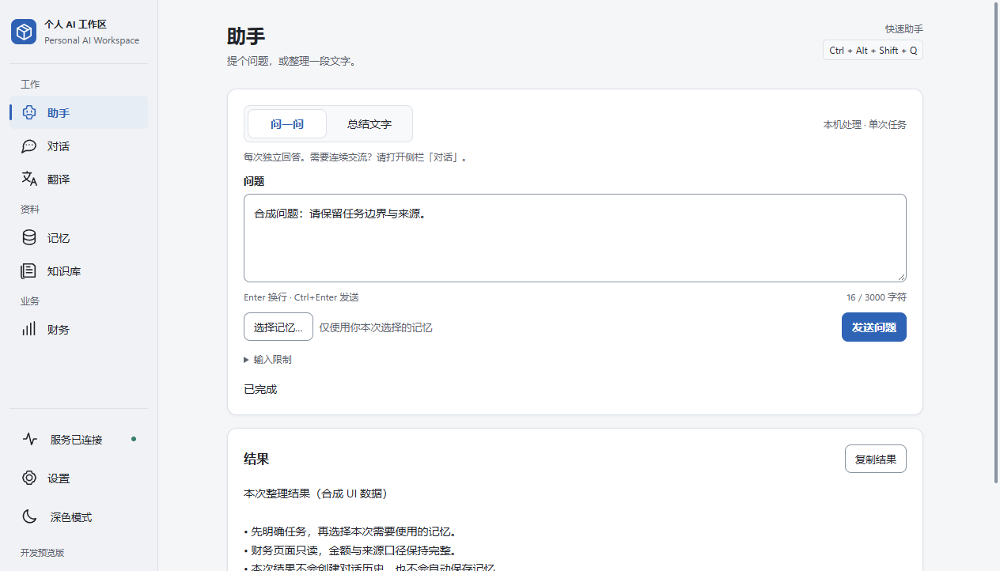
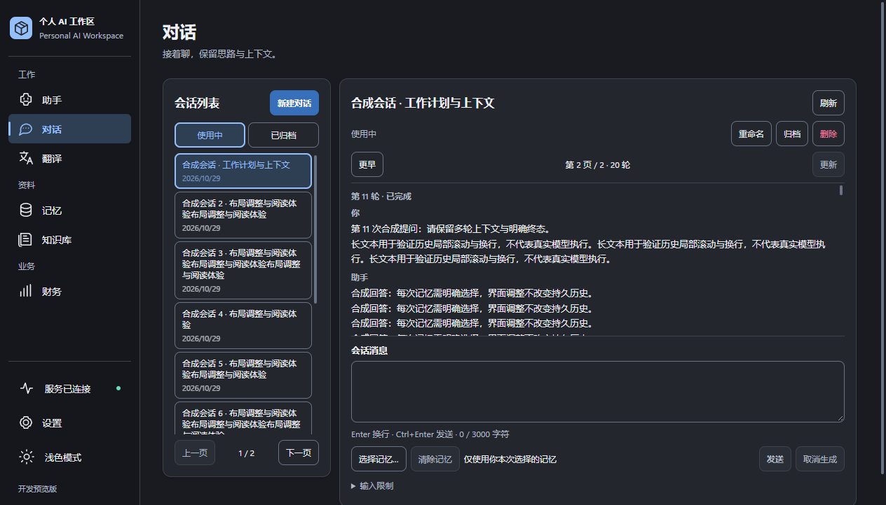
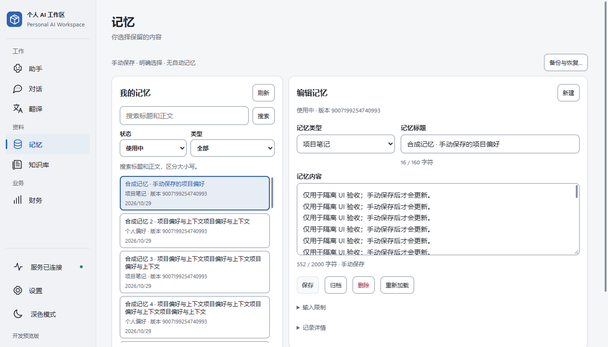
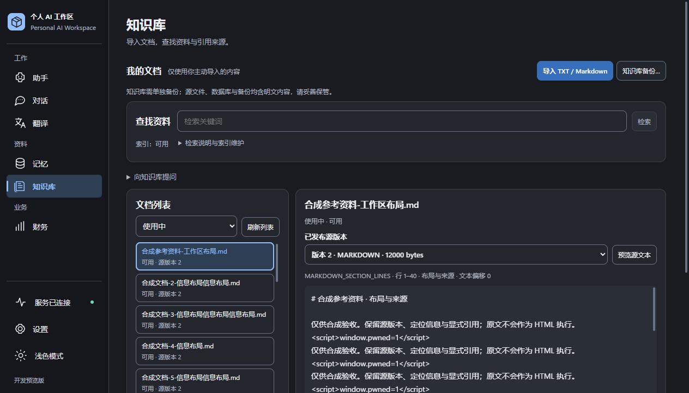
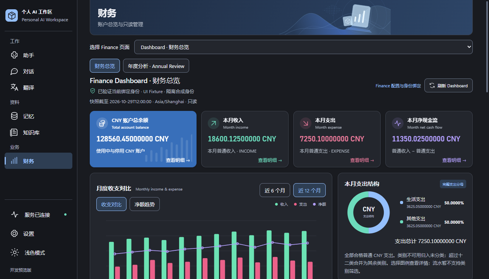
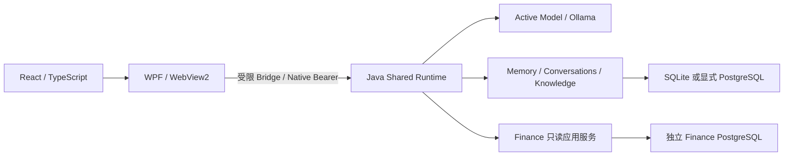

# Personal AI Workspace

<p align="center"><strong>一个 Windows 本地 AI 工作区，把问答、对话、个人资料与财务查询放在同一桌面入口。</strong></p>
<p align="center">Local models · Explicit memory · Knowledge citations · Read-only finance</p>
<p align="center">
  <a href="docs/DEVELOPMENT.md">开发指南</a> ·
  <a href="docs/STATUS.md">当前状态</a> ·
  <a href="docs/architecture/current-architecture.md">架构</a> ·
  <a href="docs/roadmap/V1-ROADMAP.md">路线图</a> ·
  <a href="docs/README.md">全部文档</a>
</p>

> **Development-only。** 当前 X1 Windows Acceptance 为 **PARTIAL**，Vision 为 **BLOCKED**。此前 uncertainty 已解除并有一次文本问答成功记录；最新开发包重启后的记录为 **NotValidated**，不能继承旧进程的 Ready。尚无已核验的 GitHub CI PASS，尚未取得 Production GO；仓库未提供正式 Release 或安装器。详见 [Runtime 核对与 X1 准备](docs/engineering/GITHUB-SHOWCASE-RUNTIME-READINESS.md)。



*2026-10-29，UI Polish / P0 / P1 / P2 完成后的真实 WPF / WebView2 渲染，使用隔离合成 UI fixture。图中连接、完成、财务金额及模型告警均为演示状态，不代表当前 Runtime、真实模型或端到端验收通过。*

## 可以做什么

| 能力 | 当前实现与边界 |
| --- | --- |
| **助手与翻译** | 本地文本问答、摘要、单条／批量翻译；通过受控任务执行，支持取消与明确失败状态。 |
| **持续对话** | 持久化多轮 Conversations，保留轮次、成功／失败／取消状态与重开能力；记忆按次显式选择。 |
| **个人记忆** | 手动创建、编辑、归档与删除 Memory，保留 revision 冲突保护；不会自动从对话提取或注入。 |
| **知识库与引用** | 原生导入 TXT / Markdown、文档管理与预览、确定性词法检索、显式知识问答及 Runtime 生成的来源引用。 |
| **跨应用快速助手** | `Ctrl+Alt+Shift+Q` 获取主动选区并选择翻译、总结或解释／提问；`Ctrl+Alt+Shift+T` 直接翻译。真实完整流程仍 **PARTIAL**。 |
| **财务工作区** | 显式绑定后的账户、流水、资产、持仓、投资历史、导入回执、财务总览与统计等只读查询；不修改账本。 |
| **行情参考** | 用户主动刷新 Massive 日线参考值；AAPL、SPY、USD/CNY 有用户报告的真实人工成功证据。成功不保证最新，不进入持久缓存或派生估值。 |
| **模型与本地数据管理** | 单一 Active Model、原生确认与 uncertainty guard；SQLite 默认存储，受控 PostgreSQL 配置和独立备份／恢复入口。 |

所有 AI 推理由本机 Ollama 执行，无云端模型回退。网页 Fetch 和行情是独立、显式的联网能力，因此“本地 AI”不代表所有功能始终离线。Browser 客户端保持 Translate-only；不开放个人记忆、知识库或 Finance 权限。

当前实现、证据来源及未完成关卡见 [STATUS](docs/STATUS.md)。不承诺任意 Ollama 版本、模型或本机环境都能通过现有准入。

## Windows 客户端

**Conversations · 深色主题**：会话列表、历史阅读与输入分区，记忆按次显式选择。点击图片查看原始分辨率。



<table>
  <tr>
    <td width="50%"><a href="docs/design/ui-experience-p2/memory-1280x800-light.png"></a></td>
    <td width="50%"><a href="docs/design/ui-experience-p2/knowledge-1280x800-dark.png"></a></td>
  </tr>
  <tr>
    <td><strong>Memory · 记忆管理</strong>：搜索、手动编辑与版本保护。</td>
    <td><strong>Knowledge · 资料与原文</strong>：文档列表、源版本及纯文本预览。</td>
  </tr>
  <tr>
    <td><a href="docs/design/ui-experience-p2/finance-1280x800-dark.png"></a></td>
    <td><a href="docs/design/ui-experience-p2/settings-1280x800-dark.png"></a></td>
  </tr>
  <tr>
    <td><strong>Finance · 财务仪表盘</strong>：只读总览、趋势与结构；金额和身份均为合成。</td>
    <td><strong>Settings · 模型与设置</strong>：重要状态独立显示；此图演示 uncertainty 告警。</td>
  </tr>
</table>

以上六页为原始 PNG，未裁剪、拼接或生成界面；不含真实用户财务、记忆、凭据或个人文档。缩略图可点击查看原图。截图来源、与最新开发包的资源对应及隐私核查见 [展示核对记录](docs/engineering/GITHUB-SHOWCASE-RUNTIME-READINESS.md)，交互验证与物理验收边界见 [P2 报告](docs/engineering/UI-EXPERIENCE-P2-REPORT.md)。原生跨应用快速助手仍以 [X1 报告](docs/engineering/X1-CROSS-APP-REPORT.md) 的 PARTIAL 结论为准。

## 架构与技术栈



WPF 负责生命周期、快捷键、原生确认和凭据边界；Runtime 负责任务、模型准入、数据真相与领域校验。React 负责展示，不持有 Token 或数据库凭据。Finance 与 Workspace 共享 Runtime，保留独立数据库与身份边界；Vision 候选链存在，但准入仍阻断。

| 层 | 仓库使用的技术 |
| --- | --- |
| Windows 宿主 | C#、WPF、.NET 10、WebView2 |
| 界面 | React 19、TypeScript、Vite 8 |
| 共享后端 | Java 21、Spring Boot 4.1.1、Maven reactor |
| 持久化 | SQLite、显式 PostgreSQL；Finance 独立 PostgreSQL / MyBatis |
| 本地推理 | Ollama、Runtime-owned Active Model 和能力准入 |
| 安全边界 | Windows Profile / ACL、DPAPI、Native Gate、受限 Bridge |

完整模块关系、调用链和备份边界见 [当前架构](docs/architecture/current-architecture.md)。

## Quick Start：开发环境

这是面向开发者的受控本机构建路径，**不是正式安装流程**。需要 Windows x64、已审查的本机 JDK 21、.NET 10 SDK、PowerShell 7.4+、Node `^20.19.0 || >=22.12.0`、npm 和 WebView2 Evergreen。实际推理另需通过准入的本地 Ollama / 模型；Finance 不是首次启动的必需项。

先阅读 [开发指南](docs/DEVELOPMENT.md)，将 `JAVA_HOME` 配置为你已审查的本机 JDK 21，再在 PowerShell 7.4+ 执行：

```powershell
git clone https://github.com/qianlixunbai/personal-ai-workspace.git
cd personal-ai-workspace

npm --prefix desktop/frontend ci
dotnet restore desktop/src/PersonalAiWorkspace.Desktop/PersonalAiWorkspace.Desktop.csproj
dotnet build bootstrap/PersonalAiWorkspace.NativeBootstrap/PersonalAiWorkspace.NativeBootstrap.csproj -c Release
pwsh -NoProfile -File scripts/verification/build-trusted-development-runtime.ps1 -JavaHome $env:JAVA_HOME

& .\desktop\src\PersonalAiWorkspace.Desktop\bin\Debug\net10.0-windows\PersonalAiWorkspace.Desktop.exe
```

脚本会校验已审查 Bootstrap 的固定字节，并构建 Runtime 与前端；工具链或来源不匹配时会拒绝。新机器上完整构建与启动尚未在本轮复验，不应通过修改 pin、ACL 或门禁强行启动。`start-workspace.cmd` 对应的正式启动路径当前主动阻断；不要将普通 `dotnet build` 输出等同于已配置的受信开发客户端。

首次启动按原生选择器显式创建或选择开发 Profile；后续恢复上次成功工作区。数据库与 API Key 只通过既有原生设置输入，不写入聊天、前端、源码或示例配置。详细步骤、失败处理与存储位置见 [Development Guide](docs/DEVELOPMENT.md)。

## 开发状态与限制

- **X1 Windows Acceptance — PARTIAL**：已有一次文本问答成功的历史记录，完整跨应用选区到结果与物理流程仍待验收。
- **Runtime Ready 需重新验证**：最新开发包重启后为 NotValidated；用户需通过原生界面重新验证加载。历史 uncertainty 已解除；若再次出现，仍不得绕过 guard。
- **Vision — BLOCKED**：源码候选和无模型 fixture 不等于图片推理可用。
- **Development-only / 尚未 Production GO**：无正式安装器、代码签名或自动更新。
- **尚无已核验的 GitHub CI PASS**：历史本机验证不是当前提交的 CI 通过记录。
- 当前未声明项目级 LICENSE；第三方依赖声明见 [frontend notices](desktop/frontend/THIRD-PARTY-NOTICES.txt)。

默认本地数据库、Knowledge 源文件及逻辑备份可能是明文；DPAPI 保护指定凭据，不代表所有数据均加密。PostgreSQL 统一加密离线备份有独立合同，不能与逻辑备份混用。

## Roadmap & Documentation

| 入口 | 用途 |
| --- | --- |
| [当前状态](docs/STATUS.md) | 已实现能力、阻塞、证据层级和主线基线 |
| [路线图](docs/roadmap/V1-ROADMAP.md) | 已交付源码、待验收事项和未来规划 |
| [开发指南](docs/DEVELOPMENT.md) | 环境、构建、启动、原生配置和最小验证 |
| [架构](docs/architecture/current-architecture.md) | 模块 ownership、数据和安全边界 |
| [完整文档索引](docs/README.md) | ADR、工程报告、里程碑、设计与审计 |
| [历史入口归档](docs/history/README.md) | 现代化前四份文档的完整快照 |

后续重点是完成真实 Windows / 模型关卡、Vision 独立审查与准入，再推进最终产品整合；先后顺序与尚未授权的能力以路线图为准。
