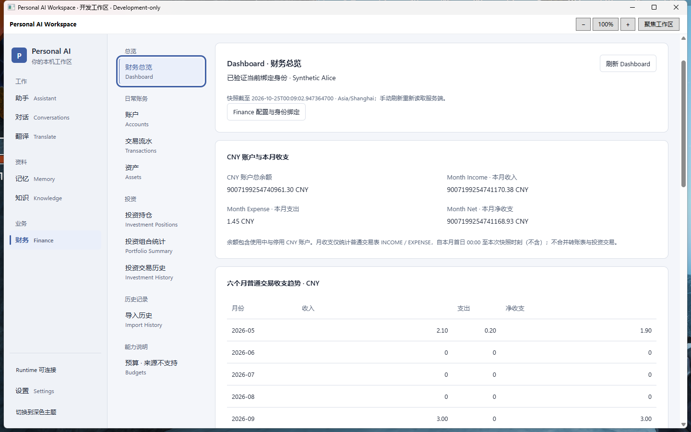
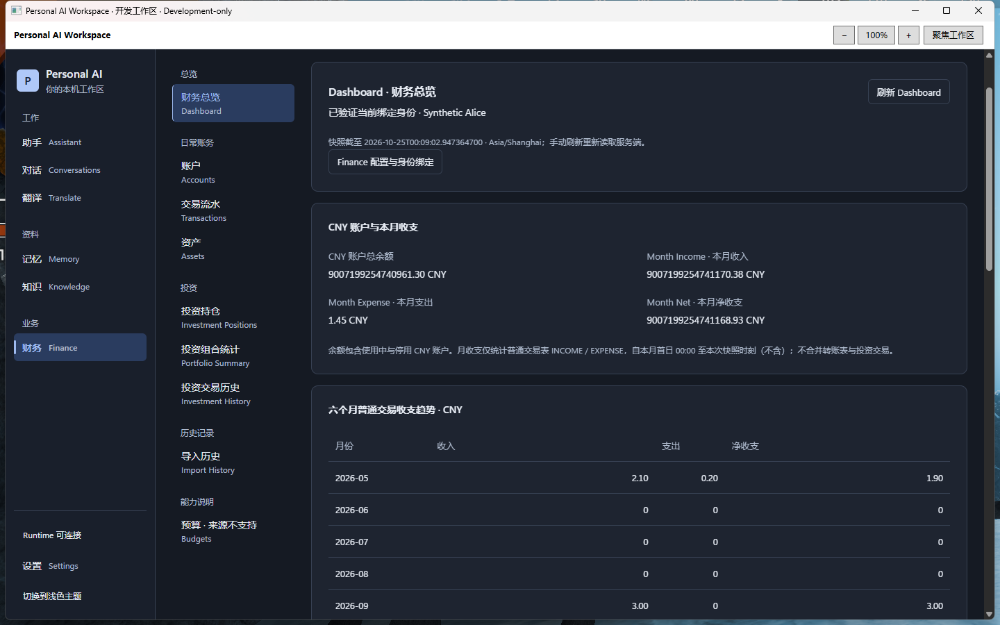

# Workspace UI Phase 1 — Shell & Navigation Foundation

2026-10-25，Asia/Shanghai。**Development-only，供用户人工验收；不是正式 Release 或 Production GO。** 原始任务跨过午夜，独立开发包采用实际交付日期 `20261025`。本轮仅实施 Phase 1，未启动 Phase 2–5。

## 基线与范围

从本地/远端一致的研究分支 `codex/workspace-ui-research @ a9c2b99772ed69c546e630e4321233dde4b5dce2` 创建 `codex/workspace-ui-phase-1`。入场工作树干净；指定 7890 代理 `fetch --prune origin` 成功。已读四份设计文档、清理/F-next-10 报告、当前架构、ADR-008/009/010，以及真实 App、Memory、Finance、页面挂载与原生内容策略。Windows 交付以本轮用户完整指令覆盖旧 Prompt 的不打包限制。

核心改动：

| 文件（相对仓库） | 实际变化 |
| --- | --- |
| `desktop/frontend/src/app/App.tsx` | 分组导航、窄窗页面选择、真实连接状态、Runtime 状态入口与焦点 |
| `desktop/frontend/src/app/navigation.ts` | 七个原 route 增加中文标签/分组并调整呈现顺序 |
| `desktop/frontend/src/styles/tokens.css` | 明暗语义 Token、旧变量映射、系统高对比颜色 |
| `desktop/frontend/src/styles/workspace.css` | Shell、共同表面/字体/间距、宽度策略与 Finance 导航响应式 |
| `desktop/frontend/src/pages/FinancePage.tsx` | 原九个 view 的分组导航/select 与外层布局 |
| `desktop/frontend/src/pages/SettingsPage.tsx` | 仅现有运行状态标题增加 `tabIndex=-1`，供状态入口聚焦 |
| `desktop/frontend/src/pages/MemoryPage.test.tsx` | 扩展既有 App 离页综合用例；无新增测试 case |

没有修改依赖/lockfile、Java、Finance 业务组件、Native/Bridge DTO、CSP、受信 Origin、Gate、数据库/schema/migrations、DPAPI、绑定或冻结 Finance OS 仓库。金额、百分比与 ID 继续按来源字符串显示；没有客户端金融计算。

## 可见变化与 Tokens

采用 AI Productivity Workspace：冷灰蓝画布、深蓝当前项、细指示线、紧凑圆角、自然系统中文字体；去掉 01–07 和固定 Local only 绿点/“原生功能可用”。页面标题降到 24px，正文 14px，共同按钮最小高 36px；卡片 10px、控件 6px。继承的业务页面局部样式未重写。

`tokens.css` 按设计方向使用 light canvas `#F4F6FA` / surface `#FFFFFF` / text `#1B2638` / accent `#315EA8` / border `#D7DEE8`，dark canvas `#141A23` / surface `#1C2431` / text `#E6ECF4`；rail、muted、primary fill/text、success/warning/danger/unknown 同文档。旧 `--bg/--muted/--active/--focus` 映射到语义变量。保留 `readTheme/saveTheme`、系统初始偏好和原 `workspace.theme` 键，不加持久化项。forced-colors 使用系统颜色，reduced-motion 关闭动效。

## 导航与生命周期

全局“工作”：Assistant / Conversations / Translate；“资料”：Memory / Knowledge；“业务”：Finance。底部保留 Runtime 状态、Settings 与主题。紧凑栏用真实短中文和完整 accessible name；窄窗用带标签的原生 select，包含全部七页。Assistant 默认与七个 hash ID 不变。

Runtime 只复用已有 ShellStatus 显示“可连接/不可连接/未核对”，不宣称模型 Ready、不多发模型轮询。入口调用同一个 `navigate('settings', true)`，待 Settings 挂载后聚焦现有运行状态标题，不增加路由。

所有链接/select/状态入口经过原 navigate / MemoryLeaveGuard；用户取消后保留路由、草稿与合理焦点。原 bootstrap/session generation、hashchange 保护和页面树保留：Assistant/Translate/Conversations/Memory/Knowledge 仍以 hidden/visible 控制，Finance/Settings 仍条件挂载。响应式仅改变导航呈现，不复制业务页面实例。

Finance 按五组呈现：总览（Dashboard）、日常账务（Accounts/Transactions/Assets）、投资（Positions/Portfolio/History）、历史记录（Import History）、能力说明（Budgets · 来源不支持）。仍默认 Accounts；九个原分支与组件身份保留。Dashboard→Assets、Position→History 的 positionId、显式 History 清位置筛选的原语义保持；这些回调/组件状态边界已静态核对。切离 Finance 卸载、清敏感树，重入 Accounts。Import 仍为已确认历史，Budgets 仍为 UNSUPPORTED。

## 响应式实现

全部断点用 CSS viewport，未按物理屏幕选择布局：

| 实际断点 | 行为 |
| --- | --- |
| ≥1280 CSS px | 全局 216px 导航；Finance 176px 分组二级栏 |
| 760–1279 | 全局 64px 短文字栏；Finance 改 label + optgroup select |
| <760 | 顶部完整页面 select；Runtime/主题常驻，Settings 由 select 到达 |
| <1024 | 边距 16px；其余 24px；继承业务页面自己的单栏规则 |

Assistant/Translate 外层最大 880px，Finance 与其他管理页面最大 1680px；不再全局固定 960px。Conversations 等内部正文布局留待后续阶段。侧栏整体 `overflow-y:auto`，低高度可滚到设置/状态/主题；小窗改为自然页面流。不设置全局 `overflow-x:hidden`；金融正文允许断行，表格保留具标签、可聚焦的局部横滚。

1280 采用同一分界，减少两层导航同时挤压有效数据宽度；实际原生 1440px 窗口 WebView 物理宽 1424px，展开两层仍有足够内容；1160px 默认窗口和 1024px 窗口使用紧凑栏/select。物理窗口/WebView bounds 与 CSS viewport 在报告中分开，不把二者当成相同测量。

## 实际验证

具体命令、日志哈希、失败与恢复边界见 [verification.txt](evidence/workspace-ui-phase-1/verification.txt)。

| 实际执行 | 结果与证据类型 |
| --- | --- |
| 既有 App/Memory 离页保护综合用例 | PASS；扩展侧栏/select/Runtime 取消、草稿与焦点、直接 hash 取消、确认后 Settings 目标焦点 |
| 既有 Finance Dashboard 综合用例 | PASS；精确字符串、部分分布、迟到/失败/session/runtime 快照清除。桥接合同替身，不是 SQL 测试 |
| `npm run build` | PASS；已含 TypeScript、Vite production assets 与资源 manifest，不重复单独编译 |
| 合成 Playwright/Edge 导航综合流 | PASS；七个顶级页、九个 Finance view、Memory 键盘/取消/确认、明暗主题、60位整数+16位小数、长名称/ID、卸载/重入。Dashboard 在 1920/1440/1280/1024/800/540/400 CSS px 无文档横溢出，表格允许局部横滚 |
| 窄窗补充布局检查 | PASS；七页分别在 1024/540/400 CSS px 可达且无文档横溢出；forced-colors/reduced-motion 浏览器模拟。devicePixelRatio=1 |
| `dotnet publish` 与启动器 CheckOnly | PASS；真实 Debug Profile 受信宿主、资源校验，原合成数据库身份校验通过；非正式安装包 |
| 实际 Windows WPF/WebView2 | 有限范围 PASS；真实 CMD、EXE、Bridge、Runtime、合成 PostgreSQL，七页入口、九 Finance 入口、明暗、原精确余额；1024×800 / 100% select Home/End 能切 Dashboard/Budgets；780×540 / 200% 全局 select 存在、Runtime 入口可进入 Settings |
| 正常退出与重开 | PASS；托盘退出释放本包 Runtime，实际 CMD 再开，Finance 初始 Accounts 可读，再次托盘正常退出。不是 Windows 重启 |
| 包/源码/身份一致性 | PASS；新包 payload/源文件哈希匹配 BUILD-INFO，包内 React manifest 与本次 dist 一致；旧 F-next-10 36 个 payload 未变；已有合成配置 DPAPI/Finance binding 哈希未变 |

原生环境：2560×1440 物理屏幕、96 DPI；宽窗口 1440×900、100%，WebView bounds 1424×821。未启用 DevTools，未取得原生 `innerWidth/devicePixelRatio`，不把这些 bounds 冒称 CSS 测量。

实际合成 Dashboard 仍显示 CNY 余额 `9007199254740961.30`、月收入 `9007199254741170.38`、支出 `1.45`、净收支 `9007199254741168.93`，由原 Runtime/SQL 提供。

失败不计 PASS：浏览器初次选择器重复、默认页 hash 等待；原生 UNSUPPORTED 文字、标签/ComboBox 重名、前台焦点干扰和重开瞬时句柄导致的超时，均只修忽略目录的验收工具，从失败点续查，没有迎合工具改生产逻辑。后续被其他前台应用/开始菜单遮挡的小窗截图已排除。**200% 下全局 select 的原生键盘选择、无干扰小窗视觉仍需人工验收**；不以浏览器结果代替。

未运行 Java/Desktop/Frontend 全套、真实 Provider/付费请求、生产金融数据、Windows 整机重启、其他 OS DPI/完整 IME/压力矩阵；未新增数据库/Profile、金融写入或迁移。没有重复构建 Java，也未因报告改动重复测试/打包。

## Windows Development-only 客户端

```text
D:\IDEA\Daima\personal-ai-workspace\artifacts\PersonalAiWorkspace-ui-phase1-development-20261025\Open-Workspace-UI-Phase1.cmd
```

本包使用本轮真实 React production 资源和新 `dotnet publish` 的 WPF/WebView2。保留既有 Native Gate、受信固定参数与资源 manifest；没有 DevTools、开发 Origin 或 CSP 放宽。复用 F-next-10 已验收合成集群/Profile 的既有安全启动配置，保留目录/数据库身份/配置/二进制 pin、DPAPI/绑定校验和 fail-closed 行为；不新建、不修复、不回退 SQLite。只在独立新目录输出，不修改历史包。

运行要求仍是同一 Windows 用户、固定目录、现有 JDK 21、.NET 10、WebView2 和 PowerShell 7.4+。托盘退出后合成 PostgreSQL 按原约定保持运行。本次验收结束时 Desktop 与本包 Runtime 已正常停止。

没有后端改动，Runtime/JAR 直接复用 `PersonalAiWorkspace-finance-fnext10-development-20261024`。该里程碑最终源码为 `f09d1bd1f883db8740cef8336a78e9a3a4123270`；原包构建实际记录是 `d17261729bd5d74a07b7ee933bc751984292e5a4` + `sourceDirty=true`，不将其改称最终 SHA 的干净构建。新包 BUILD-INFO 如实记录该来源、研究基线 dirty build、运行 manifest、修改源文件和全部 payload SHA-256；最终 Git commit 见本分支实际记录与交付回复。

关键哈希见 [package-hashes.json](evidence/workspace-ui-phase-1/package-hashes.json)，完整清单在包内 `BUILD-INFO.json`。例如复用 JAR 为 `a55b5b8b8244b4e025ba887eae6ea98e9d82fa901df379f5ef0033edc7524920`，本轮 React manifest 为 `85bdafbbf32231aef3e0fd24f0811a8f674777e321eb8032e2282e57655023a2`。本机打包/校验命令保存在 `.verification/ui-phase1-package.ps1`、`ui-phase1-verify-package.ps1`；不将私有 manifest/Profile 路径集上传 GitHub。

本轮真实宿主截图（仅合成 Finance）：





## 已知问题与人工验收

- 原生白色标题/工具栏与网页深色主题的接缝保留，Phase 5 处理；没有新增主题 Bridge 合同。
- 小窗/200% 的完整人工视觉与全局 select 键盘操作待验；后续受遮挡截图不作为证据。其他 OS DPI 未测。
- Assistant/Conversations/Memory/Knowledge/Settings 内部仍为已有页面，未提前实施 Phase 2–5。现有模型可用性提示沿用实际功能，不因 Shell 可连接就声明 Ready。

最少人工步骤：

1. 双击本轮 CMD，查看工作/资料/业务分组并切换明暗；Finance 初始 Accounts，检查分组导航与 Dashboard 精确金额。
2. 缩窗并使用原生“+”到 200%，用页面 select 到 Settings，再到 Finance 的九个目的地；检查滚动、Tab/Enter/Esc 与文字可读。
3. Memory 输入未保存草稿后尝试离页，取消应保留，确认后应离开；最后托盘“退出”，重开 CMD 再确认正常。

本轮完成后仅正常 commit/push `codex/workspace-ui-phase-1`，检查 status/实际及 staged diff/`git diff --check` 并核对远端 HEAD。`main`、F-next-10、清理与研究分支保持原 tip；未 force push、merge、改历史、打 Tag/Release 或清理分支。Phase 2 须本轮人工验收后另行授权，只建议处理 Assistant 输入/阅读/状态与 Conversations 列表和消息布局。
