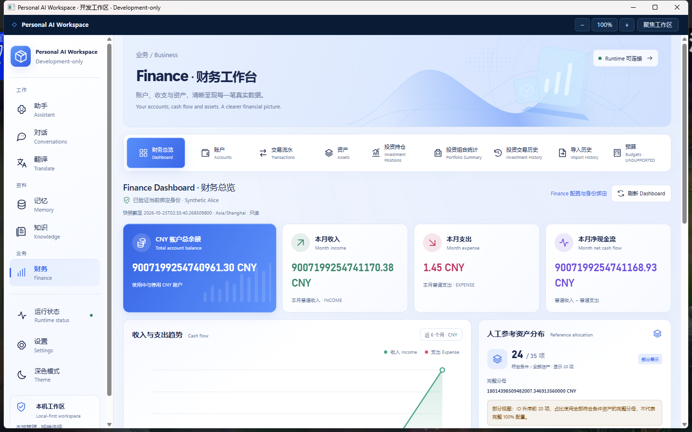
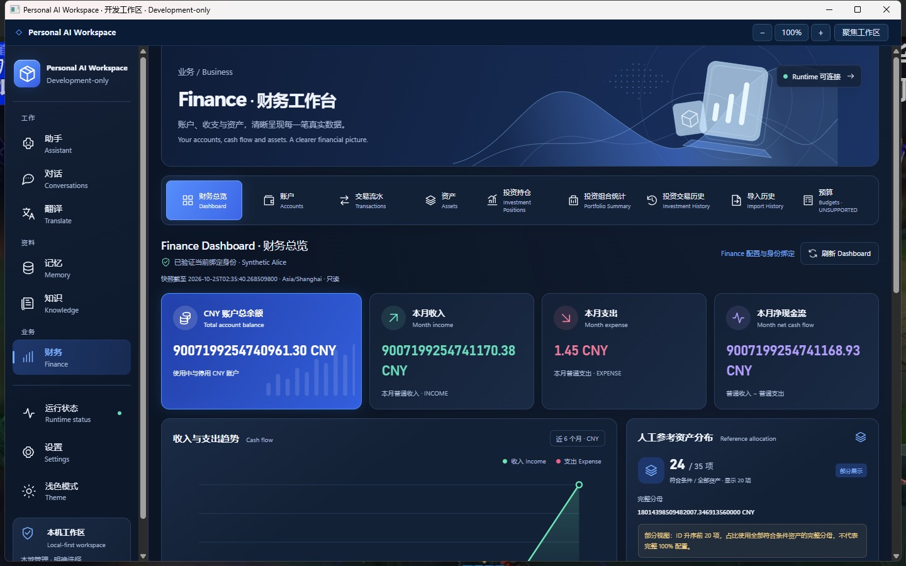

# Workspace UI Visual Redesign

2026-10-25，Asia/Shanghai。**Development-only，已交付可运行的独立 Windows 开发客户端；不授予 Production GO。**

## 基线与范围

从干净的 `codex/workspace-ui-phase-1 @ 01258eb0ab00e11946dc2fde9e3b9e79c68e49fe` 创建 `codex/workspace-ui-visual-redesign`。指定 7890 代理 fetch 成功，原远端 Phase 1 HEAD 与本地一致。核对设计研究、设计方向、实施计划、Phase 1/F-next-10 报告、架构及真实调用链。本轮明确需求覆盖此前限制装饰、Accounts 默认页及不打包的旧规划。

实际读取用户提供的两张 PNG，以蓝白浅色与海军蓝深色为视觉参考。改动集中于 Shell、Finance 导航、Dashboard、共用 Tokens 和原生工具栏。没有重写其他模块的业务逻辑，没有添加搜索、通知、用户管理、支付或上传确认功能。

## 与参考图的对应

| 参考要素 | 本轮实现 |
| --- | --- |
| 左侧产品标识、线性图标、双语导航 | 本地 SVG 立方体标识及统一描边图标；中文主标签、英文次级信息、蓝色活动项；保留七个真实页面 |
| 蓝色科技 Banner | 本地 SVG 波形、点阵、轨道与玻璃图形，随同一套主题 Tokens 切换；装饰图与数据图明确分离 |
| 四张金融摘要卡片 | 渐变蓝余额主卡、收入绿、支出红、净现金流紫；负净额使用支出色；精确字符串原样显示 |
| 收支图 | 真实六个月收入/支出折线和面积、零线、图例、月份、原始精确明细；没有预测线或虚构走势 |
| 资产分布 | 逐项百分比条形列表，显示覆盖数、全部数、完整分母、部分展示与排除说明；没有迁入容易误导的完整环形图 |
| 最近交易与账户 | 双栏最近五条真实普通交易 + 当前用户账户数、身份及 Accounts 入口；不额外请求账户列表 |
| 明暗卡片层次 | 统一 Tokens、蓝灰画布、渐变表面、柔和边界、阴影与适度蓝色发光 |
| 桌面顶栏 | 原生工具栏使用海军蓝、蓝色交互状态；保留原生缩放、聚焦、最小化/最大化/关闭 |

所有 SVG 自有、本地随包构建，没有新增依赖、图标字体、远程字体、CDN 或图片服务；无 Lucide 安装及许可变更。

参考图中的资产总值、同比/环比、固定日期、银行品牌、资产分类、搜索、通知和头像没有准确业务合同时未迁入。账户概览明确采用已有 Overview 的真实账户数与快捷入口，不伪造支付账户列表。

## Dashboard 与导航

进入 Finance 默认 Dashboard，切离 Finance 仍卸载敏感组件树，再进入重新验证身份并读取 Dashboard。全局默认仍是 Assistant。

Dashboard 内容顺序为：财务工作台 Banner → 图标导航 → 当前绑定身份/刷新/快照时刻 → 四张摘要卡 → 六个月收支与人工参考分布 → 最近普通交易与账户入口 → 金融口径说明。

宽窗口使用九入口横向图标导航，1280–1399 CSS px 使用紧凑两行，低于 1280 使用原生分组 select。全局栏在中窗保留有 accessible name/title 的图标，低于 760 CSS px 使用包含七页的页面 select。不会复制两套业务页面实例。

Budgets 明确显示 `UNSUPPORTED`；窄窗选项也保留“来源不支持”。Import History 仍只读已确认记录。Dashboard → Assets/Accounts/Transactions 为已有真实入口；Position → History 的 positionId 和显式切换 History 清筛选语义不变。

所有 Shell 导航和 Runtime 状态入口继续走原 `navigate` / MemoryLeaveGuard。没有新 hash、金融本地缓存或持久化项；主题仍使用原 `workspace.theme`。

## 金额与图表合同

既有余额、月收入、月支出、月净额、资产价值/百分比、ID 和交易金额均保留原字符串合同。没有修改 SQL、身份/所有权过滤、事务隔离、统计日期边界、完整分母或金融算法。

仅在原 `FinanceDashboardQueries` 增加只读 `cashFlowPlot`：

- 取同一快照的六个月收入/支出，用 BigDecimal 求共享范围，并将零纳入范围。
- 生成 `income[6]`、`expense[6]`、`zero` 的 SVG 纵坐标，均为 0–10000 整数；HALF_UP 舍入仅作用于绘图坐标。
- 支持全零、负值与超出 JavaScript 精确整数范围的金额。绘图投影不反写金额、净额或资产覆盖。
- WPF 和 React 均严格校验新增字段、六点长度、整数与范围；其他金额与覆盖校验不变。空请求、Bridge allowlist、HTTP 60 KiB 与 Bridge 64 KiB 上限不变。
- React 仅对有界坐标做像素映射，不对权威金额使用 Number/parseFloat/toFixed。图中圆点 title 与可展开明细提供精确金额；没有凭绘图坐标反推金额。

这是同步交付的 DTO 扩展，**必须配套本轮 Runtime、Core 与前端**；旧 Runtime 缺少字段会被新客户端拒绝，不做隐式兼容或放宽字段检查。

资产条形长度直接使用原服务端四位小数百分比字符串，不转浮点、不对当前 20 条重新归一化。显示全部合格分母、合格/全部资产数、当前条数、非 CNY/缺价/无效数量/非正价值排除数。价格新鲜度未知，不称为实时行情或净资产。

## 实际执行与证据边界

摘录和本机日志哈希见 [verification.txt](evidence/workspace-ui-visual-redesign/verification.txt)。

| 实际执行 | 结果与范围 |
| --- | --- |
| 新增一个 Java 展示投影回归用例 | PASS；共享比例、超大精确金额、微小正负值、零线、全零和原金额不变；无数据库或 Provider |
| 既有 React Dashboard 综合流 | PASS；默认 Dashboard、精确字符串、20 条部分覆盖、非法坐标/长度、非法金额、迟到响应、Session/Runtime/关闭清除 |
| 既有 App/Memory 离页综合流 | PASS；侧栏/select/Runtime 入口取消与确认、草稿、焦点及直接 hash 保护 |
| 既有账户/交易/资产/持仓综合流 | PASS；适配显式进入 Accounts，保留原迟到快照、失效身份及精确数据断言 |
| Playwright 合成浏览器综合流 | PASS；七页、九 Finance view、Memory guard、键盘/焦点、明暗、60 位整数加 16 位小数、卸载/重入、明细展开、forced-colors/reduced-motion。400/540/800/1024/1280/1440/1920 CSS px 无文档横溢出，表格保留局部横滚 |
| 前端生产构建 | PASS；包含 TypeScript、Vite 和资源 manifest |
| Maven package + JAR audit | PASS；本轮新 Runtime，跳过全套测试；保留 Native Gate 与构建身份审计 |
| dotnet publish / launcher CheckOnly | PASS；新 Core/WPF/WebView2 和本轮前端资源，原合成数据库身份校验通过 |
| 实际 Windows 客户端 | 有限范围 PASS；实际 CMD/EXE/JAR、原合成 PostgreSQL、默认 Dashboard/重新进入、四项精确金额、真实 SVG 图、展开明细、七页与九入口、真实明暗截图 |
| 原生窗口与缩放 | 1920×1080、1440×900、1280×800 实际调整；780×540 的 150%/200% 缩放和 Runtime → Settings 入口通过。原生 select End 可到 Budgets，随后 Home 自动化未可靠返回，完整键盘选择待人工确认 |
| Runtime 清除与重开 | PASS；仅终止已验证父进程和本包 JAR 路径的任务自有 Runtime，确认 Dashboard 金额移除；托盘正常退出 → 实际 CMD 重开 → 默认 Dashboard 精确读取 → 再次托盘退出，监听已释放 |
| 包/源码/历史保护 | PASS；本包全部 payload、修改源码、生产 React manifest、新 JAR、旧 F-next-10/Phase 1 包及原 DPAPI/绑定文件哈希核对一致；Finance 来源仓库工作树干净 |

浏览器为替身合同与 CSS 检查，不能冒称真实 SQL 或物理 Windows 结果。原生屏幕为 2560×1440、96 DPI；未打开 DevTools，不把原生 bounds 当成 CSS viewport。150%/200% 指 WebView Zoom，不是更改 OS DPI。

真实合成数据仍为余额 `9007199254740961.30`、月收入 `9007199254741170.38`、支出 `1.45`、净额 `9007199254741168.93`；24 / 35 项资产合格，显示 20 项，分母 `18014398509482007.346913560000 CNY`。巨大金额使早期小额月度点贴近零线，这是共享真实比例的结果，精确明细仍可查看。

开发失败不算 PASS：初次账户综合测试使用旧 Budgets 文案，修正定位后只续跑失败用例；浏览器热更新 timestamp 导致旧入口匹配失效，改为匹配带 query 的模块，并在页面就绪后显式发送测试 Session；原生 summary 使用 ExpandCollapse 而非 Invoke，修正忽略目录脚本后续查。早期截到 Settings 或主题与文件名不符的图片已排除，报告仅使用核对过主题和 Dashboard 状态的截图。

**审批限制：** 自动审批拒绝“解密既有 DPAPI 测试凭据并生成临时 SQL 测试配置”的命令，相关 Maven SQL 重跑未启动，没有绕过或导出凭据。本轮跨用户 SQL 隔离没有重新执行；F-next-10 双用户 SQL PASS 仅为历史证据。现有身份查询、所有权过滤与绑定边界的静态审查无修改，实际原生读取仅使用既有合成 Alice。

未执行 Java/Desktop/Frontend 全套、全浏览器/IME/压力/包装矩阵、真实模型调用、付费 Provider、生产金融数据、金融写入或 Windows 整机重启。没有新增数据库/Profile、迁移、重新绑定或更改密码。

## 独立 Windows 开发客户端

```text
D:\IDEA\Daima\personal-ai-workspace\artifacts\PersonalAiWorkspace-ui-visual-redesign-development\Open-Workspace-Visual-Redesign.cmd
```

本轮真实构建 React、Core/WPF 和 Runtime JAR。启动器复用既有可信合成启动机制，更新本包实际二进制 pin；保留目录/进程/配置/数据库身份、DPAPI、绑定、Native Gate、CSP、固定 Origin 与受控资源 manifest。没有 DevTools、开发 Origin、权限放宽、SQLite 回退或对历史客户端的覆盖。

要求同一 Windows 用户、固定目录、原 JDK 21、.NET 10、WebView2 和 PowerShell 7.4+。使用原 F-next-10 合成环境；托盘退出后 PostgreSQL 按旧约定继续运行。验收结束 Desktop 和其自有 Runtime 均已退出。

`BUILD-INFO.json` 的 format 为 `WORKSPACE_UI_VISUAL_REDESIGN_DEVELOPMENT`；如实记录构建时 `01258eb… / sourceDirty=true`，修改源码哈希、Runtime manifest 和全部 payload。最终交付提交包含后续文档与截图，不将 dirty build 冒称最终提交的干净构建。没有因文档更新重复构建。

关键哈希见 [package-hashes.json](evidence/workspace-ui-visual-redesign/package-hashes.json)。本机打包与验证脚本位于忽略目录 `.verification/ui-redesign-package-final.ps1`、`ui-redesign-verify-package.ps1`；私有启动设置与 Profile 路径集合不上传 Git。

本轮真实 WPF/WebView2 截图（仅合成金融数据）：





## 剩余问题与最少人工验收

- Windows 系统标题栏仍由系统决定外观，未增加跨层主题 Bridge 或窗口命中测试；原工具栏已统一为海军蓝。
- 小窗口的原生 select 完整键盘选择需人工复核。放大后顶部选择与状态区会占据更多高度，需纵向滚动到 Dashboard；不隐藏内容掩盖布局。
- 部分原生截图/键盘检查受前台焦点影响；未核实图片和失败检查不作为通过证据。浏览器与原生结果分别记录。
- 其他页面仅继承共用字体、图标、表面和主题，没有宣称其深度 UI 改造或模型可用性已验收。

人工步骤：

1. 双击实际 CMD → Finance，应直接进入 Dashboard；切换浅色/深色，核对四项金额、六个月精确明细、资产覆盖和最近交易。
2. 查看 Accounts 等九个入口，再离开 Finance 后返回，应重新进入 Dashboard；Memory 未保存内容离页时取消应保留草稿。
3. 缩小窗口并用原生“+”调至 150%/200%，用 Tab/方向键/Enter 操作两个 select，检查局部表格滚动、错误提示与 Settings 可达性。
4. 托盘“退出”后重开实际 CMD，确认 Dashboard 可读，再正常退出。

本轮只正常 Commit/Push `codex/workspace-ui-visual-redesign`；提交前检查 status、实际 diff、staged diff 与 `git diff --check`，推送后核对远端 HEAD。最终 SHA 见分支 Git 记录和交付回复。main、F-next-10、UI Phase 1、Finance 来源、历史包和 B4A6 私有归档不改写；无 force push、merge、Tag、Release 或 Production GO。
