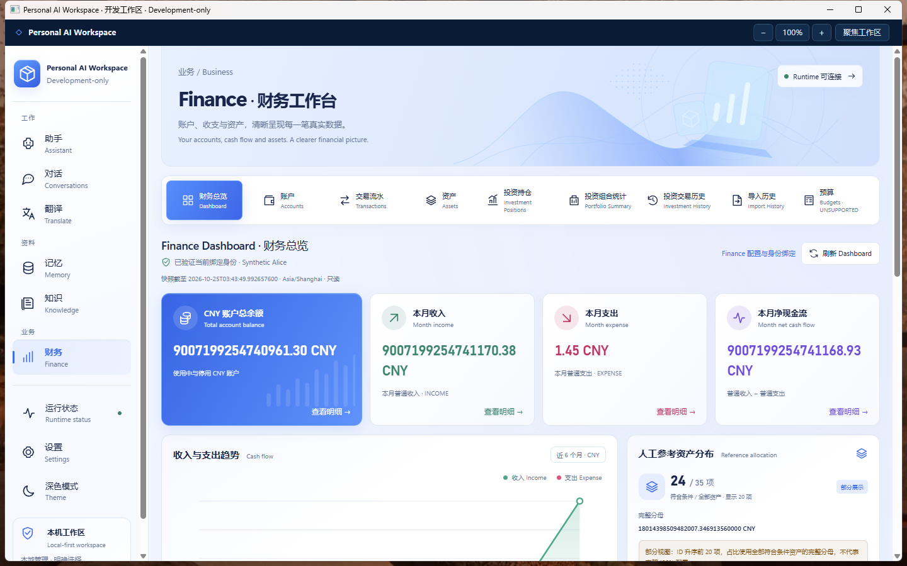
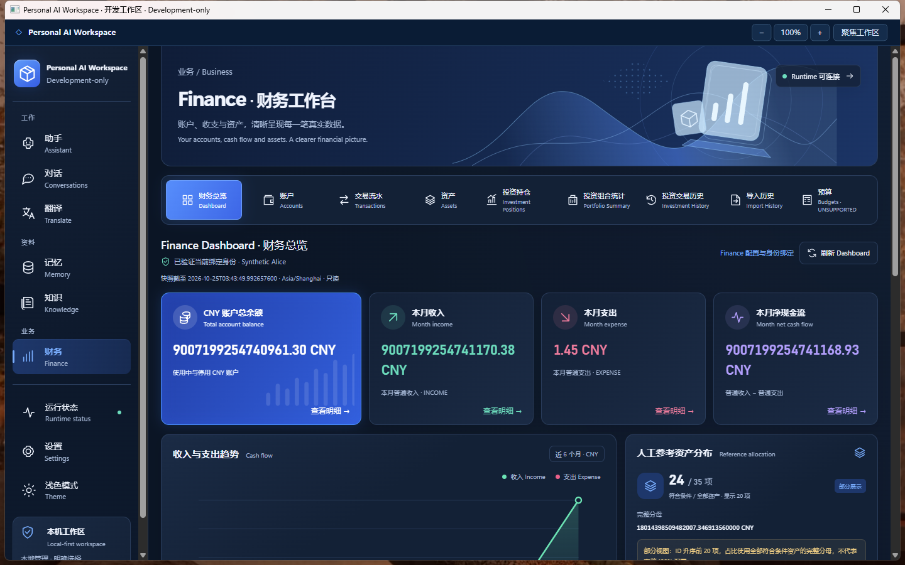
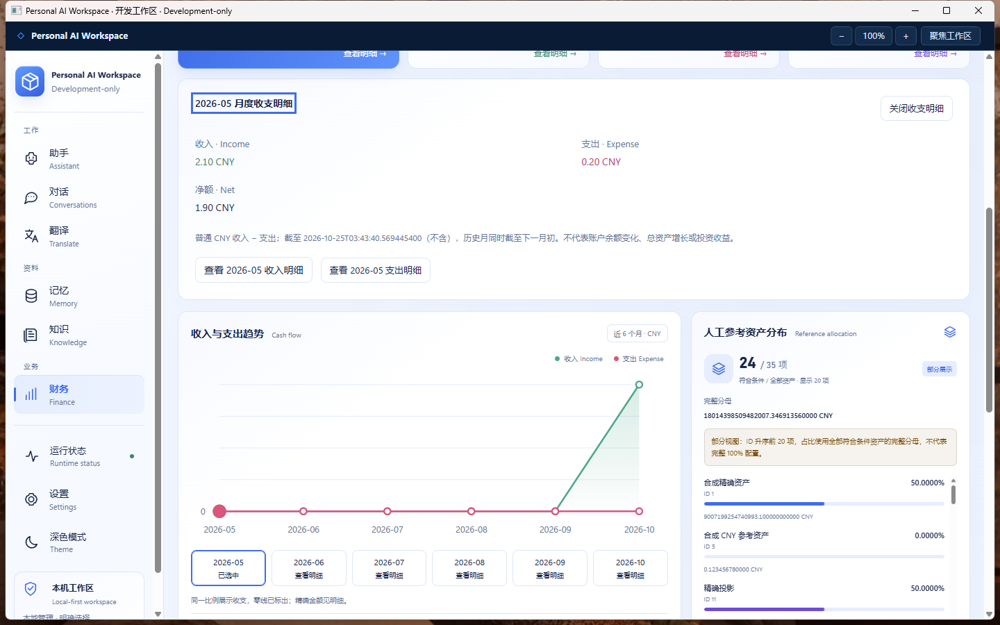

# Finance UX D1 — Dashboard Drill-down 交付

2026-10-25，Asia/Shanghai。**实际功能、真实 Windows 验收和独立 Development-only 客户端已交付；不授予 Production GO。Market Data M1 未开始。**

## 工程基线与研究

从 `codex/workspace-ui-visual-redesign @ 003562cf327d1f97167284ad01090cfc9be16b22` 创建 `codex/finance-dashboard-drilldown`。开始时按 7890 代理 fetch 成功，远端基线 SHA 与本地一致；工作树干净，同名本地/远端分支不存在，没有暂停任务未提交文件。已读用户 AGENTS 约定、当前架构、Visual Redesign/F-next-10 报告及实际 Finance 调用链；仓库内未发现额外 AGENTS.md。

冻结来源 `D:\IDEA\Daima\personal-finance-OS @ c6c87a0627b746e70a45b1c7896f63defd76a810` 前后工作树干净。没有修改来源、原账本、finance-domain、migrations、Shared AI Runtime、Native Gate、DPAPI、可信 Origin/CSP、绑定机制、MemoryLeaveGuard 或旧开发包。

先读取四个开源项目固定 Commit 的真实源码，再实施。文件、事件、导航、状态及许可记录见 [交互参考](../design/FINANCE-INTERACTION-REFERENCE.md)：借鉴 Actual 的筛选传递、Ghostfolio 的持仓复合标识、Firefly 的范围查询和 AnythingLLM 的局部选择/返回；独立实现，没有复制 MIT/AGPL 代码或加入框架。

## 实际交互

| 入口 | 本轮实际行为 |
| --- | --- |
| CNY 余额卡 | 语义按钮 → 原 Accounts → 原账户详情 → 返回列表/财务总览。余额仍包含使用中与停用 CNY 账户。 |
| 本月收入 / 支出 | 原 Transactions，page=0，预置 INCOME/EXPENSE、月份与 Dashboard asOf。可见 CNY/普通交易/Asia/Shanghai/上下界；日期锁定避免模糊修改，保留账户过滤、类型切换和分页。清除筛选恢复全部币种与原自然日查询。 |
| 净现金流卡 | 内嵌显示 monthIncome、monthExpense、monthNet 原字符串与两个流水入口；明确不是余额变化、资产增长或投资收益。 |
| 六个月趋势 | 保留原 SVG 和配色；点击点或语义月份按钮选择，点高亮/aria-pressed，显示 monthlyCashFlow 的精确 Income/Expense/Net 和该月流水入口。支持 Tab、Shift+Tab、Enter/Space、Escape 关闭及焦点返回。 |
| 最近普通交易 | 显式 `kind=TRANSACTION` 与字符串 ID → 原可信详情接口重读；不把历史普通 TRANSFER 解释成 V19 Transfer，不使用 Dashboard 行替代完整详情。未找到/无权限时保持安全错误和返回列表入口。 |
| Portfolio | 查看全部、OPEN、CLOSED 持仓及全部投资交易历史。持仓详情继续按 positionId 进入 History。保留成本、已实现盈亏、参考估值/freshness、Receipt、Correction 与 Audit Timeline。 |
| 返回 | Dashboard 恢复所选月份并重新读取；History 返回持仓筛选及所选详情，从首页重新查询，继而返回 Portfolio。详情可关闭，筛选可清除。 |

保留蓝白/海军蓝、Hero、蓝色余额卡、语义色、本地装饰、九入口及原生工具栏。只新增 hover/active/focus、选择、详情和返回；没有全局视觉改造。

## Intent 与生命周期

`financeNavigation.ts` 定义按 target 区分的 `FinanceIntent`，包含 source、目标查询或 kind/id/positionId；FinancePage 仅在本地 view 内投递。目标挂载捕获入口，FinancePage effect 随即消费并清空 pending；子页 ref 也只使用一次。没有新 Router 或每次跳转的新 hash。

返回条件最多两层，只保存 view、月份、持仓筛选和所选 ID，不保存响应或金额；持仓返回不保存旧 Cursor 页。显式九入口切换会清除返回条件并进入该视图默认状态。

Finance 卸载时销毁整棵组件树；enabled=false、Session/Runtime 事件清除导航、筛选、选择和快照；身份非 READY 或 FinanceBindingInvalid/FinanceNotBound 清除相关入口上下文。既有 generation 丢弃迟到响应，Runtime 恢复重验 Overview。历史 positionId 改为一次性入口，避免 Runtime 重启后自动重新套用旧 ID。

Intent 不能指定或授予用户身份；Session 由原 Bridge 校验，每个列表/详情由 Finance 私有只读事务重新验证原绑定用户、用户指纹、数据集指纹和所有权。绑定仍 CREATE_NEW，不允许重绑。没有通过客户端传 userId/指纹扩权，也没有在 localStorage、sessionStorage、Cookie 或 URL 保存金融条件；主题继续使用原 workspace.theme。

## Dashboard 与 Transactions 的严格范围

原 Transactions 混合 transactions/transfers、全部币种，endDate 为自然日 inclusive；只传日期/类型无法对应 Dashboard。因此仅扩展原固定 `finance.transactions` / `GET /api/v1/finance/transactions`，增加成对的字符串 `cashFlowMonth`、`cashFlowAsOf`：

- 空范围保留原查询。非空必须为有效月份/本地日期时间，月份处于 asOf 所在月及前五个月，type 只能 INCOME/EXPENSE；startDate 必须为该月第一日，endDate 必须为空，防止两个上界相互矛盾。
- 服务端固定 `kind='TRANSACTION' AND currency='CNY'`，时间为 `[月初 00:00, min(下一月初 00:00, cashFlowAsOf))`；当前用户、账户授权 Join、Finance 专用 DataSource 与 REQUIRES_NEW/read-only/REPEATABLE_READ 保持原样。
- 若合格普通交易的关联账户无法通过原所有权 Join，安全拒绝该统计明细，避免静默漏行后声称与汇总一致；没有放宽所有权。
- 响应回显范围。Java、C#、React 同步校验字段、分页、类型和范围；C#/React 拒绝非普通 CNY 行、超过 exclusive 上界、错回显、数字金额/ID 和未知字段。时间比较保留纳秒字符串精度。
- 老字段集合只用于未指定统计范围的请求/响应；带 scope 的请求必须有相同 scope 回显，不能将旧 Runtime 的普通列表当成统计明细。

同一天晚于 asOf 的交易不进入统计明细；历史月上界不放宽到当前 asOf。本轮真实 PostgreSQL 用固定 `2026-10-24T12:00` 证明：11:59:59.999999 支出纳入，12:00 收入排除；USD 支出排除；五月末与六个月起点正确，两用户结果独立。同号普通交易 1 与 Transfer 1 返回不同来源金额。

`asOf` 是时间筛选参数，不是身份凭据或数据库历史快照 Token。返回/刷新会重读当前记录；范围内来源记录后来变化时，金额可能变化，页面已说明。React 不汇总一页记录、不计算 Net、不从 SVG 反推金额；cashFlowPlot 只生成几何坐标。

## 改动文件

- React：`pages/FinancePage.tsx`、新增 `pages/financeNavigation.ts`；`components/FinanceDashboard.tsx`、`FinanceTransactions.tsx`、`FinanceInvestments.tsx`、`FinancePortfolio.tsx`、`FinanceHistory.tsx`。Accounts 的实际 owning component 位于 FinancePage；`FinanceAssets.tsx` 只增加身份失效时清除导航上下文。
- 合同/样式：`bridge/client.ts`、`bridge/financeTransactions.ts`、`styles/dashboard.css`。
- 窄只读 API：`FinanceTransactionQueries.java`、`FinanceTransactionController.java`；C# `RuntimeClient.FinanceTransactions.cs`、`Bridge/WorkspaceBridge.cs`。没有新增 Native 方法、金融写服务或迁移。
- 验证：扩展原 `FinancePage.test.tsx` 的 Dashboard/Portfolio 综合流、原 `WorkspaceBridgeTests.cs` 的非法 payload 检查；新增一个 C# 范围合同回归和一个 opt-in PostgreSQL 综合用例，分别位于 `RuntimeClientTests.cs`、`FinancePostgresqlIntegrationTest.java`。
- 文档：本报告、交互参考及本目录 evidence。忽略目录 `.verification/finance-d1-*` 保存本机打包、UIA/浏览器脚本和日志；不将私有启动配置上传 Git。

## 实际执行证据

[日志标识及哈希](evidence/finance-dashboard-drilldown/verification.txt)、[原生结果](evidence/finance-dashboard-drilldown/native-result.json)、[浏览器结果](evidence/finance-dashboard-drilldown/browser-result.json)、[键盘补查](evidence/finance-dashboard-drilldown/keyboard-result.json) 均为本轮实际执行。

| 实际执行 | 结果 / 边界 |
| --- | --- |
| Maven 聚焦 PostgreSQL 用例 | PASS；原 F-next-10 合成库，只读 reader，真实 SQL、六个月、分页、双用户、币种/截止、同号 kind 和失效指纹。仅替代 Profile IO，不替代 SQL。直接读取原受保护 DPAPI 到进程内存，没有导出凭据或改旧数据。 |
| React 聚焦综合流 | PASS；扩展 Dashboard 卡片/月/近期详情、投资导航与返回，复用既有精确金额、迟到响应、Session/Runtime/失效身份检查。没有执行 Frontend 全套。 |
| C# 范围与原 Bridge payload 检查 | PASS；固定方法、成对范围、回显、普通 CNY、exclusive 纳秒边界、精确字符串与拒绝客户端 userId。没有执行 Desktop 全套。 |
| Playwright 合成浏览器流 | PASS；Enter 卡片、Space 月份、Escape，精确长字符串、筛选/清除/返回、Runtime 清理、明暗主题、1024/1280/1440/1920 和 540 CSS px；无文档横溢出或按钮越界。补查 Tab/Shift+Tab 顺序及 Escape 返回焦点通过。是替身合同/CSS证据，不冒称 SQL/原生结果。 |
| React production build / Maven package / JAR audit | PASS；TypeScript、Vite、资源 manifest；新 Runtime 仅跳过全套测试，JAR 构建身份审计通过。 |
| dotnet publish / launcher CheckOnly | PASS；本轮 Core/WPF、React 与新 Runtime 配套，既有合成数据库身份验证通过。 |
| 实际 WPF/WebView2 综合流 | PASS，分两段完成；真实 CMD/EXE/JAR/原合成 PostgreSQL。余额→账户详情；Enter 收入、支出/清除；净额组成；Space 选五月 `2.10 / 0.20 / 1.90` 并进入支出、返回恢复月份；普通 TRANSFER 307 正确详情；Portfolio 三种状态→持仓18→交易107/原始 Receipt/Audit→返回持仓详情→组合→全部历史；明暗及原生 1920/1440/1280/1024 调整。 |
| Runtime / 托盘 / 重开 | PASS；只终止已验证父进程及本包 JAR 路径的自有 Runtime，scope 与返回上下文移除；正常托盘退出→实际 CMD 重开→新 Dashboard 查询→再次正常退出，Desktop 和其 Runtime 已退出、18765 监听释放。PostgreSQL 按旧约定保留运行。 |
| 保护/一致性 | PASS；本包全部 payload、构建时源文件和 React manifest；F-next-10、Phase 1、Visual Redesign 三个历史包逐项哈希；原 Profile/DPAPI/绑定 pin 不变；合成账本前后只读摘要相同；Finance 冻结仓库干净。 |

没有把失败算 PASS：初次 React 定位遇到隐藏文本空格差异，改为明确 aria-label 后仅续跑相关用例；原生脚本最初按 Invoke 处理净额按钮，但其 aria-expanded 暴露 ExpandCollapse，修正**忽略目录验收脚本**后从余额/净额阶段续验，未因此修改产品代码或重建。Python Playwright 未安装，复用本机已有 Node Playwright，没有新增依赖。

没有执行 Java/Desktop/Frontend 全套、完整浏览器/IME/压力/包装矩阵、整机重启、付费模型、任何真实金融数据、金融写入或市场 Provider。本轮未篡改旧数据库身份/Profile 来做物理失效测试；身份/Session 失效由 SQL/Bridge/React 聚焦证据覆盖，实际原生验证 Runtime 失效和重新启动。App/MemoryLeaveGuard 仅静态核对未修改，不冒称本轮重跑其旧全套验收。

实际客户端截图（全部为既有合成金融数据）：





[收入范围截图](evidence/finance-dashboard-drilldown/native-income.png) · [投资历史截图](evidence/finance-dashboard-drilldown/native-history.png)。原生 bounds 是物理窗口尺寸，不冒称 CSS viewport；未开启 DevTools。

## Development-only 客户端与版本

```text
D:\IDEA\Daima\personal-ai-workspace\artifacts\PersonalAiWorkspace-finance-ux-d1-development\Open-Workspace-Finance-UX-D1.cmd
```

新目录、新启动器，未覆盖旧包；仅同一 Windows 用户、固定目录和既有 F-next-10 合成环境。保留全部可信启动、Native Gate、绑定、进程/配置/二进制 pin；无开发 Origin、权限放宽、Profile 重绑、自动迁移、SQLite 回退、安装程序或正式 Release。

`BUILD-INFO.json` format=`FINANCE_UX_D1_DEVELOPMENT`，sourceCommit=`003562cf327d1f97167284ad01090cfc9be16b22`、sourceDirty=true，逐项记录本轮修改源文件及 payload 哈希。EXE FileVersion=`1.0.0.0`、ProductVersion=`1.0.0+003562cf327d1f97167284ad01090cfc9be16b22`；Runtime Maven 版本 `0.1.0`，构建用 Java `21.0.7`、.NET SDK `10.0.401`、Node `24.16.0`。如实保留提交前构建身份；最终交付提交见功能分支 Git 记录及交付回复，不能把该包描述为最终提交的干净重建。

- 新 Runtime JAR SHA256：`d478bf7cdcdb6b4258a117f508c5755f8c02dd72f8b0eed0f40aea897a48330d`。
- 新 EXE SHA256：`a8ec1d650c4cd3913ab6eb682b1f6304a278782e001bc99b7cf9d69b0ebe5e10`。
- 其余 DLL、启动器、React manifest、BUILD-INFO 哈希见 [package-hashes.json](evidence/finance-dashboard-drilldown/package-hashes.json)。后续只添加报告/证据，不重复构建已验收二进制。

## 最少人工验收与后续条件

1. 打开上述 CMD → Finance；点击余额看账户/详情，返回。依次点收入、支出，核对类型、CNY、月初/不含截止时间；打开一条详情，再清除筛选并返回。
2. 点净额检查组成；Tab 到月份按钮、Enter/Space 选择、查看月收入/支出并返回；Escape 关闭，检查选中与焦点。点最近交易，核对 TRANSACTION/ID 和可信详情。
3. Portfolio → OPEN/CLOSED/全部持仓 → 持仓详情 → History/Receipt/Audit → 返回持仓/组合；切换明暗，缩小窗口检查按钮和局部滚动。
4. 正常托盘退出并重开；需要模拟 Runtime 故障时只停止本包自有进程，确认金额/筛选/选择清除，随后正常退出和重开。不要改旧数据库或绑定文件。

限制：返回持仓从首页重读，不保存历史 Cursor 页/响应；Dashboard 返回重新取快照，来源变化可能改变金额；人工价格与现有报价缓存仍可能缺失/过期。只验证上述聚焦范围，未授予 Production GO。

未来 Market Data M1 可复用本轮 Portfolio/Positions/History 导航及既有 freshness 展示；Twelve Data、美股/ETF、USD/CNY、受控行情缓存和 BigDecimal 估值必须在下一独立阶段实现。本轮没有行情 HTTP、API Key、自动刷新、券商连接或下单。

Git 交付仅正常 Commit/Push `codex/finance-dashboard-drilldown`，推送后核对远端 HEAD；不 force push、rebase、merge main、删除分支、打 Tag 或发布 Release。最终状态以 Git 与交付回复为准。
