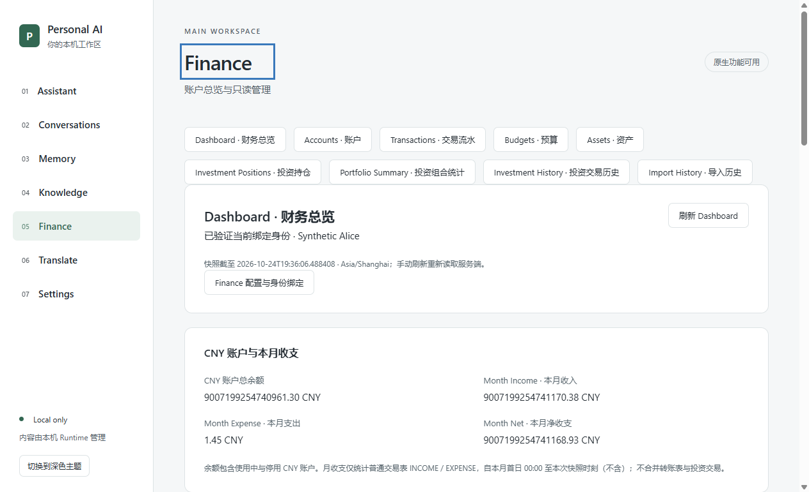

# Finance F-next-10 — Dashboard & Cashflow Read-only Integration

2026-10-24，Asia/Shanghai。**Development-only，不是正式 Release、Finance Freeze 或 Production GO。用户最终人工验收仍待执行。**

## 基线与历史保护

从已提交规划分支 `codex/finance-remaining-capabilities @ d17261729bd5d74a07b7ee933bc751984292e5a4` 创建 `codex/finance-f-next-10`。开始时按指定代理 `fetch --prune origin` 成功，远端规划 HEAD 一致，同名功能分支不存在。功能历史为 F-next-9 `aac471d8fc6a70697c4c1111658bb615ab5c69e4`，没有改写历史。

冻结 Finance 来源为 `D:\IDEA\Daima\personal-finance-OS @ c6c87a0627b746e70a45b1c7896f63defd76a810`，前后工作树干净。已读规划、F-next-10 提示、F-next-7/8/9 报告及真实 DashboardService、TransactionMapper、TransactionQueryService、既有账户/资产/身份/Bridge 调用链。

入口只有 B4A6 原八个未追踪文件，原样保留、不加入提交。对旧开发包（包括原 F-next-2 recovery）、历史 Profile 的 DPAPI/绑定、原 migrations、B4A6 和既有保护清单保存当前哈希；复核 17,308 个受保护文件，变化为零。没有新迁移、旧数据库授权调整、全局 Git/代理配置修改、分支清理或历史包归档。

构建时实际 HEAD 为上述规划 SHA，`sourceDirty=true`，如实反映当时尚未提交的本轮代码；最终提交由 Git 记录及交付回复标识。没有为了补充报告而重复构建已验收二进制。

## 实际功能和金融口径

新增 `Dashboard · 财务总览`，保留 Accounts 默认入口和既有 Finance 风格，无新图表库。页面提供刷新、重试、空状态、未绑定/身份失效/Runtime 状态、趋势与分布表格、近期交易和 Assets 详情入口。

| 指标 | 服务端金融合同 |
| --- | --- |
| CNY 账户总余额 | 复用原 AccountQueryService.sumBalanceByUser，包含来源覆盖的使用中与停用 CNY 账户；不是总资产或净资产。 |
| 本月 Income / Expense / Net | 当前绑定用户、普通 transactions 表、CNY、精确 INCOME / EXPENSE 类型；Asia/Shanghai `[本月首日00:00, now)`；Net 使用 BigDecimal 相减。 |
| 六个月收支趋势 | 当前月及前五个月，来源 date_trunc + SUM/CASE SQL，同一 now 截止，升序补零；不是余额变化、投资现金流或全部资金流。 |
| 人工参考资产分布 | CNY、价格/数量非 null、数量及乘积为正；逐资产 `current_price × quantity`，完整分母，BigDecimal `value × 100 / denominator`，scale=4 / HALF_UP；不按类型或名称合并。 |
| 最近五条普通交易 | 普通 transactions 当前用户/CNY，`transacted_at DESC,id DESC`；无额外类型或未来日期过滤。账户名称限本人；分类名称限本人或 user_id 为 null 且 is_system=true，缺失显示未知。 |

普通月收支不直接读取 V19 transfers、investment_transactions 或 import_batch。REFUND / ADJUSTMENT / 旧 TRANSFER 不计入月收支；原交易若已存储为 INCOME，则按其类型统计，包括历史导入生成的普通交易，不设计退款抵扣算法。

资产按 ID 升序最多返回 20 条，`total/complete` 表示全部合格资产覆盖，百分比分母覆盖全部合格资产。另返回全部资产数及按顺序互斥的非 CNY、未定价、数量缺失/非正、乘积非正排除数。部分列表明确说明不代表完整 100% 配置，React 不重新归一化。未定价不冒充价值零；人工价格更新时间/新鲜度标为未知，资产记录更新时间不冒充价格更新时间。

与原 Dashboard 有意不同：不迁入 `totalAssets = accounts + manual asset values` 或 `netWorth = totalAssets`，不合并账户余额、投资成本、Portfolio 市场估值、负债，不刷新 Quote/FX；不迁入 Finance AI Analyst、Tool Calling、第二套 AI/Memory 或金融写入。

本轮为冻结 SQL/算法的窄 JDBC 只读适配，没有原字节复制新来源文件，未新增 byte-for-byte provenance 清单。冻结来源和 finance-domain 既有 provenance 保持不变。

## 查询、Native 与生命周期

```text
GET /api/v1/finance/dashboard
Native Bridge: finance.dashboard, payload: {}
WPF/WebView2 → Native Gate → 已确认绑定 → ACTIVE 用户/数据集指纹 → Finance 专用 DataSource
```

`FinanceDashboardQueries.dashboard` 进入既有 `FinanceAccountQueries.query`，先校验绑定，再在 Finance 专用 `REQUIRES_NEW / read-only / REPEATABLE_READ` 事务内读取余额、全部聚合及名称。Clock 固定业务时区，每次请求只取一次 now，全部读取同一快照，不与 Workspace 数据源混读。没有扩大 com.financeos 扫描或装配写服务。

HTTP 拒绝任何 query string，Bridge 只接受空字段集，不允许客户端传 userId/Profile/指纹或数据源。保留 Native Bearer、可信 Origin、Session、Browser Translate-only、Finance 默认关闭、固定方法/路径和 no-store；HEAD/OPTIONS/POST 拒绝。

金额、百分比、金融 ID 全程为字符串：Java BigDecimal/toPlainString → C# 严格字段和嵌套 DTO 校验 → React 原样展示。月份标签可以格式化，React 不求和、不算 Net、不用 Number/parseFloat/toFixed 处理金额。按最大接收字段长度、20 资产/5 交易/6 月及完整 JSON 转义估算：HTTP 54,284 bytes，Bridge 54,419 bytes，低于既有 60 KiB / 64 KiB；上限未提高，原有超限拒绝保留。

请求开始/失败即清除旧快照；Session、Runtime、enabled 变化和导航卸载均清除并递增 generation，迟到响应丢弃。Runtime 恢复先重读 Overview 校验身份，再读取 Dashboard。手动刷新重新请求服务端，没有金融本地缓存。

## 新合成环境和实际验证

仅新建 `D:\PersonalAiWorkspace-Fnext1\40b154be2d91`、端口 `55432`，Finance V1–V21 / Workspace V1–V2。Alice 新 Profile `a194ebeba9724c7ead716ea9a2bc832e`，Bob 新 Profile `4544f1929e984d99a202db38468eb33a`，均通过真实原生审查、显式选择和 MessageBox 确认 CREATE_NEW 绑定，未触碰历史集群/已有 Profile。

NEW 初始化路径增加月初/截止/未来/六个月边界交易、历史特殊类型、跨用户/伪系统分类和 21 个同名资产；复用原账户、投资、审计和回执夹具。Alice 全部 35 项资产中 24 项满足参考分布，仅显示 20 项；完整分母 `18014398509482007.346913560000 CNY`，同名资产仍逐条保留。

2026-10-24 实际业务时刻：Alice 账户余额 `9007199254740961.30`、收入 `9007199254741170.38`、支出 `1.45`、Net `9007199254741168.93`。余额包含既有夹具投资账户 `-32.00`。固定上海 12:00 流程收入为 `9007199254741093.38`，恰好 12:00 的 77.00 被排除；实际验收时该笔已在过去，故计入。未来 11 月交易仍可能在 recent 显示，但不进入本月收支。

以下均为**本轮实际执行**；日志摘录、完整日志哈希和截图见 [verification.txt](evidence/finance-f-next-10/verification.txt)。覆盖点不是独立执行数。

| 实际执行 | 结果与边界 |
| --- | --- |
| Maven package / Runtime JAR audit | PASS；新 Runtime JAR，未跑全套测试。 |
| 既有 Java 装配及 Native/绑定前置拒绝聚焦方法 | PASS；替身/配置检查，不作为 SQL 证据。 |
| 既有 FinancePostgresqlIntegrationTest 中新增的一个聚焦流 | PASS；新集群真实 SQL、固定 Shanghai Clock、月初/截止/未来、六个月补零、类型/CNY、精确大额、完整分母、名称权限、双用户。仅 Profile 文件 IO 用替身，金融金额不 mock。 |
| React FinancePage 的一个 Dashboard 综合流 | PASS；精确字符串、部分视图、Session 迟到响应拒绝、数值型金额拒绝、失败清除、Runtime/关闭清除；合同替身验证，不冒称 SQL。 |
| 既有 Native 空 payload 安全用例 | PASS；扩展 finance.dashboard，拒绝 userId/任意 URL/路径等非空字段。 |
| 前端 typecheck / production build、Native build/publish | PASS。 |
| Alice 真实 WPF/WebView2/Bridge/Runtime/PostgreSQL 流程 | PASS，exit 0；Dashboard、刷新、部分分布、recent、HTTP 鉴权/参数/方法/no-store、1280/800 无文档横向溢出、身份清除恢复、Runtime 停启清除恢复、Assets 导航和核心 Finance 读取。 |
| Bob 独立原生绑定流程 | PASS，exit 0；只读自己的余额、月收支、分布及 recent。 |
| 最终独立包实际 CMD / EXE / JAR / React | PASS，最终 resume runner exit 0；实际 CMD 启动及 Dashboard/核心读取、停本轮集群后快照清除、正常托盘退出释放 Runtime、CMD 安全恢复集群并重开读取、再次正常退出。仅修正停库提示定位后从该阶段继续，未重复无关矩阵。 |
| 历史文件和包哈希 | PASS；17,308 个受保护文件未改变；payload、React 清单、Runtime manifest 一致。 |
| 新夹具账本前后只读摘要 | PASS；reader READ ONLY / REPEATABLE READ 前后账户、资产、投资事实/修正、普通交易、导入批次/行/影响表计数和内容摘要一致。 |

开发失败不计 PASS：SQL 验证预期漏算既有 -32.00 账户、零行损坏回执和 USD 导入行，核对真实夹具与源码后修正预期，生产算法未改；一次 Profile 准备被 Windows 目录身份检查拒绝，保留原状态，经既有 Explorer 调度成功，未放宽门禁。GUI 脚本把 Assets aria-label 当可见文字、产品 UIA 将金额与 CNY 拆为节点、旧托盘层级假设不符，以及停库状态使用了错误的提示文本，均仅修正验收工具定位。初始失败日志保留在忽略目录，不算成功执行。

复用准备：`pwsh -NoProfile -File scripts/verification/prepare-finance-next-test.ps1 -Port <NEW_UNUSED_PORT> -Dashboard`。GUI 模式为 `gui-finance-next10` / `gui-finance-next10-bob`，沿用 RuntimeLifecycleProbe、Mmf3ProfileAcceptanceBuild 和受审 Runtime manifest。固定 SQL 流使用新夹具的当前用户私有临时配置，通过 FINANCE_DASHBOARD_TEST_CONFIG 传路径，运行后删除明文配置；凭据不进仓库/日志。



## 独立开发包及哈希

```text
D:\IDEA\Daima\personal-ai-workspace\artifacts\PersonalAiWorkspace-finance-fnext10-development-20261024\Open-Synthetic-Finance.cmd
```

`BUILD-INFO.format=FINANCE_F_NEXT_10_DEVELOPMENT`，记录实际规划 sourceCommit、sourceDirty、分支、manifest 和全部 payload 哈希。EXE / Desktop / Core 来自本轮 dotnet publish，JAR 来自本轮 Maven，React 来自本轮 production build，不是旧包改名。baseline 字段仅为 recovery 模板来源，不是本功能开发基线。

| 关键文件 | SHA-256 |
| --- | --- |
| PersonalAiWorkspace.Desktop.exe | `6e63c2837686472eaf3873903f697ccaefe4662ae9bfa9a63b40658c1195ab84` |
| PersonalAiWorkspace.Desktop.dll | `495c505713535d1b7f02dea188e9b4db0e85992cf05bc320ff44f19908597159` |
| PersonalAiWorkspace.Core.dll | `cea0154c9c9ad56683ff4785e6801020437f8cb0d9a44872a76a479cb9b87250` |
| runtime/personal-ai-workspace.jar | `a55b5b8b8244b4e025ba887eae6ea98e9d82fa901df379f5ef0033edc7524920` |
| MainWorkspace/workspace-assets.json | `95aabcb6e337d02eaa38acd04febd62b7585ef34c9b632fe2e67463929807dc9` |
| Open-Synthetic-Finance.cmd | `02cdf5908c6835202ffd58bf2961cf67f8072f047fb719b219c47a80d6fad752` |
| Open-Synthetic-Finance.ps1 | `3c50b54b9ddb9d89e1ce92824e8afd04912c7e752e3d9e2dceb882398593a336` |
| BUILD-INFO.json | `4c6b7613bd4dba33ce52c5cf20ea2b749c872b9ff69dc1742a10ae9a9420d22b` |
| runtimeManifest | `1fc33faeefe39238b1278a271d288f9bace4c0db6521c51bedb42b7501c222e8` |

要求同一 Windows 用户、固定目录/新 Profile、已有 JDK 21、.NET 10、WebView2 和 PowerShell 7.4+。保留原 PostgreSQL 目录/ACL/二进制/config/system identifier/OID/marker/进程/端口归属、DPAPI/绑定及安全恢复校验；不自动 initdb、删 PID、重建/改密码、静默重绑或回退 SQLite。托盘退出后 PostgreSQL 保持运行。数据库、凭据、开发 EXE 不上传 GitHub。

## 人工验收、限制及下一阶段

最少人工验收：

1. 双击上述 CMD → Finance → Dashboard，核对 CNY 余额和本月收入/支出/Net，查看六个月（含零月）及部分资产覆盖提示。
2. 查看 recent 中未来记录、未知分类和历史类型；刷新，进入 Assets 查看详情后返回 Dashboard。
3. 托盘“退出”后重开 CMD，再次核对数据。进程重开不等于 Windows 整机重启。

**NOT RUN：** 用户最终人工验收、真实 Windows 整机重启、Java/Desktop/Frontend 全套、大型浏览器/IME/压力和完整包装矩阵、真实付费 Provider、生产金融数据、金融写入、Import Confirm 完整事务及正式 Release 验收。结论仅限上述新合成环境及实际范围，不授予 Production GO。没有把 F-next-7/8/9 历史 PASS 重新计为本轮执行。

交付仅含本轮生产代码、必要聚焦测试/NEW 夹具/打包入口、报告与合成截图/摘录。提交前检查 status、实际 diff、staged diff、git diff --check；正常 Commit/Push 到 `origin/codex/finance-f-next-10` 并核对远端 HEAD。最终 SHA 见交付回复和本机 `.verification/fnext10-git-delivery.json`。原 B4A6 八个文件保留未追踪，无 force push、历史改写、main 合并、Tag 或 Release。

本轮到此停止 Finance 新功能，不自动开发 F-next-11。人工验收后，工程清理单独进行：先核对分支独有提交、保留引用和 B4A6 实际用途，再决定退役与归档，本轮不先行删除。之后按既定顺序开展 GitHub 开源 UI 调研、方案选择和统一 Workspace UI。Categories、Import Confirm、金融写入及统一 AI Finance Tools 仍在 Backlog。
