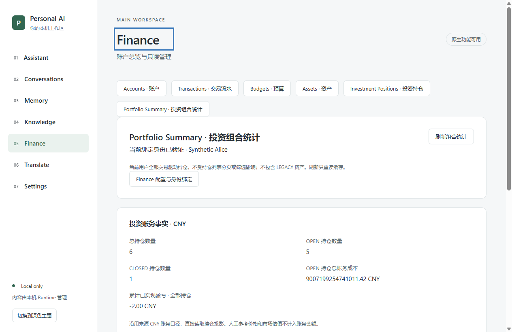
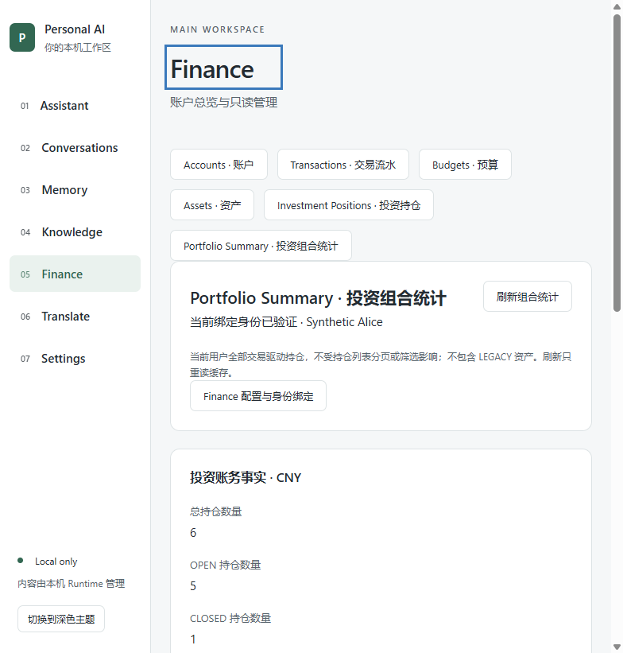
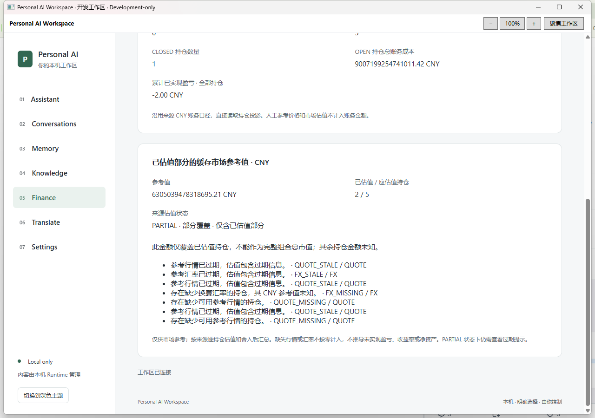
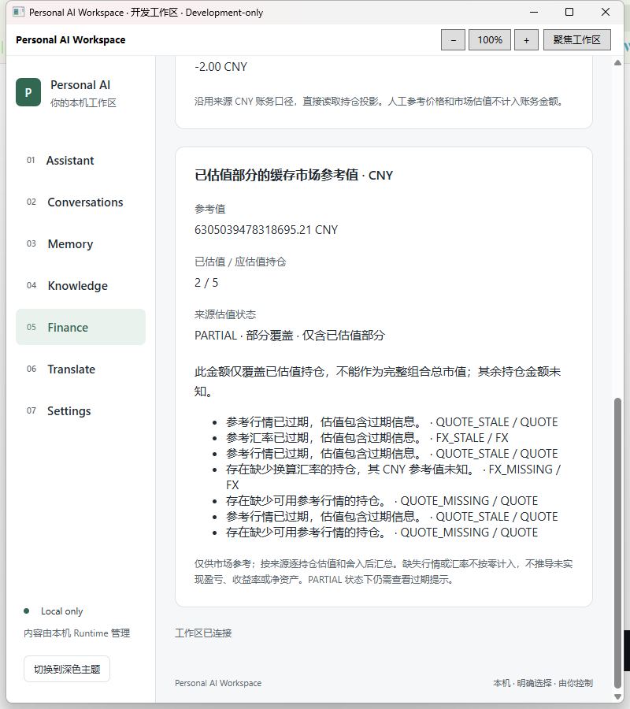

# Finance F-next-7 — Portfolio Summary 投资组合统计

2026-10-24，Asia/Shanghai。**Development-only 技术交付；不是 Finance Freeze、Production GO 或正式 Release。**

## 基线、保护与范围

开始时按指定代理 Fetch 两个仓库成功，确认 Workspace 本地及远端 `codex/finance-f-next-6` 均为 `4a7ae93cfd510eb7dd92546abf1071c4119cc6a9`。从该提交建立 `codex/finance-f-next-7`。冻结来源 `qianlixunbai/Personal-Finance-OS @ c6c87a0627b746e70a45b1c7896f63defd76a810`，来源工作树保持干净。

开始时只有 B4A6 八个已列明的未追踪文件；记录其哈希，保留原状态且不加入提交。既有 Profile、DPAPI、Finance 绑定、migrations 和历史 Development-only 包均按开始时哈希复核。原 Finance/Workspace 数据库不迁移、不补写、不重置。原 F-next-6 合成集群只使用 reader 进行来源查询核对。

新增 Finance 内的 `Portfolio Summary · 投资组合统计` 视图，沿用现有导航按钮、卡片、金额排版和窄屏布局。包含总数、OPEN/CLOSED 数、OPEN 账务总成本、全部持仓累计已实现盈亏、缓存 CNY 参考值、估值覆盖数、来源状态和 warnings，以及加载、手动刷新、错误、重试、空组合和全部平仓说明。未改全局导航或视觉系统，未增加金融写 API、Provider、自动行情刷新、收益率或净资产。

## 来源审查与 provenance

本轮实际阅读原 `InvestmentPortfolioQueryService`、`InvestmentPortfolioResponse`、`InvestmentPortfolioStatisticsRow`、`InvestmentReadMapper`、`InvestmentReadController`、`InvestmentReadSupport`、`ReferenceValuationService`，以及已迁入的持仓列表/详情、Quote/FX 查询、Finance 身份和事务装配。对照原投资只读 PostgreSQL 集成测试的账务/估值分离、跨用户、无写入和 REPEATABLE_READ 断言，核对投资 migrations 与原账本 CNY 边界；没有把这些来源测试的历史结果声称为本轮执行。

本轮只增加两个保持原字节的来源文件，其他依赖复用 F-next-6/F-next-5 已迁入文件。逐文件记录在 [investment-source-provenance.json](../../finance-domain/investment-source-provenance.json)，原资产估值 provenance 继续有效。

| 原文件 | SHA-256 |
| --- | --- |
| InvestmentPortfolioQueryService.java | `428c356a5698ed275d508a7c38b4f3b20f7a15029509f2a4bccd73f24226a7b4` |
| InvestmentPortfolioResponse.java | `ac3acd1ab827585073c20e787df5be9dc4de54be09a045961e04fe925935f87d` |

源路径分别为 `backend/src/main/java/com/financeos/module/investment/read/service/` 和 `dto/`；目标位于 `finance-domain/src/main/java/com/financeos/module/investment/read/` 对应目录。Git 的既有 `-text` 属性保留原换行字节。没有复制原 Controller 的 JWT/写入体系，而是在 Workspace 可信只读入口显式构造原查询服务，没有新增依赖或重写统计、成本、盈亏、估值及舍入算法。

## 金融口径与状态

- Mapper 对当前绑定用户的**全部 TRANSACTION_DRIVEN 持仓**计数；不采用前端持仓页、Cursor、账户或 Instrument 筛选，不包含 LEGACY。
- `openTotalCost` 只汇总 OPEN 投影的 `total_cost`；`cumulativeRealizedProfitLoss` 汇总 OPEN 和 CLOSED 投影的已实现盈亏。账务事实沿用冻结来源明确的 CNY 口径，不把 Instrument 报价币种当作账本币种。
- 参考估值独立读取全部 OPEN 持仓。原服务逐持仓读取缓存 Quote/FX，使用原估值和舍入规则，再汇总已完成的 CNY 参考值。人工参考价格、市值和账户余额不参与统计。
- Java DTO 的金融金额本身就是字符串；HTTP → C# record → Typed Bridge → React 保持精确十进制字符串。Bridge 和前端检查金额格式与两位小数，不用浮点数解析、重新计算或舍入。Number 仅用于来源整数计数和界面参数。

| 来源情况 | 原合同与页面行为 |
| --- | --- |
| 全部 OPEN 可估值 | 完整来源参考值；有效缓存为 FRESH，有过期输入为 STALE。 |
| 部分可估值 | 保留已估值部分金额和 `valued/total`，明确 PARTIAL，不能作为完整组合总市值。 |
| 没有任何可估值持仓 | `value=null`、覆盖为零、UNAVAILABLE；显示未知，不虚构零市值。 |
| PARTIAL 同时含过期输入 | 总体状态仍按来源优先级为 PARTIAL；保留 QUOTE_STALE / FX_STALE 提示。 |
| 空组合 | 账务统计为来源零值；参考值 null、0/0、UNAVAILABLE，明确没有交易驱动持仓。 |
| 全部 CLOSED | OPEN 成本为来源零值；累计已实现盈亏保留，参考值 null、0/0、UNAVAILABLE，明确无应估值 OPEN 持仓。 |

warnings 原样保留 `code/component` 及重复项：INVALID_INPUT 对应无效数量，QUOTE_MISSING 对应缺少行情，FX_MISSING 对应缺少 CNY 换算汇率，QUOTE_STALE / FX_STALE 对应过期输入。没有用状态优先级掩盖 warning，也没有推导未实现盈亏、总收益率或投资回报率。

Alice 的来源全量结果为：6 个持仓、5 OPEN、1 CLOSED，OPEN 成本 `9007199254741011.42 CNY`，累计已实现盈亏 `-2.00 CNY`，已估值部分 `6305039478318695.21 CNY`，覆盖 `2/5`、PARTIAL。同一 Instrument 在不同账户的 OPEN/CLOSED Position 均分别统计；已平仓的 `-3.00` 与开放持仓的 `1.00` 来自原投影。Bob 只有自己的一个 OPEN 持仓，成本 `999.00`、累计已实现盈亏 `0.00`、参考值 `699.30`、覆盖 `1/1`、STALE。

## 可信只读链路

```text
GET /api/v1/finance/investment/portfolio
Native method: finance.portfolio, payload: {}
```

入口没有任何查询参数；userId、status、分页和筛选参数全部拒绝。POST/PUT/PATCH/DELETE/HEAD/OPTIONS 拒绝为 405，未认证为 401，响应 no-store。原持仓列表和详情路径保持不变。

继续使用 Native Bearer → 私有已确认 Finance 绑定 → ACTIVE 用户 → 用户/数据集指纹 → 独立 Finance DataSource → read-only / REPEATABLE_READ / REQUIRES_NEW 快照。`FinanceAccountQueries.query` 拥有实际 Finance 事务，内部直接调用原统计服务，避免默认事务管理器歧义。Mapper 仍使用 Finance 专用 SqlSessionTemplate。

C# 和 React 检查精确字段集、类型、CNY、十进制金额、非负整数计数、总数等于 OPEN+CLOSED、应估值数等于 OPEN、覆盖数不超过应估值数，以及 value/null 与 FRESH/STALE/PARTIAL/UNAVAILABLE 的一致性。Portfolio warnings 不错误套用单个持仓的八项上限；继续服从原 HTTP 60 KiB / Bridge 64 KiB 限制，不截断或隐瞒来源结果。

读取开始、失败、Session/Runtime 变化及身份/数据集失配时清除旧统计，迟到响应受 generation/session 约束。Runtime 恢复后重新查询 Overview 验证身份，再读组合。没有任意 URL/SQL/Shell/文件路径代理、HTTP 绑定接口、自动重绑、DPAPI 修改或 Native Gate 绕过；异常继续使用既有安全错误合同。

## 合成资源与实际验证

先通过原 F-next-6 的只读合成环境核对 Alice/Bob 全量结果。为新边界夹具和身份/恢复操作，另建本轮资源：`D:\PersonalAiWorkspace-Fnext1\4efd6f35206e`，端口 `55428`，独立 Finance/Workspace 数据库，V1–V21/V1–V2。新 Alice/Bob Profile 为 `e3f0eb8a20f6436ca8518c1d40ac2ac8` / `0ff4813573494a4faf7787ae60175ba0`，通过真实 Native 窗口审查、显式选择和确认绑定，未复制旧绑定文件。

附加来源统计夹具只在新集群初始化；其场景用户为 DISABLED，不能出现在 Native 绑定候选中。内部 Java probe 通过 reader 读取这些明确指定的测试用户，不为客户端增加 userId 参数。probe 使用 Finance 原 Mapper/Quote/FX/Portfolio 服务与实际 PostgreSQL，只读 REPEATABLE_READ 快照，并检查读取前后资产投影的 xmin 和内容不变。为可重复验证 FRESH/STALE，probe 的 Clock 固定在合成 CNY 报价 fetched_at；Windows 产品仍使用普通 systemUTC，缓存随时间自然变旧。

以下均为**本轮实际执行**。完整日志留在本机忽略目录 `.verification`，[持久化验证摘录](evidence/finance-f-next-7/verification.txt) 记录原日志 SHA-256 和结果行，未将多个覆盖点算成多次独立执行。

| 实际执行 | 结果和完整日志 |
| --- | --- |
| Maven package、Runtime JAR audit | PASS；`fnext7-maven-build.log`、`fnext7-runtime-audit.log`。 |
| Java Finance 装配、Native 前置拒绝、用户作用域与身份变更聚焦方法 | PASS；`fnext7-java-focused.log`、`fnext7-java-identity.log`。这些原用例使用 JDBC substitutes，不冒称真实 SQL。 |
| 原 F-next-6 集群的来源全量组合查询 | PASS；`fnext7-existing-fnext6-readonly-final.log`，仅 reader，未改原数据。 |
| 新 PostgreSQL 来源统计综合流 | PASS；`fnext7-source-postgresql-fixed-clock.log`。空/全 CLOSED/全 OPEN/混合、大额金额、正负已实现盈亏、同 Instrument 多账户、逐持仓舍入、完整/部分/无估值、缺 Quote/FX、过期 warnings 与只读投影保护。 |
| React FinancePage 聚焦综合流 | PASS；`fnext7-frontend-focused-final.log`。原 Finance 回归和新 Portfolio 精度、PARTIAL、未知、空/全平仓、错误重试、身份变化清除、迟到响应丢弃及非法响应拒绝。 |
| Native payload 与 Portfolio 响应聚焦测试 | PASS；`fnext7-native-focused.log`。拒绝客户端 userId/代理字段、数值型金额、错误币种/计数/覆盖状态和未知字段。 |
| 前端 typecheck / production build、Profile Debug build / publish | PASS；`fnext7-frontend-build.log`、`fnext7-desktop-build-final2.log`、`fnext7-package.log`。 |
| Alice 真实 WPF/WebView2/React/Bridge/Runtime/PostgreSQL 综合流 | PASS，exit 0；`fnext7-windows-e2e-final2.log`。包括原持仓综合流和新 Portfolio；日志中 FNEXT6 前缀来自复用的既有方法，实际是本轮重跑。 |
| Bob 第二个真实 Native 绑定用户 | PASS，exit 0；`fnext7-bob-windows-e2e.log`。Alice/Bob 组合不同；双向 Position/Account/Instrument 隔离仍成立。 |
| 组合身份、数据集和 Runtime 恢复 | PASS；Alice 同流实际改变本轮用户指纹、替换本轮数据库 OID，验证 403/UI 清除，finally 恢复；Runtime 原进程退出、新进程恢复读取，绑定哈希不变。 |
| 1280px / 800px 和核心 Finance 回归 | PASS；真实 WebView 检查 document 无横向溢出，截图已查看。Overview、Accounts、Transactions、Assets、Positions、Budgets 的既有语义通过。 |
| 独立包实际 CMD / EXE / JAR、正常停库与恢复 | PASS，exit 0；`fnext7-product-final.log`。CheckOnly、Native Gate、独立 JAR 路径、组合及资产/持仓/交易读取；运行中正常停本轮 PostgreSQL 后清除组合快照；托盘正常退出，再由实际 CMD 安全恢复 PostgreSQL，重新读取并再次正常退出。最终无 18765 listener。 |
| 文件保护、来源、历史包与最终包哈希 | PASS；`fnext7-protection-audit.log`、`fnext7-source-provenance-audit.log`、`fnext7-delivery-hashes.json`。 |

可复现入口：

```powershell
pwsh -NoProfile -File scripts/verification/prepare-finance-next-test.ps1 -Port <NEW_UNUSED_PORT> -Portfolio
pwsh -NoProfile -File scripts/verification/verify-finance-portfolio-test.ps1 -FixtureReceipt .verification/fnext7-target.json
# 原 F-next-6 核对：使用新 tooling 编译 probe，旧集群仅供 reader 查询
pwsh -NoProfile -File scripts/verification/verify-finance-portfolio-test.ps1 -FixtureReceipt .verification/fnext6-target.json -ExistingPositionsOnly -ToolingReceipt .verification/fnext7-target.json
```

真实桌面入口为既有测试项目 apphost 的 `<AliceProfile> gui-finance-next7` / `<BobProfile> gui-finance-next7-bob`。构建使用 `Mmf3ProfileAcceptanceBuild=true`、`Mmf3AcceptanceBuild=false`、`RuntimeLifecycleProbe=true`、`FrontendSkipBuild=true` 及当前受审 runtime manifest。启动脚本经当前用户 Explorer 执行；未为测试清除环境保护、放宽 ACL 或修改 Native Gate。

开发中的失败不计 PASS：新夹具第一次触发 Instrument 唯一约束；修正为跨账户复用 Instrument。随后 probe 定位到场景资产遗漏镜像 symbol/market，已补全最终初始化代码，仅对本轮新集群的场景行完成对应元数据初始化。失败集群 `cf4b47a93467` / `55427` 保留文件并正常停止，没有删除资源。原回归脚本依赖资产恰好位于创建时间第一页；改为等待排序控件可用并选择 ID_ASC。首次独立包 UIA 将 React 相邻金额/单位文本误当单节点；修正实际节点定位及覆盖数结构断言后通过。保留 `fnext7-prepare.log`、`fnext7-source-postgresql-diagnostic.log`、`fnext7-windows-e2e.log` / `-final.log`、`fnext7-product.log` 等失败记录；没有弱化产品校验、删除关键断言或修改正确生产行为。

## 截图

已实际查看以下真实截图；上部由 E2E WebView 捕获，下部来自最终独立 WPF 包。全部为明确标注的 Synthetic Alice 数据。

| 1280px | 800px |
| --- | --- |
|  |  |
|  |  |

## 独立客户端与文件身份

```text
D:\IDEA\Daima\personal-ai-workspace\artifacts\PersonalAiWorkspace-finance-fnext7-development-20261024\Open-Synthetic-Finance.cmd
```

不覆盖 F-next-6 或其他历史包。当前 Windows 用户、固定隔离 Profile/路径、既有 JDK 21、.NET 10、WebView2、PowerShell 7.4+ 是前提。启动器继续验证文件/目录身份、ACL、依赖哈希、system identifier、数据库 OID/marker、进程/端口归属及 DPAPI/绑定；仅对安全确认已停止的本轮 PostgreSQL 正常 start，不 initdb、删 PID、重建库、改密码、自动重绑或回退 SQLite。托盘退出释放客户端 Runtime，PostgreSQL 保持运行。

BUILD-INFO format=`FINANCE_F_NEXT_7_DEVELOPMENT`；如实记录构建时 `sourceCommit=4a7ae93cfd510eb7dd92546abf1071c4119cc6a9`、`sourceDirty=true`，不将其冒称最终实现提交。最终 payload 用实际哈希标识；验证后仅修改测试/报告及 Git 记录，没有重新构建包。

| 文件 | SHA-256 |
| --- | --- |
| Open-Synthetic-Finance.cmd | `02cdf5908c6835202ffd58bf2961cf67f8072f047fb719b219c47a80d6fad752` |
| Open-Synthetic-Finance.ps1 | `ad20c002d270346d7b8cc49615a02d3ea9e4903d3bdbb2436b86d783b1b59fe3` |
| PersonalAiWorkspace.Desktop.exe | `78aac5abbd6a3f264e2c321303a2077e568c2daee38a56803e91c6cccf4dce54` |
| PersonalAiWorkspace.Desktop.dll | `8e7e115d3a897f7ad25a3525a64d3bffd78e0a5291b8343692d29d4689e9044c` |
| PersonalAiWorkspace.Core.dll | `a4db2d5e10622c3c4862e8adb061e94b9f58ed7d682dacd4d40b4de58d3eaa0e` |
| runtime/personal-ai-workspace.jar | `7281da420d4f8aa55df981517f35bce9d2bbecbcde50628dc24a166fe6fc2842` |
| MainWorkspace/workspace-assets.json | `d65111ce27d63215bfbff026c4b910911409c5f862f9ee61db4eece5e99cbe68` |
| BUILD-INFO.json | `a609b17ce28d22ad39abb7306afd3d6d7f565ca1ebc15ef50003529600369432` |

完整 payload 清单在包内 BUILD-INFO；本轮开始/结束时旧包文件哈希一致。F-next-2 recovery 的历史启动脚本哈希问题单独保留，未修复、重建或覆盖该包。

## 未运行与遗留边界

- 未运行 Java/Desktop/Frontend 全套、浏览器/IME/压力/完整历史安全矩阵、真实 Provider/付费 API 或真实 Windows 重启。没有继承旧日志冒称本轮 PASS。
- 未重跑投资写入、修正/重放算法；夹具是独立初始化的事实/投影与统计场景，不等同于交易命令验收。金融 schema/migrations 和写服务未改。
- 来源统计遍历所有 OPEN 持仓，规模受来源实现和现有响应上限约束；大量 warnings 超过传输上限会安全拒绝，不截断后展示不完整数据。
- 缓存值会自然过期，PARTIAL 金额永远只是已估值部分；人工参考价不参与组合统计。若未来来源支持非 CNY 账务，必须先修改领域合同，不能在页面猜测汇率或跨币种成本合计。
- 独立客户端为同机 Development-only，未签名、未发布安装包；真实 Windows 重启验收仍待人工执行。没有 Finance Freeze、main 合并、tag 或 Release。

## Git 交付与最少人工验收

正常 Commit / Push 到 `origin/codex/finance-f-next-7`，不改写历史、不 force push。报告随实现提交，无法在正文自包含自身提交 SHA；提交后本地 HEAD、origin tracking HEAD、远端 ls-remote HEAD 与 GitHub API commit SHA 的核对记录保存在 `.verification/fnext7-git-delivery.json`，最终提交链接和一致性结论见交付回复。提交后工作树只保留原八个 B4A6 未追踪文件。

人工验收：双击上述 CMD → Finance → Portfolio Summary，核对 6 / 5 / 1、成本 `9007199254741011.42 CNY`、已实现 `-2.00 CNY`、参考部分值 `6305039478318695.21 CNY`、覆盖 `2/5` 与 PARTIAL/过期/缺失提示；点击刷新；托盘正常退出并重开。真实 Windows 重启后的同机恢复可作为额外人工验收，不应以本轮 Runtime/数据库重启代替。
