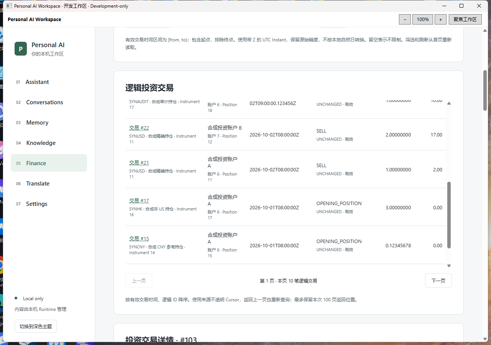
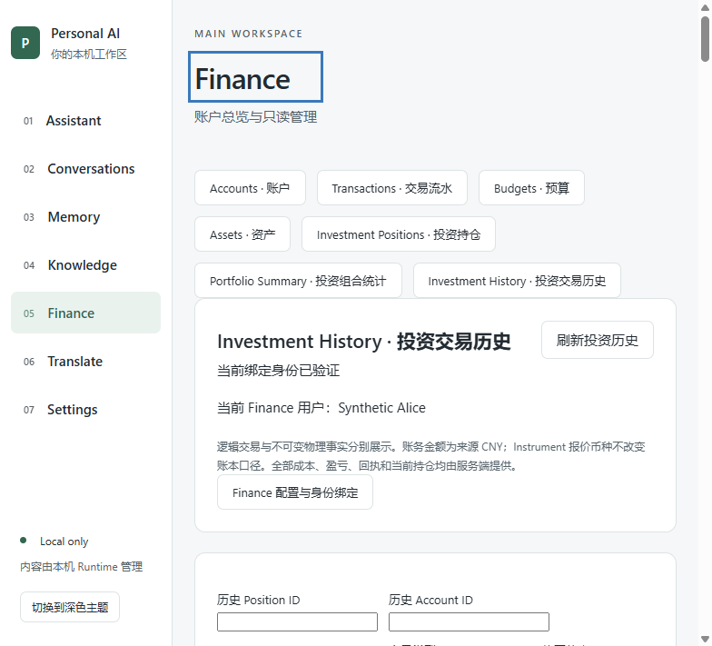

# Finance F-next-8 — Investment History & Immutable Audit Timeline

2026-10-24，Asia/Shanghai。**已交付实际可运行的 Development-only Windows 客户端；不是正式 Release、Finance Freeze 或 Production GO。**

## 工程基线与保护

开始时 Workspace 本地及远端 `codex/finance-f-next-7` 为 `0495ce13898e8651696dbb916e9436a7af6b7327`，从该提交建立 `codex/finance-f-next-8`。冻结 Finance 仓库为 `c6c87a0627b746e70a45b1c7896f63defd76a810`，工作树干净。两个仓库均先按指定代理执行 Fetch 成功。

开始时只有原 B4A6 八个未追踪文件。对这些文件、既有 Profile 的 DPAPI/绑定、原 migrations、全部旧开发包文件保存并复核 SHA-256，均保持一致；八个 B4A6 文件不纳入提交。没有修改冻结来源、既有数据库、绑定或历史包，也未增加投资写入接口。

## 实现及金融语义

Finance 新增 **Investment History · 投资交易历史**，保留原有界面；持仓详情可以直接进入该 Position 的历史筛选。列表支持 Position、Account、Instrument、交易类型、修正状态、UTC 时间范围、手动刷新、错误重试、空状态和来源不透明 Cursor 的前后导航。

- 来源按 `effective_trade_time DESC, logical_transaction_id DESC` seek 分页；没有转换为 offset。Cursor 的版本、类型、筛选指纹及 seek 键仍由原 `CursorCodec` 处理，Workspace 额外拒绝重复字段、非整数 ID/版本及尾随 JSON。每页限制 1–20，以保持现有传输预算。
- 时间范围是 Instant **`[from,to)`**：包含起点、排除终点。界面要求显式 UTC `Z` 时间，保留来源小数秒，不转换为本地自然日；有效时间沿用原始事实的 trade time，修正创建时间单独展示。
- 点击逻辑交易后重新查询详情和时间线，展示原始/有效业务事实、结算时间、精确数量/单价/费用/净额/释放成本/已实现盈亏、修正原因和关联物理 ID、原始 Posting Receipt、Correction Final Receipt、当前持仓摘要。
- 所有金额与数量是来源十进制字符串，ID 也在传输适配层转为字符串；没有 JavaScript 金融计算。投资账务沿用冻结来源 CNY 口径，Instrument 报价币种另行标注。null、未知和不适用分别说明；DIVIDEND 的数量/单价为 null，不能显示为零。

| 修正状态 | 保留的语义 |
| --- | --- |
| UNCHANGED | 原始事实仍有效。来源 `effectiveBusinessValues=null` 表示未发生替换；OPENING_POSITION 可以没有原始 Receipt。 |
| REVERSED | 原逻辑交易不再有效，原始事实和独立冲正事实仍保留。原 Receipt 与冲正完成的最终 Receipt 分别展示。 |
| REPLACED | 原逻辑 ID 保留，当前以替换事实生效；原事实、分组冲正、替换事实和替换命令均保留。不是删除原交易。 |

Audit Timeline 保持原事件结构：`ORIGINAL_POSTING`；独立修正为 `STANDALONE_REVERSAL`；替换修正为一个 `REPLACEMENT_COMMAND`，内部关联 `GROUPED_REVERSAL` 和 `REPLACEMENT_FACT`。命令没有物理事实 ID，分组冲正的 Receipt 为 `NOT_APPLICABLE`，替换命令的最终 Receipt 不冒充两次独立过账回执。当前持仓与历史快照单独展示。前端不展开重建账本，也不执行 Replay。

## 来源与受信调用链

审查并复用原列表/详情服务、三个交易 DTO、`InvestmentReadMapper`、`InvestmentReadSupport`、`CursorCodec`、`LogicalTransactionListQuery`、两个事实/修正 Mapper，以及来源读查询 PostgreSQL 测试和 V12/V13 修正约束。

本轮原字节迁入 11 个来源文件：两项查询服务、三项 DTO、查询模型、两个实体、两个 Mapper、UUID TypeHandler。逐文件来源路径及 SHA-256 记录在 [investment-source-provenance.json](../../finance-domain/investment-source-provenance.json)。已存在的 Mapper/Support/Cursor 和全部原 migrations 保持原样。Git `-text` 保留迁入来源文件的字节身份；provenance 使用 LF，与提交和包内副本一致。

```text
GET /api/v1/finance/investment/transactions
GET /api/v1/finance/investment/transactions/{id}
GET /api/v1/finance/investment/transactions/{id}/audit-timeline

Native methods: finance.history / finance.historyDetail / finance.historyTimeline
```

没有复制原 JWT Controller。继续使用 Native 身份 → Finance 私有绑定 → ACTIVE 用户与用户/数据集指纹 → 独立 Finance DataSource → read-only / REPEATABLE_READ / REQUIRES_NEW。直接构造原服务，由 `FinanceAccountQueries.query` 拥有 Finance 专用事务和身份核验；Mapper 使用 Finance 专用 SqlSessionTemplate。原 Mapper 中的写方法随冻结文件保留，但没有装配写服务或入口，客户端使用的 reader 也没有写权限。

所有查询只使用服务端绑定身份；客户端 userId、额外/重复参数均拒绝。逻辑详情不能直接访问冲正或替换物理事实 ID；他人 ID 和不存在 ID 统一安全拒绝。仅 GET，拒绝 HEAD/OPTIONS 与其他写方法；未认证拒绝，响应 no-store。没有 SQL、路径、Shell 或任意 URL 代理。

C# 和 React 均检查完整字段集及嵌套类型、十进制字符串、修正有效性、事件分组、物理 ID 和 Receipt 适用关系。读取开始/失败、Session/Runtime 变化时清除旧列表、详情和审计；丢弃迟到响应。Runtime 就绪后先重新验证 Overview 身份。详情与时间线观察到不同修正状态时拒绝组合显示。

## 本轮实际验证

新建隔离资源 `D:\PersonalAiWorkspace-Fnext1\c05814991303`，端口 `55430`，Finance V1–V21、Workspace V1–V2。Alice Profile 为 `b39802170ec245a0a587e1639b21cd0b`，Bob 为 `9dbe0f1ea20845c5aafda81450a1a16b`；通过真实原生窗口审查、显式选择与确认绑定，未复制旧绑定文件。

只在 NEW 初始化路径增加合成修正样本。交易 #101 为未修正，#102 为独立冲正，#103 为替换；#105/#106 是该替换命令关联的物理事实，不能作为逻辑交易读取。#107 为 SELL，#108 为 DIVIDEND。#103 原过账余额 `-40.00`，修正最终余额 `-44.00`，当前持仓数量/成本 `3.00000000 / 33.00`，用于验证快照区别。夹具是显式初始化的合成事实与投影，不声称完成交易命令或 Replay 验收。

下表均为本轮真实执行；完整日志在忽略目录 `.verification`，结果摘录与完整日志 SHA-256 在 [verification.txt](evidence/finance-f-next-8/verification.txt)。覆盖点没有计作独立执行次数。

| 实际执行 | 结果与证据 |
| --- | --- |
| Maven package、Runtime JAR audit | PASS；`fnext8-maven-build.log`。 |
| Java Finance 专用装配、Native 前置拒绝、用户作用域/身份变化聚焦方法 | PASS；`fnext8-java-focused-final.log`。既有 substitute 用例，不冒称真实数据库测试。 |
| React FinancePage 聚焦综合流 | PASS；`fnext8-frontend-focused-final.log`。投资精度、空 Receipt、未替换事实解释、Session 清除、迟到审计丢弃、嵌套数值型金额拒绝与原页面回归。 |
| Native 审计响应及 Bridge payload 聚焦检查 | PASS；`fnext8-native-focused.log`。完整嵌套合同、纳秒时间、大额精度、错误物理事实/事件、数值金额、额外 userId 和代理字段拒绝。 |
| 前端 typecheck/production build、Native build/publish | PASS；`fnext8-frontend-build-final.log`、`fnext8-desktop-build-final.log`、`fnext8-package.log`。 |
| 真实 PostgreSQL 经 Runtime/Native 的来源查询断言 | 已完成并 PASS；`fnext8-windows-e2e-current.log` 的 SOURCE 与 ISOLATION 结果行。实际读取全部 Cursor 页、同时间 ID 排序、各筛选、微秒起点包含/终点排除、精确大额、三个修正状态、两类 Receipt、完整分组时间线、物理 ID/跨用户/无认证/写方法/模糊 Cursor 拒绝。该调用之后在 UI 导航处超时，**整次调用不是 PASS**。 |
| 修复导航后的真实 WPF/WebView2 UI 综合流 | PASS，exit 0；`fnext8-windows-e2e-ui.log`。仅继续 UI 部分，没有重跑已通过的来源/HTTP 检查；包括持仓到历史筛选、详情/分组时间线、刷新、分页、错误恢复、1280/800px 无文档横向溢出、Portfolio 和核心 Finance 查询、Runtime 进程重启、身份指纹变化后清除及恢复。 |
| Bob 第二个真实 Native 绑定用户 | PASS，exit 0；`fnext8-bob-windows-e2e.log`。只读自己的历史/冲正与组合；Alice 逻辑详情和审计及物理事实 ID 拒绝。 |
| 最终独立包实际 CMD/EXE/JAR 综合流 | PASS，exit 0；`fnext8-product-final.log`。Native Gate、当前独立 JAR、React/Bridge 历史详情/Receipt/分组审计/Cursor、Portfolio/Accounts/Transactions/Assets/Budgets；正常停本轮 PostgreSQL 后清除历史和审计；托盘退出释放 Runtime；实际 CMD 安全恢复该停库集群，重读并再次正常退出。 |
| 不可变事实与文件保护 | PASS；reader 的 REPEATABLE_READ / READ ONLY 快照在验收前后对全部投资事实、修正、资产和账户计数及内容摘要一致；`fnext8-ledger-before.txt` / `-after.txt`。旧文件/包、来源、最终 payload 哈希及退出后无 Runtime listener 均复核。 |

开发中的失败没有计为 PASS：首次夹具误将 DIVIDEND 写为已实现盈亏，来源约束拒绝后只修正 NEW 初始化代码，在另一新集群重新准备；失败集群 `3cf3e41d017b / 55429` 正常停库并保留。第一次桌面调度脚本沿用旧 F-next-7 mode，新增的临时 Profile `5da1f28bfbe149808ccc0c07dc269e3a` 因此绑定旧只读合成集群；未改旧库或旧绑定，临时 Profile 保留，最终另建上述正确 Alice Profile。随后 UI 导航发现初始 Runtime 通知清空 Position 筛选，已修复并通过续跑。保留失败日志；没有修改正确金融逻辑或弱化关键断言。

新增长期测试仅聚焦审计精度/物理事实合同和旧响应清除；扩展既有 payload 拒绝用例与综合桌面工具。没有新测试框架或大型矩阵。

可复现 NEW 环境入口：

```powershell
pwsh -NoProfile -File scripts/verification/prepare-finance-next-test.ps1 -Port <NEW_UNUSED_PORT> -History
# 既有测试 apphost：--prepare-profile；新 Alice 用 gui-finance-next8，新 Bob 用 gui-finance-next8-bob。
# gui-finance-next8-ui 只供已正确绑定的本轮 Profile 继续 UI/恢复部分。
```

构建使用 `Mmf3ProfileAcceptanceBuild=true`、`Mmf3AcceptanceBuild=false`、`RuntimeLifecycleProbe=true`、`FrontendSkipBuild=true` 和当前受审 Runtime manifest；桌面调度经当前用户 Explorer，不清除环境保护或放宽 Native Gate/ACL。

## 独立开发客户端

```text
D:\IDEA\Daima\personal-ai-workspace\artifacts\PersonalAiWorkspace-finance-fnext8-development-20261024\Open-Synthetic-Finance.cmd
```

实际查看的界面截图，仅 Synthetic 数据；完整功能由上述运行证据确认：

| 1280px 独立 WPF 包 | 800px WebView |
| --- | --- |
|  |  |

当前 Windows 用户、固定包/Profile 路径、已有 JDK 21、.NET 10、WebView2 与 PowerShell 7.4+ 是运行前提。启动器保留原文件/目录身份、ACL、哈希、PostgreSQL system identifier、数据库 OID/marker、进程和端口归属、DPAPI/绑定核验；只安全恢复已停的本轮集群，不 initdb、删 PID、重建、改密码、自动重绑或回退 SQLite。托盘退出后 PostgreSQL 保持运行。

BUILD-INFO 为 `FINANCE_F_NEXT_8_DEVELOPMENT`，如实记录构建时 `sourceCommit=0495ce13898e8651696dbb916e9436a7af6b7327`、`sourceDirty=true`，不冒称最终提交 SHA。其 baseline 是既有 recovery 包模板来源，工程分支基线仍为本报告开头的 F-next-7。实际验证的文件由下列哈希及包内完整清单标识；验证后补充报告和证据，并将 provenance 换行规范为 LF、同步更新 BUILD-INFO 清单后复核；EXE/JAR/React/Bridge 字节未变。

| 文件 | SHA-256 |
| --- | --- |
| PersonalAiWorkspace.Desktop.exe | `5fbe1c18ed47105b2fa2364c6487687ca554a697cadeb9feb5ae9c5c11883456` |
| PersonalAiWorkspace.Desktop.dll | `3316d95c8e44a641e0631a4a18f871fa982cc66bbbfb83558f3a66615afc3f9e` |
| PersonalAiWorkspace.Core.dll | `b6f108dad03325488ec73343c835f4e2c9a0818282ff8756415ba97b95332335` |
| runtime/personal-ai-workspace.jar | `5c83340b32214fabc527d5e0428146a2c7232be9bb0fb40b176e36d9fc2bc5f9` |
| MainWorkspace/workspace-assets.json | `5d8283273a1caac47b785533f490f60b7a12917f7ae0f440637265b4b17fe27f` |
| investment-source-provenance.json | `c234fcd5256438565c3a9ab1456f396f61c1b8913e248d62f71afd04975d7f16` |
| BUILD-INFO.json | `4a15ada38681143803b74049be2af1904f52f04eedb7b8df31d1b00b2035c798` |

## 未验证、Git 与人工验收

未运行 Java/Desktop/Frontend 全套、压力/IME/完整历史安全矩阵、真实 Provider/API、投资写入或 Replay、真实 Windows 整机重启；未做生产签名、安装包、Release 或 Finance Freeze。审计数据规模仍受来源模型及既有 HTTP 60 KiB / Bridge 64 KiB 预算约束，超限安全拒绝而不截断。金融写入和来源持久化格式未变。历史查询还需要 reader 对 `investment_transaction_corrections` 的 SELECT 权限；本轮只给 NEW 合成角色配置该权限，未调整旧数据库角色。旧角色若缺权限会安全返回 UNAVAILABLE。

正常 Commit / Push 到 `origin/codex/finance-f-next-8`，不 force push、改写历史、合并 main 或打 tag。报告随实现提交，最终 SHA 与本地 HEAD、origin tracking HEAD、远端 ls-remote HEAD 核对保存在本机 `.verification/fnext8-git-delivery.json`；提交链接见最终交付回复。开发包在本机忽略目录，不把 EXE/数据库/凭据上传 GitHub。交接工作树只保留原 B4A6 八个未追踪文件。

最少人工验收：双击 CMD → Finance → Investment History → 打开 #103，核对原数量 1、替换数量 3、原始/最终 Receipt `-40.00 / -44.00` 和命令下 #105/#106；查看 #102 的独立冲正、#108 的 null 数量；在持仓 #18 进入历史，分页/筛选/刷新；查看 Portfolio 的成本 `9007199254741044.42 CNY` 与覆盖 `2/6`；托盘正常退出并重开。真实 Windows 重启后的恢复仍待人工验收。

下一阶段建议：评估冻结来源交易导入批次与确认回执的只读追溯，继续复用现有身份和隔离事务。核心只读集成结束后，再统一优化 Dashboard 视觉。
