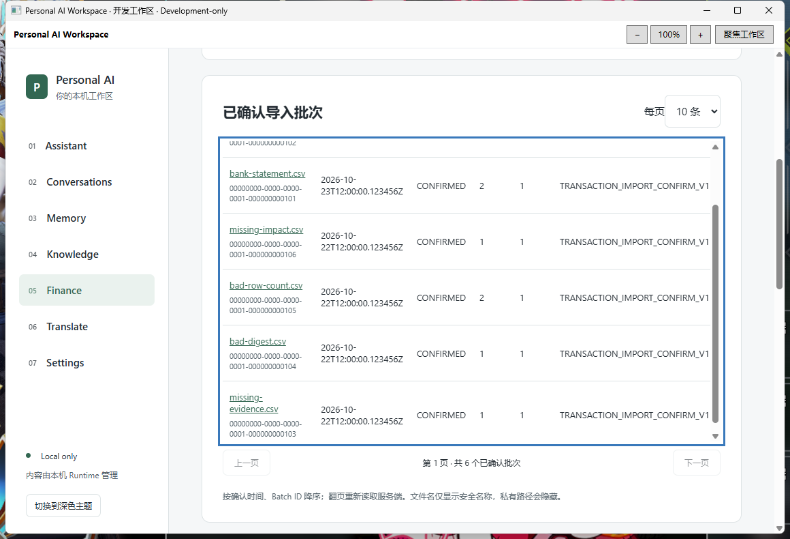

# Finance F-next-9 — Import History & Confirmation Receipts

2026-10-24，Asia/Shanghai。**已交付真实运行的 Development-only Windows 客户端。不是正式 Release、Finance Freeze 或 Production GO。**

## 基线与保护

Workspace 从 `codex/finance-f-next-8 / 01aa1f59b33b884b7acf002c66b43b31bfc7d0d9` 建立 `codex/finance-f-next-9`。冻结 Finance 来源为 `c6c87a0627b746e70a45b1c7896f63defd76a810`，工作树干净。开始时两个仓库均按指定代理 Fetch 成功。

入口工作树只有 B4A6 原八个未追踪文件；它们不纳入提交。开发前保存旧包、既有 Profile 的 DPAPI/Finance 绑定、Finance migrations 和 Workspace migrations 的哈希，并在交付前复核一致。没有修改历史数据库、旧绑定、冻结来源或旧客户端，包括 F-next-8 和原 F-next-2 recovery 包；没有修复或改写旧包历史哈希记录。

## 功能与来源边界

Finance 新增 **Import History · 导入历史**，沿用现有页面、表格、错误重试与原生身份配置入口。

- 当前绑定用户的 CONFIRMED Batch 列表，展示 Batch ID、安全文件名、确认时间、状态、总行数、Warning Count 和原 Contract Version。
- 新增 Workspace 服务端有界 offset 分页：`page=0..100000`、`size=1..20`，按 `confirmed_at DESC, id DESC`，使用来源既有索引。总数在同一读取事务中查询。没有声称迁移来源不存在的历史列表接口；没有加入来源无法可靠支持的筛选。
- 点击 Batch 后重新读取服务端回执，展示 Session/Batch 身份、File Digest、确认时间、合同版本、行数统计、警告数、Result Digest、历史行映射和账户影响。空历史显示正常空列表；Preview、Session 和确认回执含义分别说明。

```text
GET /api/v1/finance/imports/transactions/batches?page=0&size=10
GET /api/v1/finance/imports/transactions/batches/{uuid}?transactionPage=0&accountImpactPage=0
Native methods: finance.imports / finance.importReceipt
```

原来源的单 Batch GET 使用 `TransactionImportConfirmService.getReceipt`，没有独立分页历史列表。审查其 `getReceipt`、完整 `reconstruct`、`receipt`、Result Digest、确认时账户影响生成逻辑及 V14/V16/V17/V20 约束后，Workspace 只适配读取部分：固定 JDBC SELECT 进入原 `FinanceAccountQueries.query`，不装配 ConfirmService，不复制原 Controller，不引入确认事务、重放、上传、预览、交易创建、余额修改或文件清理入口。

原字节迁入的唯一来源文件是 `TransactionImportReceipt.java`，保留其不可变列表及两个嵌套 record。源路径、冻结 SHA、文件 SHA-256 与适配来源服务的 SHA-256 见 [import-source-provenance.json](../../finance-domain/import-source-provenance.json)。不是把整个确认服务迁入 Finance-domain。

## 回执与金额语义

服务端先完整读取并校验回执，确认后才返回任何详情。沿用来源：

1. Batch 必须属于当前绑定用户且为 CONFIRMED；行数必须与持久化行映射一致。
2. Source Row 按行号升序，Account Impact 按 Account ID 升序；金额使用原 BigDecimal 值和 scale。
3. 账户影响必须存在，历史 `balanceAfter = balanceBefore + delta`。
4. Result Digest 保留来源精确编码：SHA-256 UTF-8 `sessionId|batchId|Instant|TransactionReference list|AccountImpact list`。使用原 DTO record 的字符串表示，不改用 JSON 或前端求和；保留 PostgreSQL 微秒时间与数值 scale。

额外拒绝未知 Contract Version、超过来源 10,000 行限制的证据、重复/无效行映射、无效账户/交易标识以及账户 Row Count 总数不一致。读取最多 10,001 条以发现超界，不把超界数据截断后标记为有效。缺失或不一致返回安全的 `FINANCE_IMPORT_RECEIPT_INVALID`，不重算、补写或以当前值代替历史值。

V20 有意解除历史 Receipt 与当前交易生命周期的依赖：交易后来删除仍保留原 Created Transaction ID。因此不关联当前 transactions 或当前账户余额来“修复”回执。每个账户金额沿用该历史 Account 的账务单位，不折算或跨币种相加。UI 和 Native 只传递十进制字符串及字符串 ID；React 不计算金额。

为保持 HTTP 60 KiB / Bridge 64 KiB 预算，每次返回最多 20 个行映射和 20 个账户影响，两个表独立翻页。每次分段请求都先在同一只读事务内完整校验。响应带总条数、页码、固定 segmentSize 和 `completeReceipt`；只有全部证据能在本段展示时才为 true。大回执显式说明“完整校验、分段视图”，保留完整 Result Digest，绝不冒称当前页是完整回执。

## 身份与安全

继续复用 Native Gate → 已确认 Finance 绑定 → ACTIVE 用户及用户/数据集指纹 → 独立 Finance DataSource → REQUIRES_NEW / read-only / REPEATABLE_READ。Finance 与 Workspace 数据源、事务管理器和 Flyway 历史未改变。

服务端身份决定 userId，不接受客户端 userId。UUID、页码、重复/未知 HTTP 参数及 Bridge 字段严格校验；固定两种 Native 方法，没有任意 SQL、URL、路径或 Shell 入口。他人 Batch 与不存在 Batch 均返回相同安全 404。仅 GET；写方法、HEAD/OPTIONS 和未认证请求拒绝，响应 no-store。

Native 与 React 校验字段集、嵌套类型、身份、精确金额字符串和分段完整性。每次读取开始/失败及 Session、Runtime、enabled 变化时清除旧列表/详情，generation 拒绝迟到响应；Runtime 恢复后先重新验证 Overview 身份。文件名仅显示安全 basename，控制字符、路径和明显凭据形式隐藏；不向 React 返回存储引用、连接凭据、SQL 或原始异常。

## 本轮实际验证

仅新建测试资源 `D:\PersonalAiWorkspace-Fnext1\18e0b75a3043`，端口 `55431`，Finance V1–V21 / Workspace V1–V2。Alice 新 Profile `58abf8afa2584ef0a67bc842c3362430`，Bob 新 Profile `64a46d57cd914852bba1681eb04596cc`；均经真实原生审查、显式用户选择与 MessageBox 确认创建绑定。

夹具仅进入 NEW 初始化分支：Alice 有两个有效批次、四个缺失/损坏批次和两个未确认 Preview Session，Bob 有独立批次。大回执包含 25 行与 25 个账户影响，用于同时跨越两个分段边界。小回执包含 CNY/USD 不同账户及历史大额 `9007199254740993.30`；当前账户余额仍为 `9007199254740993.10`。一个已导入交易在夹具初始化时删除，验证 V20 历史引用保留。

**这是受控数据库 fixture 和真实只读查询验收，不是上传/Preview/Confirm 完整事务 E2E。** fixture 使用来源原始 Receipt record 和摘要公式建立证据，并由实际服务端重建校验；没有调用原确认事务。

下表均为本轮实际执行，结果摘录和完整日志 SHA-256 见 [verification.txt](evidence/finance-f-next-9/verification.txt)。覆盖点不是独立测试次数。

| 实际执行 | 结果与边界 |
| --- | --- |
| Maven package / Runtime JAR audit | PASS。 |
| 既有 Java 专用装配、Native/绑定前置拒绝聚焦方法 | PASS；是替身/配置检查，不冒称 PostgreSQL 测试。 |
| React 聚焦综合流 | PASS；空历史、精确金额/ID、Session 清除、迟到响应丢弃、数值型金额拒绝。 |
| 既有 Native Bridge payload 聚焦用例 | PASS；扩展 userId、错误类型、越界页码及任意路径拒绝。 |
| 前端 typecheck / production build、Native build / publish | PASS。 |
| Alice 真实 WPF/WebView2 + Runtime + PostgreSQL 综合流 | PASS，exit 0；分页/同时间 UUID 稳定排序、预览排除、行映射、精确历史金额、全回执摘要、两个分段尾页、四种损坏证据拒绝、V20 删除后回执、用户隔离、HTTP 严格参数/认证/方法/no-store、刷新/错误恢复、1280/800px 无文档横向溢出、Runtime 重启与身份变化清除。 |
| Bob 独立原生绑定综合流 | PASS，exit 0；只显示自己的 Batch/Receipt，Alice Batch 与不存在 Batch 一致拒绝。 |
| 最终独立包 CMD / EXE / JAR / React / Bridge | PASS，exit 0；实际回执/分段、核心 Finance 页面入口和查询、正常停本轮 PostgreSQL 后旧回执清除、托盘退出释放 Runtime、实际 CMD 安全恢复停库集群并重读、再次正常退出。 |
| 数据与文件保护 | PASS；reader 的 READ ONLY / REPEATABLE READ 在验收前后对账户、资产、投资事实/修正、交易、导入批次/行/影响的计数和内容摘要一致；旧包/Profile/DPAPI/绑定/migrations/B4A6/来源哈希一致；包内 payload、React 清单和 Runtime manifest 哈希一致。 |

开发中的失败没有计为 PASS：新测试调用 RestartAsync 漏传参数，修正后编译通过；一次 Native 聚焦构建与运行中的 GUI 使用同一输出目录发生 DLL 占用，改为顺序执行后通过；COM 调度的新 Profile 准备在 PRIVATE_PROFILE 阶段报 IOException，保留空的部分 Profile，改用既有 Explorer 调度后通过，没有改安全规则。产品验收脚本两次因 UI Automation 文本定位失败（金额含 CNY、分页文本拆成多个节点），只修正工具定位后最终完整通过。失败日志保留在忽略目录 `.verification`。

可复现准备入口：

```powershell
pwsh -NoProfile -File scripts/verification/prepare-finance-next-test.ps1 -Port <NEW_UNUSED_PORT> -Imports
# 当前测试 apphost --prepare-profile；新 Alice: gui-finance-next9；新 Bob: gui-finance-next9-bob。
```

构建沿用 `Mmf3ProfileAcceptanceBuild=true`、`Mmf3AcceptanceBuild=false`、`RuntimeLifecycleProbe=true`、当前受审 Runtime manifest；GUI 经当前用户 Explorer 调度，不删除测试宿主环境保护、不放宽 ACL/Native Gate。



## 独立客户端、人工验收与限制

```text
D:\IDEA\Daima\personal-ai-workspace\artifacts\PersonalAiWorkspace-finance-fnext9-development-20261024\Open-Synthetic-Finance.cmd
```

需要当前 Windows 用户、固定包与 Profile、已有 JDK 21、.NET 10、WebView2 和 PowerShell 7.4+。保留原安全 PostgreSQL 恢复机制、独立 Runtime JAR、目录/来源身份、ACL、哈希、system identifier、数据库 OID/marker、进程/端口归属和 DPAPI/绑定核验。不会 initdb、删除 PID、重建/改密码、自动重绑或回退 SQLite；托盘退出后 PostgreSQL 保持运行。

BUILD-INFO 为 `FINANCE_F_NEXT_9_DEVELOPMENT`，如实记录构建时 `sourceCommit=01aa1f59b33b884b7acf002c66b43b31bfc7d0d9`、`sourceDirty=true`。baseline 字段是原 recovery 模板来源，不是 F-next-9 分支基线。最终产物由下列 SHA-256 和包内完整清单标识，未为补充本报告而重建已验收二进制。

| 文件 | SHA-256 |
| --- | --- |
| PersonalAiWorkspace.Desktop.exe | `604e87525ff85daacb103402ebe25650923879fd42d6d13ab7185b3425e042ee` |
| PersonalAiWorkspace.Desktop.dll | `4b5c97814ee5619b61b3e6170b448fb4061fb9ab2dd6d671e1b19c67e9ba05be` |
| PersonalAiWorkspace.Core.dll | `b2f5f5cf22ff666a4d8d1eaac5aef1692b7abce72f601a792cf3d3050ac2b067` |
| runtime/personal-ai-workspace.jar | `3f661cba236158ffe0cc1098856c8c0ed254aeecb06f1ad2d4b3aadb8da2bd8d` |
| MainWorkspace/workspace-assets.json | `13ad73889bf7b7429a9759ea6db84687f297b5e7cdca1fb139c9d58b11c838e3` |
| Open-Synthetic-Finance.cmd | `02cdf5908c6835202ffd58bf2961cf67f8072f047fb719b219c47a80d6fad752` |
| Open-Synthetic-Finance.ps1 | `9ab9c8bda59016619fa16f366e815eb11dd5ac2b3345582f86eb54c392ccd81e` |
| BUILD-INFO.json | `27f3d42132fc98879fa26edf2e79148954a1ef8221661cbfc086b8a88f85cf40` |
| import-source-provenance.json | `bb6d82025fed9b23b27bc285ccf3ebc6b12da9184750d30b82db31fddd4af359` |

最少人工验收：双击 CMD → Finance → Import History → 打开 bank-statement.csv，核对两个 Session/Batch UUID、Source Row 2/4、Transaction 10101/10102 与历史余额 `9007199254740993.30`；打开 many-rows.csv，两个表分别翻到第二段；打开 bad-digest.csv 观察安全拒绝；返回 Accounts 核对当前余额 `.10`；托盘退出后重开。

未运行 Java/Desktop/Frontend 全套、大型浏览器/IME/压力/完整包装矩阵、真实 Provider/API、真实金融写入、完整导入确认事务、10,000 行压力或真实 Windows 整机重启。实际覆盖为 25 行跨段与来源 10,000 行边界静态审查；不是最大规模性能结论。既有 reader 若没有三个导入回执表的 SELECT 权限，会安全返回 UNAVAILABLE；本轮只为 NEW 合成角色配置权限，没有改旧数据库授权。未知合同版本安全拒绝，后续版本须单独审查。

正常 Commit / Push 到 `origin/codex/finance-f-next-9`，本地/远端最终 SHA 核对记录在本机 `.verification/fnext9-git-delivery.json`，提交链接见最终交付回复。开发包和数据库/凭据不上传 GitHub。交接工作树只保留原 B4A6 八个未追踪文件。没有 force push、重写历史、合并 main、tag 或 Release。

下一阶段建议：先完成真实 Windows 重启的人工恢复验收，再选择下一项来源已支持的只读业务；如需扩展 Receipt 合同，先审查新版本的摘要编码和历史证据规则，继续保持金融写入关闭。
