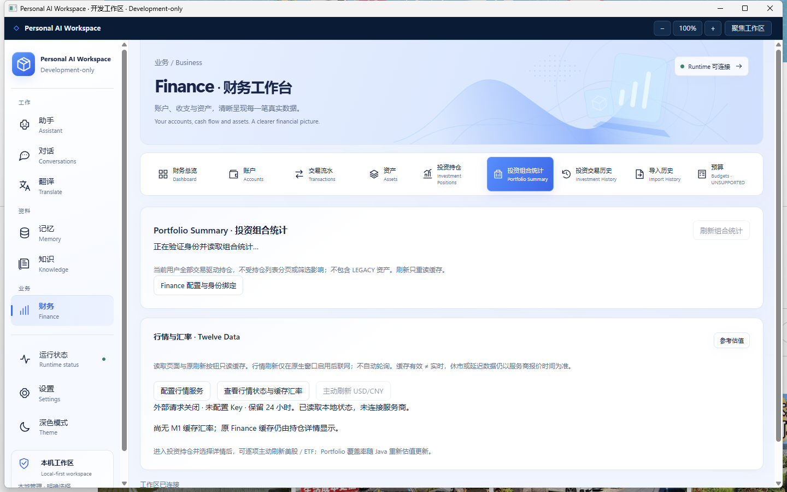

# Finance Market Data M1

2026-10-26，Asia/Shanghai。**实现、聚焦验证、独立 Windows Development-only 客户端已交付；真实 Provider NOT RUN。** D2 原生验收历史 PARTIAL 保留；不 Merge main，不授予 Production GO。

## 基线与选择

从干净的 `codex/finance-visual-analytics-d2 @ cc1c1847a0eb15632086d76fe6092cbdc4b0f0fd` 创建 `codex/finance-market-data-m1`。按指定 7890 代理 fetch 成功。未使用多 Agent。最终 Commit 以本分支 Git 和交付回复为准。

[GitHub 源码、官方接口、免费额度与许可研究](../design/FINANCE-MARKET-DATA-REFERENCE.md)。采用 Twelve Data 官方 REST：股票、ETF、USD/CNY 可共用一个 Key，Java 无新增依赖即可接入。Basic 当前是内部非展示用途；**不承诺免费 Key 可用于界面展示**。启用前须自行核对账户展示/缓存与交易所许可，原生窗口有明确确认。没有购买套餐或请求真实凭据。

## 实际功能与边界

- 原生 WPF PasswordBox 输入/更新 Key，空值保留已有 Key；显式联网开关默认关闭、禁用后不请求 Provider。仅 Profile Debug Development-only 宿主开放配置窗口，原 Gate、Native Bearer、DPAPI 与 Finance Binding 不变。
- Investment Positions 与 Portfolio 增加行情卡：按需读取无密钥状态、本地 USD/CNY、配置入口、主动刷新 FX。选择持仓详情后逐项刷新美股/ETF及必要 FX；没有自动轮询、批量上传持仓或通用 URL/symbol 请求。
- 服务端重新查询绑定用户的 Position ID，验证 US/USD、STOCK/ETF，校验返回 symbol/MIC/currency/type。其他市场明确不支持；不修改 Instrument、账务事实或持仓数量。
- 原 `ReferenceValuationService` 仍用 BigDecimal 算 CNY，原 Portfolio 汇总和 D2 图表继续读取相同服务。补了一个实际市场边界缺陷：同 symbol 的 HK 持仓不能借用 US 报价；本地适配与冻结原始哈希分别记录在 provenance 中。
- `market-data.dpapi` 保存 Key、许可/开关、最多 128 项报价和请求窗口；文件在受信 Profile data 内，与 Finance DB 分离，使用原 DPAPI/ACL/文件身份工具。没有金融数据库写入、schema 变更、Receipt 或迁移修改。
- 股票 TTL 15 分钟、FX 60 分钟，同时检查报价和获取时间。不会把刚获取的旧收盘价当新鲜报价；休市/延迟/离线可能显示 STALE。保留期限由用户按许可设置 1–168 小时，默认 24；过期限下次访问清理。没有历史行情库。页面状态是本次读取快照，重新读取可更新过期状态。
- 固定 HTTPS origin、header Key、无 redirect、连接 3 秒/请求 8 秒、有界 32 KiB 响应。8/min、800/滚动 24h 的共享持久额度，失败计入；429 冷却 60 秒，无自动重试。Provider 错误脱敏，保留原有效缓存，旧时间不能覆盖新时间。
- 前端只显示精确字符串和原服务端绘图坐标，不算权威金融金额；Bridge 没有 Key、许可、客户端 userId 或任意 URL 配置能力。Key 不写 URL、日志、前端资源、Git 或 Workspace 逻辑备份。外网仅发送目标标的/类型/国家或 USD/CNY；不发送余额、数量、账户资料或交易历史。

## 本轮实际验证

[命令与证据边界](evidence/finance-market-data-m1/verification.txt) · [原生结果](evidence/finance-market-data-m1/native-result.json) · [实际 HTTP/DPAPI/SQL](evidence/finance-market-data-m1/http-dpapi-result.json) · [包哈希](evidence/finance-market-data-m1/package-hashes.json)。

| 已执行 | 结果与限度 |
| --- | --- |
| Java 聚焦：FinanceMarketDataTest、原 FinanceAccountQueriesTest、FinanceRouteSecurityTest | PASS。默认无请求、已授权目标刷新、数字型 FX 精确解析、原估值/Portfolio partial、同名跨市场拒绝、离线过期缓存、重启额度/429/旧值保护、错误无 Key。文件/HTTP/Mapper 为确定性替身，不冒称真实 Provider/SQL。市场守卫和价格精度调整后只重跑 FinanceMarketDataTest，PASS。 |
| React 聚焦：FinanceMarketData.test.tsx + 原 FinancePage.test.tsx | PASS。显式操作、原生无凭据 payload、默认禁用、离线过期 FX、Session 丢弃迟到结果；原 Finance 页面、年度记录等现有用例保持通过。 |
| C# 聚焦：MarketData、PortfolioKeeps、AnnualRead、PayloadMustBeExactlyEmpty | PASS。固定 HTTP 路径、空 positionId 的 FX 请求、精确 FX、拒绝含 Key 响应、Bridge 拒绝凭据/伪造目标载荷。 |
| React production build；Java package/实际 JAR identity audit；Profile Debug dotnet publish | PASS。Vite 主 JS 509.35 kB 超默认 500 kB 提示；没有为此扩大到全局拆包。最终 Java/包因市场守卫修复重新构建，前端未重复构建。 |
| 最终包 CheckOnly；实际 CMD → WPF/WebView2 → admitted Java → 既有合成 PostgreSQL | PASS。实际 Portfolio 7 项、估值部分覆盖保持；原生行情窗口打开，联网 toggle Off、无 Key；持仓详情及 D2 对比图存在，主动报价按钮在无 Key 时禁用，非 US 清楚标注。正常托盘退出、重新启动最终包与退出后 18765 释放已执行。 |
| 实际 Native HTTP + DPAPI | PASS。仅用合成 canary、enabled=false 验证加密/回读、响应无 Key、未许可不联网、原 Positions/Portfolio 真 SQL。只删除本次新建且 hash 未变的 canary 文件，恢复无 Key 状态；未启用 Provider。最终包重新执行通过。 |
| 保护检查 | PASS。新包 payload、构建源文件及 asset provenance 哈希吻合；F-next-10、Phase 1、Visual Redesign、D1、D2 五个历史包 payload 与各自清单一致。冻结来源仍为 `c6c87a0627b746e70a45b1c7896f63defd76a810` 且工作区干净。 |

没有运行真实 Provider、真实账户数据、Java/Desktop/Frontend 全套、完整浏览器/IME/压力/缩放矩阵、整机重启或 D2 全部原生补验。真实 Provider 的 Key、账号 entitlement、地域连通性和实际市场字段仍需人工 smoke；没有伪造通过。离线缓存指 Provider 断网，本机 PostgreSQL 仍需运行。

本轮初次启动探测使用了错误的 PowerShell 安装路径，改用实际 `Get-Command pwsh.exe` 后成功；初次原生探测把 WPF 模态窗口误当顶层 UIA 节点，改为 owner 子树定位后通过。都未改产品安全边界，也未作为 Provider 或产品失败掩盖。D2 历史锁屏阻塞仍按原记录保留。

## 开发包与最少人工验收

启动器：`D:\IDEA\Daima\personal-ai-workspace\artifacts\PersonalAiWorkspace-finance-market-data-m1-development\Open-Workspace-Finance-Market-Data-M1.cmd`。

新目录、新 WPF/Core/React/JAR，保留所有历史包。复用原合成 PostgreSQL 和受保护 Profile，不建库、不迁移、不重绑、不降 Gate。不是 Installer、Release 或 Production GO。

`BUILD-INFO.json` format=`FINANCE_MARKET_DATA_M1_DEVELOPMENT`，sourceCommit=`cc1c1847a0eb15632086d76fe6092cbdc4b0f0fd`、sourceDirty=true，记录的是提交前实际构建来源，不伪称最终 Commit 的干净重建。后续只写报告/证据，不重复打包。

1. 启动 CMD → Finance → Investment Positions，选一个真实存在的 US/USD STOCK 或 ETF。点“配置行情服务”，在原生窗口输入自己具有展示/缓存许可的 Key，确认许可/保留时间并勾选联网，保存后关闭。
2. 点“主动刷新 … 行情与汇率”；核对来源、报价/获取时间、STALE/FRESH、服务端 CNY 参考值。若合成 Instrument 并非真实可报价代码，应保留失败/不支持状态，勿把合成报价当成功。
3. Portfolio → 查看状态/缓存汇率、主动刷新 USD/CNY，核对覆盖数量与 partial 提示。断开外网（保持本地 PostgreSQL）或禁用 Provider；在 TTL 后重新读取，核对缓存已过期仍可参考，失败没有改账务金额。

最少人工步骤只覆盖真实 Provider；不代替 D2 历史剩余验收。无需在聊天中提供 Key。
