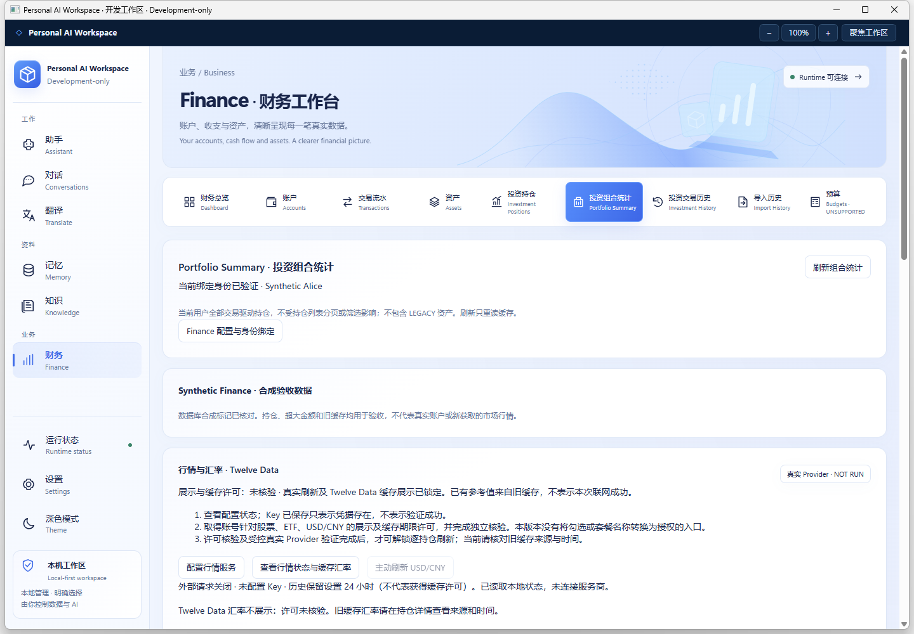
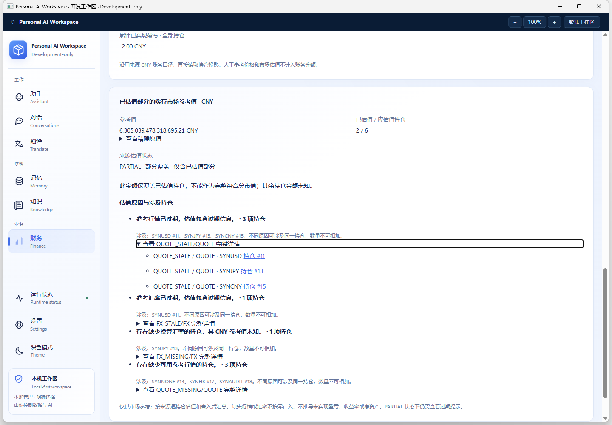

# Finance Market Data M1.1 — 可用性与信息清晰度

2026-10-26，Asia/Shanghai。基于 `codex/finance-market-data-m1 @ 3eb0e8023065ef8b8f9fa3083593990b8d8f812b`，开始时工作树干净，按指定代理 fetch 成功。本轮继续该分支，不创建新产品阶段；最终提交见 Git 与交付回复。**功能与独立 Windows 开发包已实现，真实 Provider 验证仍 NOT RUN，许可仍 UNVERIFIED。** 没有 Firecrawl 调用、真实行情请求、付费操作或多 Agent。

## 修复内容

- Synthetic Finance 由已绑定数据库的名称和 `FNEXT1_SYNTHETIC_<suffix>` 数据库标记共同确认，仍在现有身份校验和只读事务中查询；不按用户名或超大金额猜测。Positions/Portfolio 在现有 overview 可用后明确显示“合成验收数据”；其他库或旧 Runtime 缺少来源字段时显示“未核验”，不宣称真实账户。
- 现有 Quote/FX 适配器将合成库旧缓存标为 `SYNTHETIC_LEGACY`。详情明确区分旧 Finance 合成缓存与 Twelve Data 新报价，保留原报价和获取时间、STALE/缺失状态。未知非合成库的旧行情以及任何未经核验的 Twelve Data 数据不参与展示/估值；账户、成本、数量等账务读取保持原样。
- 行情卡给出配置状态、许可阻塞和下一步说明，明确 Key 已保存不等于可用或验证成功。原生 PasswordBox 仍可安全保存/更新 Key，空值保留；删除用户自报许可和启用复选框，历史缓存小时数只读并标明不是许可证。按钮保留入口但显示禁用原因，不让用户反复刷新或靠付费/自报套餐“解锁”。
- 服务端以独立于旧 `enabled/licensed` 字段的许可策略拒绝真实请求、Provider 缓存和衍生估值。生产装配没有已审核许可，也没有前端/HTTP/环境变量的授权入口。即使保留旧 M1 的启用勾选并保存 Key，状态仍 `enabled=false`、`licenseStatus=UNVERIFIED`、`providerValidation=NOT_RUN`，刷新返回 `LICENSE_UNVERIFIED`；现存加密文件不被当作授权证据。确定性后端夹具可以单独覆盖许可前提，生产接线不使用该测试前提。
- Portfolio 在既有警告生成循环中附加持仓 ID 字符串/代码，再按 code + component 分组。每类显示原因、去重持仓数、前五项代码/ID、可展开的全部原始明细，以及原持仓详情入口。各原因数量可重叠，明确提示不能相加。旧合同无关联信息时仅报“警告条数”，不冒充持仓数量。
- 超大金额和数量只对十进制字符串插入千分分隔符；不做 Number/浮点转换、不缩放、不四舍五入。保留原小数位、负号和 null；大值可展开精确原值。Java BigDecimal、既有 CNY 估值公式、舍入、图表坐标和年度记录不变。

## 许可复核与字段审计

[官方 Individual Pricing](https://twelvedata.com/pricing) 当前将 Basic 列为内部非展示用途，Grow 列有内部展示能力；这不能证明本机具体账号、股票/ETF/FX 范围、交易所或缓存期限已获授权。[Terms 2.2/2.3 与第三方数据条款](https://twelvedata.com/terms) 把显示和存储权利置于实际套餐/附加协议/交易所限制之下，并限制超期缓存。**没有找到可用于本应用的、已核验账号展示与缓存授权证据；24 小时设置、用户勾选及 API Key 均不是该证据。** 因而本版本明确锁定真实刷新；没有导入“用户填写套餐名即授权”的替代流程，也没有自行购买服务。

本轮使用本地源码及内置搜索阅读官方资料；部分完整 API 文档页面超过检索工具长度上限，官方搜索摘要可核对 FX 字段，但不把摘要或 M1 历史研究当作真实接口调用。

| 当前调用链/字段 | 实际核对与边界 |
| --- | --- |
| Position ID → 当前绑定用户详情 → US / USD / STOCK 或 ETF | 源码与确定性用例验证；实际 Windows 读取合成持仓通过。合成 `SYNUSD` 等代码不保证是真实可报价标的，没有 symbol search/别名/MIC 自动映射。 |
| `/quote` 的 symbol、MIC、currency、type、close、timestamp | M1 客户端严格比较原始 symbol，限定美国 MIC/币种/类型；价格使用 BigDecimal、最高 8 位小数，时间检查不变。错误市场/标的/未来时间等只有确定性夹具执行证据；真实响应和各交易所字段兼容性 NOT RUN。 |
| `/exchange_rate` 的 symbol、rate、timestamp | [官方文档](https://twelvedata.com/docs) 列有这些字段；数字型 rate 使用 BigDecimal 节点、最高 12 位小数。USD/CNY entitlement、实际返回及网络连通性 NOT RUN。 |
| 刷新/限流/缓存/估值 | 旧 M1 勾选不再准入；锁定在网络与缓存使用之前。原额度和 TTL 机制留在许可前提成立的确定性夹具中验证，不能当作真实行情成功。已确认合成旧缓存仍可为 Portfolio 提供原 partial 参考值。 |

要恢复真实能力，仍须取得并独立审查账号适用的展示/缓存范围及期限证据，再明确接入授权依据并做最少受控 Provider smoke。本轮没有完成该授权机制，不把“拿到 Key”写成能够解锁的步骤。既有 M1 加密数据未被擅自删除，但不作为市场数据返回、渲染或估值。

## 本轮实际验证

[命令与边界](evidence/finance-market-data-m11/verification.txt) · [原生结果](evidence/finance-market-data-m11/native-result.json) · [真实 HTTP/DPAPI](evidence/finance-market-data-m11/http-dpapi-result.json) · [包哈希](evidence/finance-market-data-m11/package-hashes.json)。

- **PASS：Java 聚焦** `FinanceMarketDataTest,FinanceAccountQueriesTest`。沿用现有用例，不新增测试类；增加旧勾选无法授权、已存 Provider 缓存不返回/不估值、警告携带持仓关联。原解析精度、跨市场拒绝、离线 stale、额度与回退等确定性验证保留。文件/Transport/Mapper 使用测试替身，不冒称真实 Provider/SQL。
- **PASS：React 聚焦** 原 `FinanceMarketData.test.tsx` 与 `FinancePage.test.tsx`。旧合同声称启用仍锁定、FX 不泄露、Session 丢弃迟到结果、警告聚合/关联、分隔与原值、原 Finance/D2 年度用例。首次因格式化把 null 参考值文案改掉而失败，恢复原“未知 / 无可用估值”语义后通过，没有弱化预期。
- **PASS：C# 聚焦** MarketData、PortfolioKeeps、AnnualRead、原 Bridge 空载荷边界；扩展许可状态解析、旧合同降级与敏感字段拒绝。警告合同最终调整后只重跑 MarketData/PortfolioKeeps，通过。
- **PASS：构建与独立包** TypeScript/Vite production build、Maven package 与实际 JAR identity audit、Profile Debug win-x64 publish、启动器 CheckOnly。Vite 主 JS 超 500 kB 提示保留，未扩大到全局拆包。
- **PASS：实际 Windows Native Gate → WPF/WebView2 → 真实只读合成 PostgreSQL**。核对合成来源、许可锁定、原生无自报授权控件、分组警告（QUOTE_STALE 3 / QUOTE_MISSING 3）、展开完整详情并进入持仓 #11、旧 Quote/FX 来源及原精度显示。正常托盘退出、重新启动最终包与最终退出后监听释放通过。初次 UIA 导航探测曾找不到目标，重新启动/定位后通过；未为验收脚本改产品安全边界。
- **PASS：实际 Native HTTP/DPAPI 合成 canary**。保存旧式 enabled/licensed=true 后仍不能请求或返回真实数据；CurrentUser DPAPI 原子更新、空 Key 保留、响应不回显密钥，Positions/Portfolio 真实只读 SQL 通过。只清理本次新建且 ciphertext hash 未变的 canary 文件，恢复无 Key 状态；没有真实 Provider 请求。
- **PASS：保护检查**。本地适配 provenance、构建源与新包 payload 匹配；F-next-10、Phase 1、Visual Redesign、D1、D2、M1 六个旧包 payload 与各自原清单一致。冻结 Finance OS 仍为 `c6c87a0627b746e70a45b1c7896f63defd76a810`，工作区干净。

未执行全套 Java/Desktop/Frontend、完整浏览器/IME/缩放/压力矩阵、整机重启、真实 Provider、真实账户或 D2 历史原生补验。D2 **PARTIAL** 保留；未 Merge main、tag、release 或 Production GO。

## 交付与最少人工验收

启动器：`D:\IDEA\Daima\personal-ai-workspace\artifacts\PersonalAiWorkspace-finance-market-data-m11-development\Open-Workspace-Finance-Market-Data-M11.cmd`。复用既有合成数据库和受保护 Profile；不迁移、不重绑，不覆盖历史包。`BUILD-INFO.json` 记录基线 `3eb0e8023065ef8b8f9fa3083593990b8d8f812b` + `sourceDirty=true` 的实际构建输入，不冒称最终源码提交的干净重建。

1. 打开客户端 → Portfolio：检查 Synthetic Finance、许可未核验/NOT RUN、超大金额分隔；展开精确原值，核对小数未变。
2. 展开 QUOTE_STALE 等原因的完整详情 → 持仓 #11：检查旧合成 Quote/FX 来源、时间、stale 状态，返回组合。
3. 打开行情设置：确认可以安全保存 Key，但没有勾选即解锁的操作，真实刷新仍锁定。不要反复输入 Key 或付费尝试解锁；下一步是许可证据审查与独立受控 Provider 验证。
