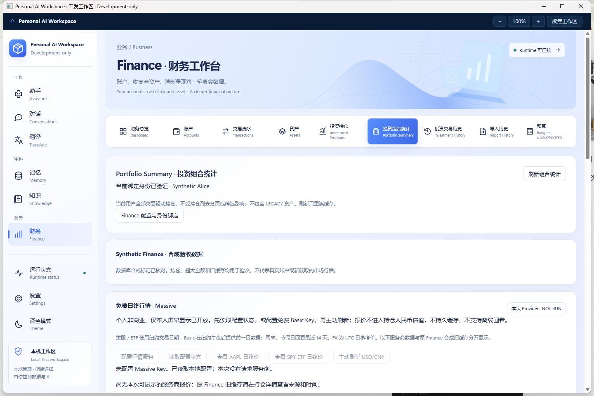

# Finance Market Data M1.2 — 免费个人日终行情

2026-10-26，Asia/Shanghai。基线 `codex/finance-market-data-m1 @ 45287ef9eaf3eab50e3122fab2137d40a9dd42b1`；按指定代理 fetch 成功，开始时工作区干净。新分支 `codex/finance-market-data-m12`，实现提交 **`466544405bef589c86f4008994312f5124e452c0`**。其后交付提交只增加本报告及证据；最终远端 HEAD 以交付回复和 Git 为准。未使用 Firecrawl、子 Agent、付费服务或真实行情 Key。

**已交付可运行的 Massive 接入和独立 Windows Development-only 包。LIVE PROVIDER NOT RUN：本机没有 Massive 凭据，不能声称真实股票、ETF 或 USD/CNY 接口已验收成功。** 许可不再全局阻止个人显示，配置有效免费 Key 后即可手动发起请求；实际账号权限依照服务商响应验证。

## 最终选型与实现

选择 Massive Stocks Basic + Currencies Basic，当前官方价格均为 $0/月、5 requests/min、日终数据。官方允许个人非商业应用仅向本人显示；持久行情缓存、离线回看及持仓派生估值权未据此扩张。官方来源、GitHub 源码核对、时间与权限矩阵见[调研依据](../design/FINANCE-MARKET-DATA-M12-REFERENCE.md)。软件许可证不是市场数据许可证；没有自报套餐或勾选授权入口。

| 能力 | 实现状态与实际限制 |
| --- | --- |
| 美股 | US/USD、STOCK 对应普通股 CS；日线 close + 对应日期的 ticker/币种/市场/交易所/类型校验。AAPL 固定入口或已绑定用户的实际持仓。真实调用 NOT RUN。 |
| 美国 ETF | ETF 类型身份校验；SPY 固定入口或实际持仓。ETF Global 付费分析产品不是本接入前提。真实调用 NOT RUN。 |
| USD/CNY | 独立的 `C:USDCNY` Forex 日线 close 查看，UTC 日期；不需要先刷新股票。具体账号 entitlement、币对覆盖和真实返回 NOT RUN；未接入 ECB，不提供未经验证的替代值。 |
| 来源与日期 | Massive 区域分别显示实际交易/参考日期、时区、原 `t` 日线窗口起点和本次获取时间；未复权参考价，不标实时。纽约日期截止昨天，最多回看 14 天；FX 另外保守排除 ET 当天。 |
| 显示与内存 | 每次手动请求直接返回给当前屏幕；状态读取不回放数据，切页/会话/重启后须再请求。一次股票最多 2 次 REST，FX 1 次；无自动刷新、重试或分页。 |
| 持久缓存、离线、派生估值 | 均未开放。服务端按 Provider/用途判断；报价没有进入现有 valuation adapters。DPAPI 仅保存凭据、Provider 与配额时间。 |
| 原 Finance | Portfolio、Positions、精确金额、警告、D2 图表与年度记录保留；已确认合成旧缓存继续标记 SYNTHETIC_LEGACY。未知旧缓存、Twelve Data、Massive/Polygon 标签数据不会借旧适配器进入估值。 |

替换原 Twelve Data transport，复用有界 Java HTTPS、Jackson/BigDecimal、DPAPI、身份绑定及原 Native Gate/Bridge。外部只发送 ticker/币对、日期和 Key header；不发送持仓 ID、数量、金额或交易。

行情配置内部合同有意更新为 key-only；状态合同改为 Massive、独立 quote/FX 与只读用途权限。新增 `referenceSymbol=AAPL|SPY` 严格白名单，不能提交任意 symbol、URL、权限或用户 ID。旧 `market-data.dpapi` 不读取、不修改、不迁移；新 `massive-data.dpapi` 与 Finance SQL 无关，不改金融持久格式或迁移。

## 实际验证及未完成项

[命令记录](evidence/finance-market-data-m12/verification.txt) · [实际 Windows 结果](evidence/finance-market-data-m12/native-result.json) · [包哈希检查](evidence/finance-market-data-m12/package-hashes.json)。

- **PASS，确定性 Java**：原 `FinanceMarketDataTest,FinanceAccountQueriesTest` 聚焦执行；补充合成旧缓存估值不变后，只重跑 `FinanceMarketDataTest`。保护个人显示与缓存/估值权分离、价格精度、跨市场/归属、日期范围、FX 权限不锁死股票、重启/换 Key 不重置额度及响应不落盘。复用原测试类，没有新增测试类。
- **PASS，React 聚焦**：原 MarketData 与 FinancePage 用例；覆盖固定 ETF 查看、来源/日期、授权后按钮、扩大用途拒绝、会话迟到响应丢弃及既有 Finance/D2 年度交互。初次新增自动状态读取打乱原页面请求顺序，恢复显式状态读取后通过，未改动原 Finance 页面预期。
- **PASS，C# 聚焦**：MarketData、PortfolioKeeps 与 Bridge 空载荷/敏感字段边界；增加固定 reference payload 的拒绝边界后，仅重跑该 Bridge 用例。首次 xUnit 分析器要求改用 Assert.Single；另一次并行构建共享 frontend dist 导致复制失败，前端构建结束后串行重跑通过，没有为环境失败修改生产行为。
- **PASS，构建/包**：TypeScript/Vite production build；Maven clean package（skipTests，不计为测试通过），实际 JAR identity audit；Profile Debug win-x64 publish；启动器 CheckOnly。保留既有 Vite >500 kB 提示。打包脚本的 README 字面 `$0` 被 PowerShell 当变量，修正文案并核对本次部分输出身份后完成；未修改历史目录或产品许可策略。
- **PASS，实际 Windows**：新包 → 原 Native Gate → WPF/WebView2 → Java → 已绑定合成 PostgreSQL；Portfolio 图表/合成来源/PARTIAL 估值、原生 Massive PasswordBox 与无许可勾选。投资持仓页点击 AAPL，经真实 Bridge/Runtime 返回 KEY_REQUIRED；无 Key 不发起外部请求。正常托盘退出 → 实际 M1.2 CMD 重开 → 再退出，Runtime 监听释放。
- **PASS，保护检查**：M1、M1.1、M1.2 payload 与各自清单一致；冻结 Finance OS 仍为 `c6c87a0627b746e70a45b1c7896f63defd76a810` 且干净；finance-domain 没有改动。
- **NOT RUN**：真实 Massive/账号 entitlement/真实报价；本轮 DPAPI 实际保存 canary（自动审批拒绝脚本，未执行，未创建凭据文件）；整机重启、完整 Java/Desktop/Frontend 或浏览器/IME/压力矩阵、D2 历史原生补验。DPAPI 依然使用既有保护实现，历史 M1.1 readback 只能算历史证据，不冒充本轮执行。

原生初次脚本误从顶层窗口查找 owned dialog，定位失败；随后只读检查确认其为主窗口子节点，完成实际操作，没有修改生产 UI 或安全边界。自动审批对含测试凭据输入、本地认证请求和 canary 清理的脚本仅返回 `blocked by policy`，未提供更细原因；后续安全检查仅使用无凭据的 UI 操作。

D2 历史 **PARTIAL** 不变；未授予 Production GO。没有券商、交易、账本/Receipt/历史迁移写入、main 合并、tag、release 或付费升级。新分支 commit/push 属于本轮用户明确授权；二进制开发包只保存在本机，未上传为公开行情服务。

## 启动器与最少人工验收

`D:\IDEA\Daima\personal-ai-workspace\artifacts\PersonalAiWorkspace-finance-market-data-m12-development\Open-Workspace-Finance-Market-Data-M12.cmd`

独立目录复用当前用户既有开发 Profile 与合成数据库，不依赖 M1/M1.1 包运行，不覆盖它们。仍要求本机原 JDK21、.NET10、PowerShell7.4+、WebView2 和已接受的 Profile；不是无需前提的正式安装包。`BUILD-INFO.json` 记录实现提交 `4665444…`、`sourceDirty=false`、源文件/实际 JAR/payload 哈希；其后 docs-only 交付不重新构建或重跑已通过测试。

1. 双击启动器 → Finance → 投资组合统计或投资持仓 → 配置行情服务。在原生 PasswordBox 输入你本地的 Massive Key，保存并关闭窗口；不要把 Key 放到聊天、React、源码或日志。
2. 点击“查看 AAPL 日终价”或“查看 SPY ETF 日终价”。确认 Massive、USD 价格、纽约日期和获取时间分别可见；再独立刷新 USD/CNY。两次股票加一次 FX 恰好消耗 5 次 REST，请勿连续重复点击；遇 RATE_LIMITED 至少等 60 秒。
3. 如服务商拒绝 FX，股票入口仍可用；在官方账号检查对应免费权限，不购买或升级套餐。关闭/切页后不应从本地持久缓存恢复 Massive 价格；原合成 Portfolio 参考估值保持原值。通过托盘退出结束。

实际免费账号验证是剩余人工步骤；在完成前，本报告不会把确定性替身数字、合成旧缓存或界面截图称为真实行情成功。
