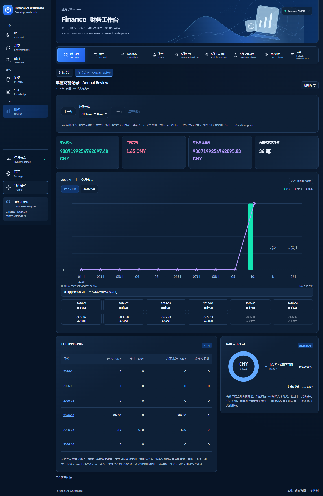

# Finance Visual Analytics D2 — Interactive Charts & Annual Financial Review

2026-10-25，Asia/Shanghai。**功能、聚焦验证和独立 Development-only 包已实现；真实 Windows 综合验收 PARTIAL，不能宣布 D2 全部验收通过。** 当前阻塞是 Windows 锁屏：键盘事件未到达客户端，屏幕截图是锁屏画面。没有绕过锁屏或索取凭据。Market Data M1 未开始，不授予 Production GO。

## 基线与边界

从 `codex/finance-dashboard-drilldown @ 3a83ea2f65792e9dfe7f926e828bd0d405038d27` 创建 `codex/finance-visual-analytics-d2`。开始时工作树干净，同名分支不存在；按用户指定 7890 代理 fetch 成功，远端 D1 HEAD 与本地一致。已读 D1 交付/交互研究、Visual Redesign、当前架构与实际 Java → HTTP → RuntimeClient → Bridge → React 调用链；没有发现仓库内额外 AGENTS.md。

冻结来源 `D:\IDEA\Daima\personal-finance-OS @ c6c87a0627b746e70a45b1c7896f63defd76a810` 前后干净。没有改动 finance-domain、迁移、Immutable Ledger、Receipt、Correction、Audit Timeline、Native Gate、DPAPI、Finance Binding、身份/指纹检查、MemoryLeaveGuard、AI Runtime 无关能力或旧开发包。

开源源码与技术选择见 [图表参考](../design/FINANCE-VISUAL-ANALYTICS-REFERENCE.md)。继续采用局部 React/SVG，无新增依赖；没有复制第三方实现或放宽 CSP/Origin。最终交付提交以本分支 Git 记录和交付回复的完整 SHA 为准；下面明确记录实际二进制的提交前构建身份。

## 实际功能与来源

| 页面 | 新增功能 | 真实来源与限制 |
| --- | --- | --- |
| Dashboard | 最近十二个月收入/支出分组柱 + 净额线；6/12 月切换；净额面积/折线切换；月份选择、精确详情、台账与原 D1 钻取；本月支出圆环；账户数量圆环 | 同一普通 CNY 交易聚合生成十二个月及原六个月数据，不重复查询两张现金流图。当前月至服务端 asOf exclusive；历史月至下一月初 exclusive。账户圆环只表达全部币种、全部状态的记录数量，不把负余额画成资产份额。原四摘要、近期交易和人工参考分布保留。 |
| Assets | 完整资产记录类型数量圆环；图例进入原类型筛选；按需读取人工参考价值比例条 | 类型数量来自当前用户全部 assets，不受当前页影响，不代表价值配置。人工参考复用 Dashboard 原合同/组件，仍是全部合格分母、ID 前二十项、24/35 合成覆盖；未补造其余价值闭合圆环，未重新归一化。原列表/详情保留。 |
| Portfolio | OPEN/CLOSED 完整数量圆环；可估值/无法估值 OPEN 数量圆环；图例进入持仓 | 直接复用来源 Portfolio Summary 的全部持仓/估值数量，Java 生成占比与角度；覆盖与过期分别展示。合成库为 7 项、OPEN 6/CLOSED 1，可估值 2/6、PARTIAL 并含 QUOTE_STALE/FX_STALE。原金额、风险说明和 History 导航保留。 |
| Investment Positions | 当前页成本/缓存参考值横向双条图；Instrument、数量、精确 CNY 金额、状态；进入原持仓详情 | 只展示当前来源分页，最多二十项，明确不是 Top Holdings。共同坐标来自 Java；null 报价不画零条，过期信息仍标示。不同币种报价须由原估值服务换算为 CNY，图表不自行合币种或推导收益率。 |
| Annual Review | Dashboard 分析子视图；年份选择、上一/下一年、当前年；四年度摘要；十二个月组合图；月度台账/合计；年度支出类别圆环；月份流水与返回 | 由既有持久交易重建，未新增年度快照表、归档或写接口。真实有数据的年份来自当前用户已发生普通 CNY 收支；可逐年查看无记录年份，未来年份拒绝。保留九个一级入口。 |

支出类别 Join 同时校验类别用户归属或系统公共类别，以及收支类型。没有可用类别的交易统一归入未分类，不暴露其他用户类别名称；合成库的支出因此如实呈现为未分类。最多十二类 + 其余类别合计，完整覆盖支出分母。任何负支出记录使圆环降级为 `UNSUPPORTED_SIGNED`，仍保留权威汇总。当前 Transactions 没有类别筛选，因此只提供类别精确详情，没有虚假的跳转。

没有历史净资产、股票市值或汇率快照，也没有目标配置、收益预测、NISA/退休模拟或市场行情 HTTP。人工价格仍是人工参考，缓存估值仍可缺失、过期；不将它们当成实时值，不混合账户余额、成本和市值。

## 精度、查询与安全合同

- `GET /api/v1/finance/annual?year=0|1900..2199`、固定 `finance.annual` Bridge 方法；0 表示 Java Asia/Shanghai 当前年。服务端拒绝未来年、未知/重复参数；C#/React 同步严格字段、请求年份回显、十二个月、最多三百年份/十三分组、有界坐标和未来 null 校验。沿用 HTTP 60 KiB、Bridge 64 KiB 限制，不返回原始完整交易账本。
- 普通 transactions、当前绑定用户、CNY、INCOME/EXPENSE；排除转账表、REFUND、ADJUSTMENT、投资交易。当前年区间 `[1月1日, asOf)`，历史年 `[1月1日, 下一年1月1日)`。当前月份为未结算的已发生区间；未来月份 `FUTURE`，金额/交易数/坐标均 null。已发生无交易月份可为真实零。
- BigDecimal 计算收入、支出、净额与占比；金额、ID、数量、价格、FX 等原精确字符串保留。独立绘图数字固定 0..10000，累计边界保证圆环闭合，四位百分比字符串不要求相加后人为改成 100%。React 仅将坐标转换为像素，Tooltip/图例/台账显示原字符串，不计算金融金额或反推金额。
- Dashboard/Portfolio/Assets/Positions 的附加绘图字段为严格的成组可选扩展：旧 Runtime 不返回这些字段时保留旧展示，不伪造坐标；存在时必须完整校验。C# 不把缺失的可选图形序列化为 null 伪装成图形。
- D1 成对 `cashFlowMonth/cashFlowAsOf` 扩展至支持年份内的已发生月份，保留普通 CNY、INCOME/EXPENSE、月初 startDate、空 endDate、exclusive 截止、字段回显及分页；因此年度与原月份入口共用同一查询，不用自然日 endDate 近似。关联账户授权异常仍安全拒绝明细。
- 原 Finance 专用 DataSource、REQUIRES_NEW/read-only/REPEATABLE_READ、Native 身份/用户指纹/数据集指纹与所有权重验保持。请求不能传 userId 扩权；年份只是查询条件。asOf 是时间筛选，不是不可变历史快照 Token，返回后按原记录重新读取。
- Finance 卸载、Session/Runtime 变化、禁用、绑定失效清除快照和选择；generation 丢弃迟到响应。Runtime 失效时不再通过切换子视图触发一次新查询。无金融条件/响应持久到 localStorage、sessionStorage 或 URL。主题继续用原 `workspace.theme`。

## 实际验证

[可检查证据与命令](evidence/finance-visual-analytics-d2/verification.txt) · [浏览器结果](evidence/finance-visual-analytics-d2/browser-result.json) · [Windows 部分结果](evidence/finance-visual-analytics-d2/native-result.json)。

| 实际执行 | 结论与边界 |
| --- | --- |
| 真实 PostgreSQL 聚焦集成 | **PASS**。扩展原 D1 只读综合用例：原受保护合成 reader、真实 SQL/来源服务，年度汇总/月交易数、未来 null、跨年、空年、十二个月、用户隔离、巨大金额、asOf 纳秒边界、分页/来源 kind、账户/资产/持仓/估值分母和当前页坐标。没有 mock SQL；只替代 Profile IO。旧合成账本摘要前后相同。 |
| 绘图精度聚焦回归 | **PASS**。原有六个月不变；新增巨大精确字符串、负净额、未来 null、三等分累计闭合、signed 降级。未执行 Java 全套。 |
| React 现有 FinancePage 聚焦文件 | **PASS**。复用原流并新增一个年度综合流：年份切换、未来禁用、跨六个月钻取、返回恢复及 Session 迟到响应清除。最后调整 Runtime 子视图行为后仅重跑年度相关用例，通过；未执行 Frontend 全套。 |
| C# 聚焦合同/原 Bridge payload 回归 | **PASS**。年度精确字符串、null、年份/坐标/未知字段拒绝；原 cash-flow 纳秒 exclusive 与 Portfolio partial；非法 year/client userId 被固定方法拒绝。未执行 Desktop 全套。 |
| 浏览器综合流 | **PASS**。使用真实 SQL 结果的合成传输替身，验证十二个月双柱、6/12、净额面积、月份/图例键盘、年度/空年/返回、Portfolio 钻取、当前页持仓图、Assets 完整分母、Runtime 清除和无金融浏览器存储。明暗 × 1920/1440/1280/1024/540 无文档级横溢出。此证据不冒称实际原生/HTTP/SQL 端到端。 |
| 构建与包 | **PASS**。React production build、Java package/JAR identity audit、dotnet publish、原启动器 CheckOnly。Vite 提示主 JS 503.60 kB（gzip 140.64 kB）超过默认 500 kB 提示值；不是构建失败，本轮未为此扩大到全局拆包。 |
| 实际 WPF/WebView2 | **PARTIAL**。实际 D2 CMD/EXE/JAR/原合成 PostgreSQL 已启动并认证，UI Automation 可读 Dashboard、真实摘要、新月度控制和两个圆环的名称。Windows 锁屏导致实际键盘与客户端截图验证失败；没有将锁屏图当作产品截图。原生 Annual、Portfolio/Assets 完整交互、明暗、窗口矩阵、150/200% 工具栏缩放、托盘正常退出/重开均 **NOT RUN TO COMPLETION**。 |
| 保护与产物一致性 | **PASS**。新包 payload/构建源文件哈希匹配；F-next-10、Phase 1、Visual Redesign、D1 四个旧包 payload 哈希不变；原受保护 Profile/绑定 pin 通过启动器检查，合成账本摘要相同，冻结来源仓库干净。 |

没有隐藏初次失败：新年度断言最初沿用六个月预期，真实库还有四月 999.00 收入；读取已有记录后修正新增断言为完整年度，未改生产行为/fixture/数据库。浏览器 Runtime 检查暴露子视图切换触发查询，修正局部生命周期后复验通过。原生键盘失败来自锁屏，保留 PARTIAL。

未执行 Java/Desktop/Frontend 全套、完整浏览器/IME/压力/包装矩阵、整机重启、真实金融数据、付费 Provider、任何金融写入或 Market Data M1。原 MemoryLeaveGuard/Native Gate 等未改动，其历史验收未冒称本轮重跑。

本轮有效截图为**浏览器合成证据**，不是 Windows 客户端截图：



[年度浅色](evidence/finance-visual-analytics-d2/browser-annual-light.png) · [Dashboard 浅色](evidence/finance-visual-analytics-d2/browser-dashboard-light.png) · [Dashboard 深色](evidence/finance-visual-analytics-d2/browser-dashboard-dark.png)。真实 Windows 截图待本机解锁后补验，当前没有有效客户端截图。验收停止后仅清理已核实路径和父进程关系的 D2 Desktop/Runtime，18765 监听已释放；这不算正常托盘退出验收。再次 CheckOnly 通过，原 Profile/绑定 pin 仍有效。

## Development-only 交付

```text
D:\IDEA\Daima\personal-ai-workspace\artifacts\PersonalAiWorkspace-finance-visual-analytics-d2-development\Open-Workspace-Finance-Visual-Analytics-D2.cmd
```

新目录、新启动器、新 React/WPF/Core/Java，未覆盖 D1 或其他旧包。复用既有合成 Finance 环境、受保护 Profile 和原绑定；不新建数据库、不迁移、不重绑、不降安全准入。不是 Installer、正式 Release 或 Production GO。

`BUILD-INFO.json` format=`FINANCE_VISUAL_ANALYTICS_D2_DEVELOPMENT`，sourceCommit=`3a83ea2f65792e9dfe7f926e828bd0d405038d27`、sourceDirty=true，记录实际构建源文件和 payload 哈希。它是提交前构建，不描述为最终提交的干净重建；本轮后续只添加报告/证据，不重复构建已检查二进制。Java 21.0.7、.NET SDK 10.0.401、Node 24.16.0；Runtime Maven 0.1.0，EXE 1.0.0.0，产品版本关联上述基线。

- Runtime JAR SHA256：`2a399651b062cca8204741da8020be6329f1bf08033a229b2a370c0c7529a571`。
- Desktop EXE SHA256：`de7d14b8f0418807ebc3011bf88b8ef789611174a71f277c8b667abef6d93b15`。
- Core DLL SHA256：`4a7aa37d1734c0bd39a1832434ac73f4c2cbb546efce8c76a04b57522f5014cd`。
- 其余启动器、DLL、前端 manifest 与旧包保护记录见 [package-hashes.json](evidence/finance-visual-analytics-d2/package-hashes.json)。

## 待解锁后的最少人工验收

1. 解锁 Windows，启动上述 CMD → Finance；检查双柱、6/12 月、净额趋势、本月支出与账户圆环；Tab/Shift+Tab、Enter/Space、Escape 选择五月并进支出、返回。
2. 年度分析 → 上一年空年 → 返回当前年 → 点击四月台账 → 收入流水，核对 999.00 与下一月初 exclusive → 返回年份和月份；滚动台账查看未来月份及年度合计。
3. Portfolio 的 OPEN/CLOSED 圆环进入持仓与当前页对比，再经原详情进入 History/Receipt/Audit；Assets 类型圆环筛选及按需人工参考分布。切换明暗、窄窗与原生工具栏 150%/200% 缩放。
4. 仅停止本包自有 Runtime 验证快照清除；正常托盘退出 → CMD 重开 → 再退出，确认本包 Runtime 监听释放。不得改旧绑定或数据库身份模拟失败。

剩余阻塞只有上述原生验收环境；未实现类别流水筛选、历史净资产快照、年度结账或 P2 同比/高级动画。M1 可复用 FinanceCharts 的有界几何/精确详情、现有 Positions/Portfolio/History 与估值 freshness；市场 HTTP、缓存刷新及 API Key 必须留待下一独立授权阶段。本轮停止，不启动 M1。
