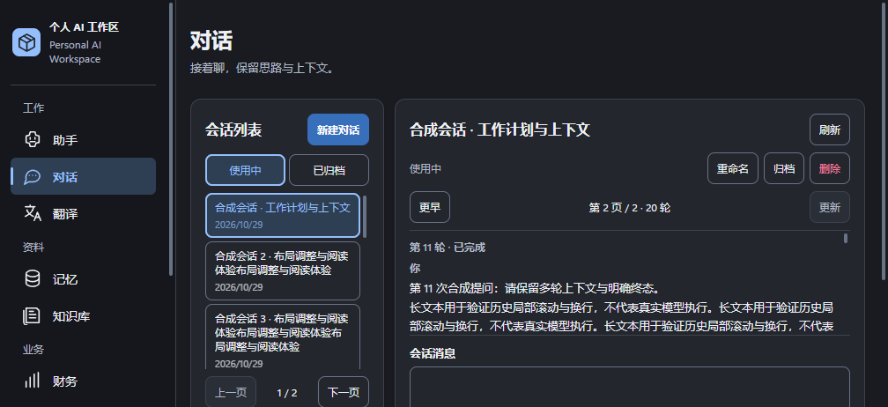
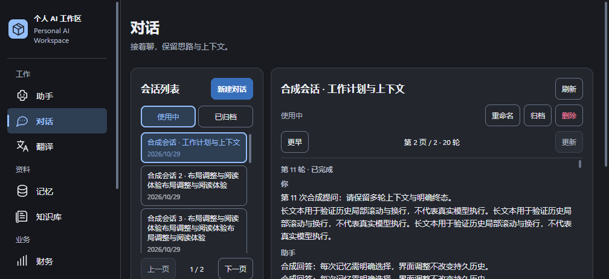
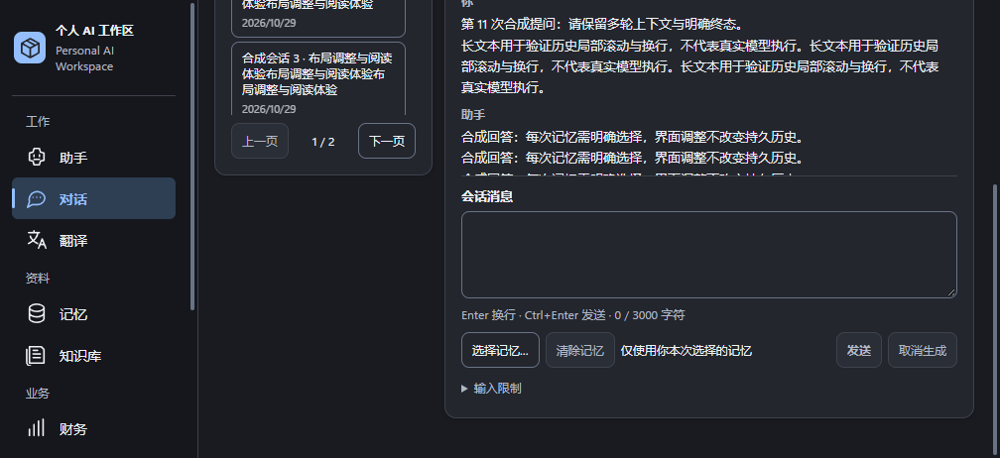
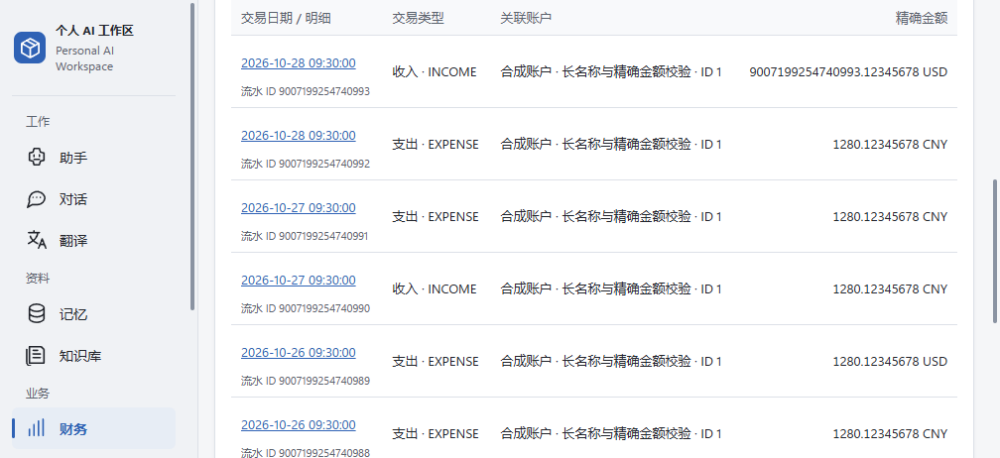

# UI/UX P2 Final Experience Review

2026-10-29（Asia/Shanghai）。审查基线为 fetch 后的 `main @ bd405ea95349a0b9e07336ae9f9b7867fdc494df`，开发分支为 `codex/ui-experience-p2`。六页指 Assistant、Conversations、Memory、Knowledge、Finance、Settings。本轮完成后停止，不进入重设计或后续功能阶段。

**Development-only / X1 Windows Acceptance PARTIAL / MODEL_EXECUTION_UNCERTAIN / Vision BLOCKED / 尚无已核验 CI PASS / 尚未 Production GO** 均保持。本轮 UI fixture 不构成真实模型、Runtime 或物理设备验收通过。

## 发现与最小修复

真实 WPF 窗口确认：长历史在 1024×540 DIP 下仅有 120 CSS px，首屏历史只能看到提问；1024×768 DIP 下仅有 180px，回答刚进入阅读区便被截断。根因是 `.conversation-history` 的 `max-height: clamp(120px, calc(100vh - 510px), 420px)` 在低视口下继续压缩历史，即使输入与发送已经需要页面滚动。

生产代码只修改 `desktop/frontend/src/styles/workspace.css` 的一个数值：将该 clamp 下限从 120px 提高至 220px。短历史仍按内容自然收缩；保留历史局部滚动、88px 输入框、原生纵向拖动及页面滚动，没有增加固定容器、交互状态或依赖。最初试验 240px 时，768 DIP 窗口的发送按钮底部超出实际视口约 4px；最终采用 220px，在该窗口保留完整输入与发送区。

同一合成历史、主题和原生窗口的 DOM 实测如下，单位为 CSS px：

| 窗口 DIP | 实际 WebView 视口 | 历史高度：改前 → 最终 | 最终输入框高度 | 发送区底部：改前 → 最终 |
| --- | --- | --- | --- | --- |
| 1280×800 | 1264×722 | 212 → 220 | 88 | 666.48 → 674.48 |
| 1024×768 | 1008×690 | 180 → 220 | 88 | 634.48 → 674.48 |
| 1024×540 | 1008×462 | 120 → 220 | 88 | 574.48 → 674.48 |

540 DIP 短窗需要页面滚动才能完整使用输入和发送区，改前亦如此。最终截图和键盘流程确认可达；不宣称短窗能同时完整容纳标题、历史与全部输入操作。表内数值代表当前合成内容，不承诺任意标题、记忆选择或告警都能同屏。

没有修改 Java Runtime、Finance 业务、模型准入、Native Gate、WPF / Bridge、数据库、schema、权限或真实用户数据。没有新增或修改长期测试；没有改动其他页面样式。

## 本轮实际完成的检查

| 范围 | 实际证据与结果 |
| --- | --- |
| 六页浅／深主题与缩窗 | 真实 `MainWorkspaceWindow`、受信 WebView2 Host 和生产前端 assets；1280×800 与 1024×540 DIP 六页均取得原始截图，Conversations 补查 1024×768。未见文档级横向溢出或未捕获页面错误。逐张审查下列公开图，并检查短窗、另一主题的代表图。 |
| Conversations 历史与输入 | 最终 220px 历史区；合成长历史、列表和多行草稿；自动化 wheel、PageDown、Control+End、Enter 换行、Tab 从历史到输入、从输入到记忆选择及聚焦发送按钮通过。阅读与长文本编辑未触发发送。768 DIP 窗口的输入与发送完整可见，540 DIP 下可滚动到达。 |
| Memory / Knowledge | 合成长标题、正文和列表能换行并局部滚动；Memory 编辑器与 Knowledge 原文可显示键盘焦点，列表、原文与页面滚动可达。仅选择／阅读，没有保存真实数据或导入文件。 |
| Assistant | 合成问题、完成状态与结果可读；短窗口通过页面滚动阅读。Vision 暂停入口和不可用说明保留，`提交单图` 禁用。合成完成不代表模型成功。 |
| Finance | 合成 Dashboard、40 条交易分页、长账户名称与精确金额；`9007199254740993.12345678 USD` 原样显示，表格可聚焦，窄视口局部水平滚动及分页通过；无文档级横向溢出。未连接 Finance 服务或 Provider。 |
| Settings 与重要状态 | uncertainty 告警不在折叠组内；短窗可完整滚动到告警，模型切换保持禁用。没有触发模型 mutation。 |
| 可访问性局部检查 | 上述控件与阅读区有可见键盘焦点；浏览器 forced-colors / reduced-motion 模拟下，历史焦点可见，过渡为 0s、滚动为 auto。540px 浏览器窄视口六页无文档级横向溢出。此为局部检查，不是完整 WCAG／屏幕阅读器验收。 |

自动化交互是一条合成浏览器综合流程的覆盖点，不能按页面、主题、视口或覆盖点累加为独立验收次数，也不等同物理键鼠或触控板操作。

本轮执行：

- `npm --prefix desktop/frontend run check`：通过。
- `node desktop/frontend/node_modules/vitest/vitest.mjs run --config .verification/ui-experience-p2-20261029/vitest.config.ts src/pages/ConversationsPage.test.tsx`：已有对话聚焦测试通过，包含持久轮次、草稿／记忆、未知结果和模拟 IME 保护。后续只调整同一 CSS 数值，没有重复执行该测试或类型检查。
- 使用既有 Vite 构建修改前／后前端至隔离目录，保留生产 CSP、生成现有 hash manifest，由真实 Host 校验加载；最终数值调整后仅重建前端并补取 Conversations 截图。既有大于 500kB chunk 提示保留。
- 复用 `artifacts/ui-maturity-development-20261028` 的 Desktop / Core / WebView2 程序集，核对复制件 hash 一致，相关原生源码从其历史基线至本轮无 diff。本轮只编译独立截图驱动，未重建生产 Desktop、Java 或分发包。
- `python .verification/ui-experience-p2-20261029/run-browser.py`：最终综合流程通过，无未捕获页面错误。首次流程末段因脚本使用不存在的按钮名 `切换所选模型` 超时，改为实际 `切换模型…` 后通过；未改生产逻辑或放宽断言。原始失败诊断留存。

原生测得 DPI scale=1、WebView ZoomFactor=1、devicePixelRatio=1；没有使用 CSS 缩放或 DPR 模拟替代系统 DPI 验收。驱动通过 DOM 选择合成页面并调用 `CapturePreviewAsync`，不是桌面前台物理操作记录。原生窗口缩放、真实 WebView 渲染与浏览器输入自动化是不同证据。

## 真实 WPF / WebView2 截图

原始 PNG 无裁剪、拼接或图像生成；均为隔离合成数据，无真实个人内容或凭据。已逐张视觉审查公开图片，并逐文件核对复制前后 SHA-256 一致。

| Conversations 1024×540 DIP／深色 | 截图 |
| --- | --- |
| 修改前：历史区 120px |  |
| 最终：历史区 220px |  |
| 最终：页面滚动后完整输入与发送 |  |

| 其他页面／窗口 DIP／主题 | 本轮真实渲染 |
| --- | --- |
| Assistant 1280×800 浅色 |  |
| Memory 1280×800 浅色 |  |
| Knowledge 1280×800 深色 |  |
| Finance 1280×800 深色 |  |
| Finance Transactions 1024×540 浅色，页面滚动后 |  |
| Settings 1280×800 深色 |  |

完整主题、尺寸截图、原始几何、驱动、合成数据和日志留在 ignored `.verification/ui-experience-p2-20261029/`。最终 Conversations 数值以 `after/conversation-native-result.json` 为准；其余页面记录在 `after/native-result.json`。初次几何诊断的输入框选择器命中了保留的隐藏 Assistant 输入框，该字段未用于结论；最终驱动仅测量实际显示的元素。公开截图只采用最终 Conversations 图和已审查的其他页面原图。

## 待人工验证，不计为通过

| 项目 | 必须取得的真实证据 |
| --- | --- |
| Windows 125%／150% 系统 DPI | 分别在真实系统缩放下启动、缩窗、检查六页字号／点击位置／原生宿主与 WebView 边界、输入和滚动；本轮未修改系统显示设置。 |
| 混合 DPI 跨屏 | 在不同缩放的实体屏幕间往返拖窗、最大化／还原，检查重新布局、清晰度、点击坐标和候选窗定位。 |
| 物理中文 IME | 使用真实中文输入法候选窗选词、Enter／Ctrl+Enter、连续输入、切页／缩窗；确认选词不误发、候选位置正确。现有 composition 测试仅是合成保护。 |
| 触控板与物理键鼠 | 实体触控板两指惯性、水平手势、内外滚动边界、滚动条拖动、WPF 与 WebView 焦点切换；浏览器 wheel／keyboard 自动化不替代此项。 |
| Windows 辅助功能 | Narrator／实际屏幕阅读器、真实高对比度主题、系统文本放大与原生对话框焦点／播报。浏览器媒体模拟仅覆盖局部样式行为。 |
| 实际长数据流程 | 用户自行在受控环境检查真实长会话、记忆／文档和财务数据；本轮不读取真实数据，也不验证推理、服务、数据库或 Provider。 |

以上需要用户设备与实际输入环境，本轮不能可靠自动完成。未运行 Java、Desktop、Frontend 全套、完整浏览器／WorkspaceSanity、IME／混合 DPI 矩阵、压力测试、真实模型／Provider／数据库测试或正式打包。

## 保护与 Git 交付

开始时工作树干净且 HEAD 与指定基线一致。按项目要求先经 `127.0.0.1:7890` 代理执行 `fetch --prune origin` 成功，main 与 origin/main 均保持指定基线。对原有 41,114 个 ignored 文件逐路径核对大小、mtime 和属性，未改变或丢失；新增验证内容限定在本轮 ignored 目录。原生 WebView 使用既有独立浏览器缓存位置，结束时恢复原主题设置；没有启动 `DevelopmentRuntimeOwner`、Java 或 Ollama，没有写入真实剪贴板、数据库或凭据。

交付仅包含一行生产 CSS、本报告、文档索引和九张审查后的原始 PNG。按授权在独立开发分支 Commit / Push，最终 HEAD 以分支 Git history 与交付回复为准；提交前检查实际 diff、staged diff 与 `git diff --check`。main 不合并，不更新仓库首页，不创建 Tag／Release。本轮 UI 检查不关闭任何既有准入或生产关卡。

返回 [文档索引](../README.md)。
