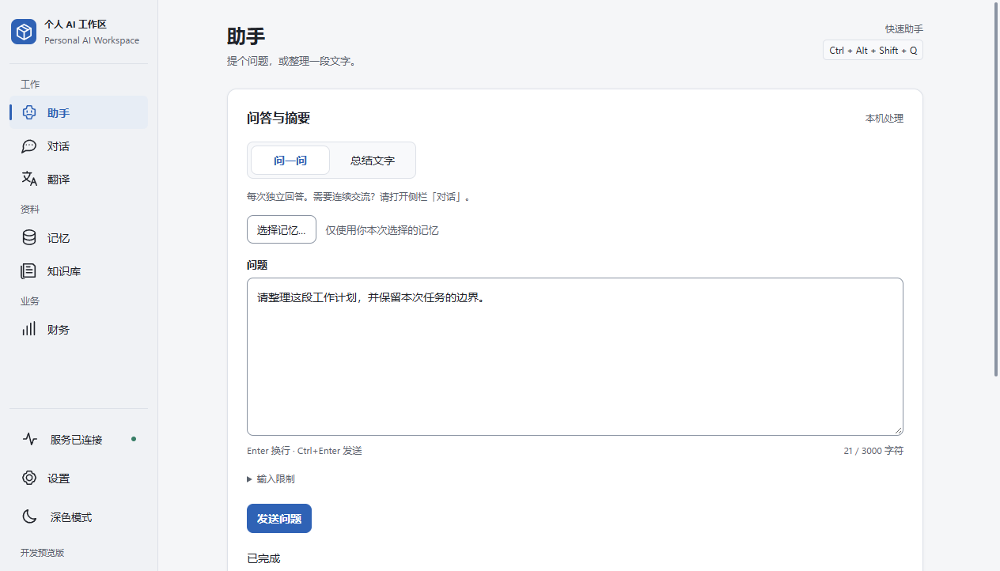
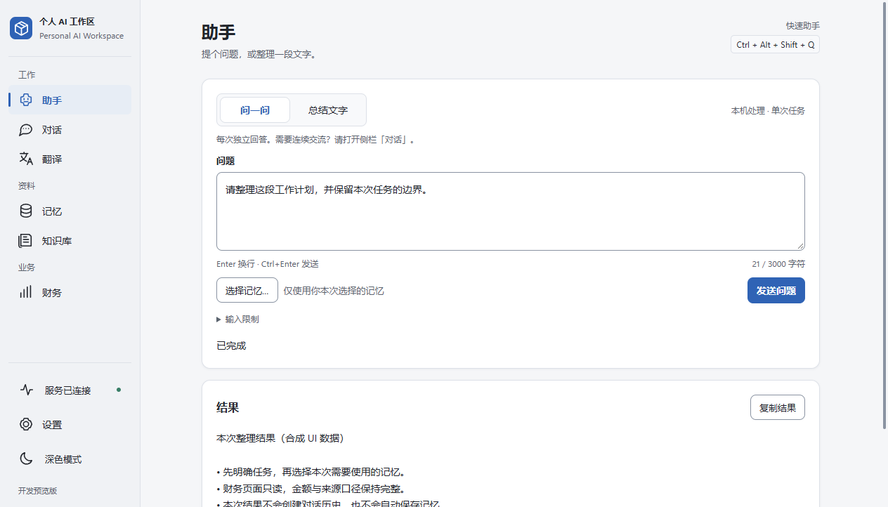
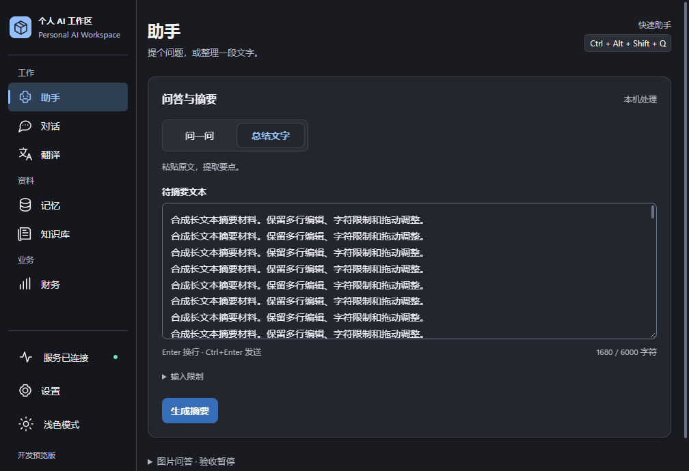
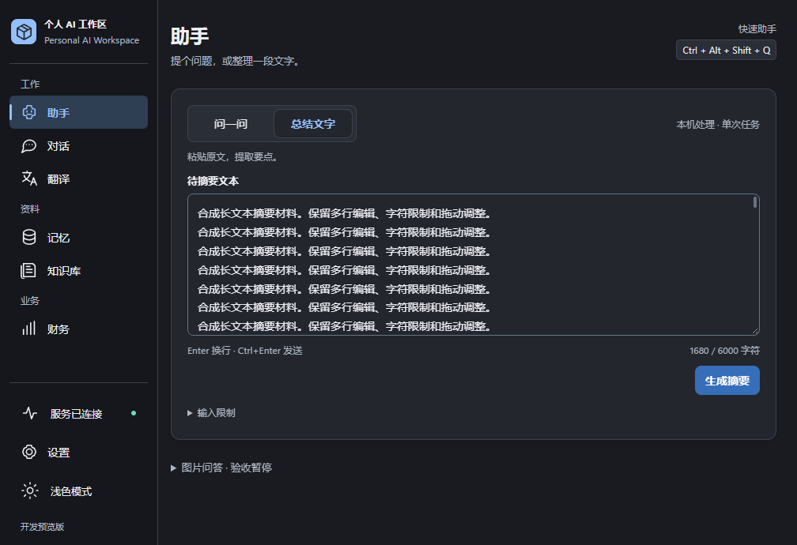
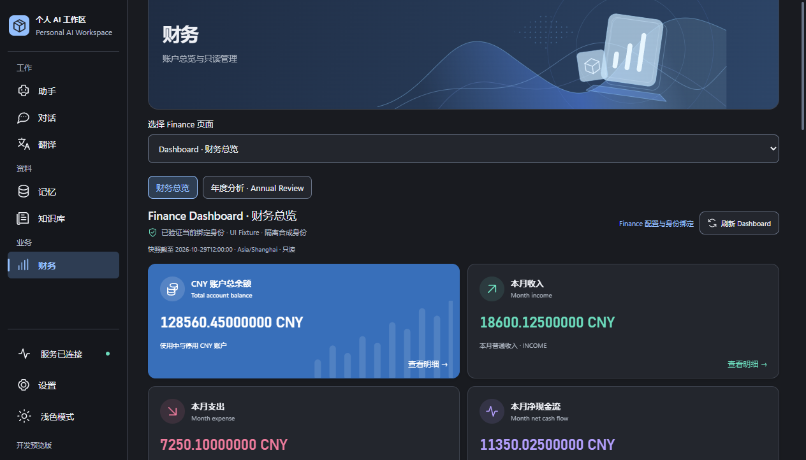
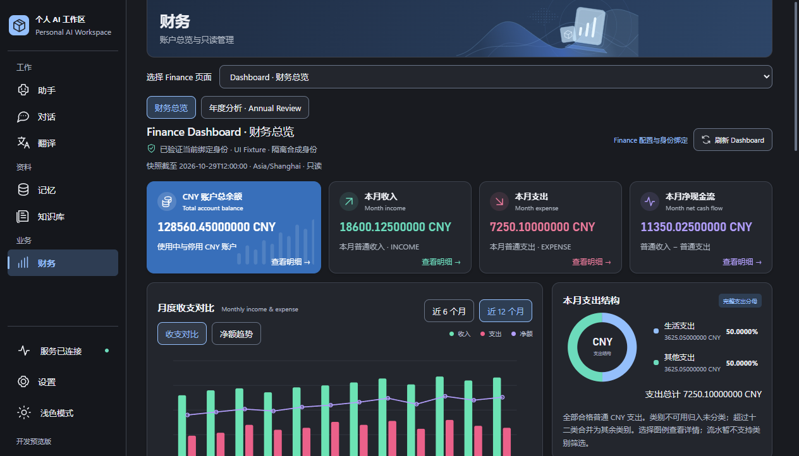
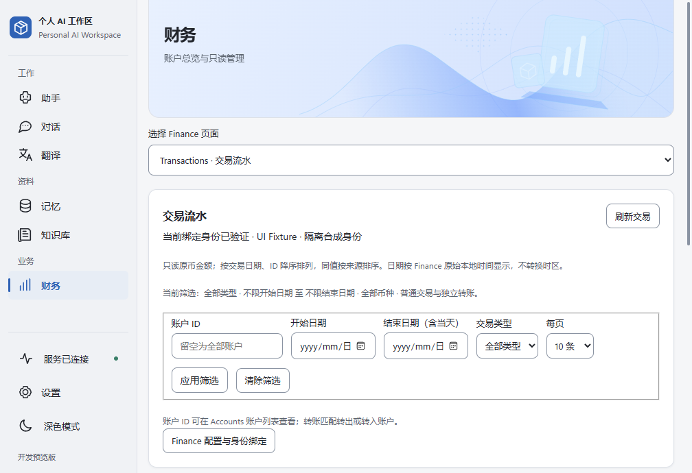

# UI/UX Layout Refinement P0

2026-10-29（Asia/Shanghai）。基线 `main @ 9dcd3b0c7969bf1020184a498b564a32c5d157a1`；开发分支 `codex/ui-layout-refinement-p0`。采用 B「聚焦型 Windows 工作区」，Finance 局部采用紧凑数据布局。最终提交由分支 Git history 标识。

**Development-only / X1 Windows Acceptance PARTIAL / MODEL_EXECUTION_UNCERTAIN / Vision BLOCKED / 尚无已核验 CI PASS / 尚未 Production GO** 全部保持。本报告不升级任何既有验收状态。

## 生产改动

仅修改 `OperationPage.tsx`、`FinancePage.tsx`、`workspace.css` 和 `dashboard.css`：

- Assistant 将模式与本机处理说明合并为紧凑标题区，保留可访问的 section 标题；显式记忆与发送／取消并排，键盘顺序跟随 DOM 顺序。
- 问答默认最小输入高度由 200px 降为 112px，摘要为 180px；保留原生纵向拖动、长文滚动、字符及 UTF-8 预算。状态、错误和本次结果随任务区收紧而提前呈现。
- 仅重排 JSX，提交、轮询、取消、复制、IME、快捷键、stale Memory 和未知结果处理未改变；翻译保留原有呈现与操作顺序。
- Finance 横幅收紧到约 88px 起步；保留九个模块及原有顺序、无障碍名称和页面选择器，去除按钮上的重复英文副标题，预算仍明确显示来源不支持。
- 总览在较宽视口采用四指标同排，较窄视口两列，最窄视口单列；减少卡片空白，快照、只读身份及指标口径保持可见。
- 筛选、详情及表格采用紧凑间距；有限页表格随根页面纵向滚动，继续支持局部横向滚动。四列及以上表格保留 640px 最小宽度，避免窄窗把数据挤成过多行；原有分布列表等有意设置的局部滚动保持。

沿用 UI Polish 的 tokens、浅深主题、细滚动条、焦点、高对比度与 reduced-motion 规则。未修改其他四页的专项布局、Java、WPF／Bridge、导航状态逻辑、数据库、权限、模型生命周期、原生确认或财务计算；未增加功能、依赖、框架或长期测试。

## 真实 WPF / WebView2 前后证据

以下原始 PNG 来自真实 `MainWorkspaceWindow`、既有受信 WebView2 Host 和生产前端 assets，使用相同合成数据与窗口尺寸。没有裁剪、拼接或生成界面。原生程序集复用 UI Polish 使用的既有开发产物，本轮仅编译独立截图驱动，未重建生产 Desktop 或分发包。

窗口尺寸以 WPF DIP 表示；本机实际记录 DPI scale=1、WebView ZoomFactor=1。1280×800 的 WebView 捕获为 1264×722，1024×768 为 1008×690。它们是 WebView 渲染捕获，不是完整桌面截图，也不证明物理前台激活、真实推理或 Native Gate 验收。

| 场景 | 修改前 | 修改后 |
| --- | --- | --- |
| Assistant 本次结果，1280×800，浅色 |  |  |
| Assistant 长文本摘要，1024×768，深色 |  |  |
| Finance 总览，1280×800，深色 |  |  |
| Finance 流水，1024×768，浅色 |  |  |

`UI Fixture` 身份、记忆、任务结果、金额、资产和交易均为隔离合成数据，不代表真实模型或财务来源。上述八张图片逐张视觉审查，未见凭据、真实个人资料或用户路径；从本轮目录逐文件复制并核对 SHA-256。完整两页四场景、两种尺寸、浅深主题的前后渲染图和脚本保留在 ignored `.verification/ui-layout-p0-20261029/`，不上传整个目录。

同尺寸原始 DOM 几何测量（CSS px，四舍五入）：

| 窗口／内容 | 修改前 | 修改后 |
| --- | ---: | ---: |
| 1280×800，问答输入高度 | 200 | 112 |
| 1280×800，Assistant 结果区起点 | 759 | 541 |
| 1280×800，Finance 指标区起点 | 414 | 287 |
| 1280×800，Finance 指标区高度 | 373 | 146 |
| 1280×800，Finance 收支图组件起点 | 874 | 510 |
| 1024×768，Finance 流水表格起点 | 758 | 548 |

这些数值只代表该合成内容及实际视口，不承诺所有文本长度都能同屏。1024×768 保持两列指标，图表主体仍需向下滚动；长结果也继续通过页面滚动阅读。

## 本轮实际验证

- **静态与构建：** `npm --prefix desktop/frontend run check` 通过。使用既有 Vite 对基线和最终前端进行隔离生产构建，保留生产 CSP，生成 formatVersion=1／bridgeVersion=1 hash manifest，并由真实 WebView2 Host 校验加载。既有大于 500kB 的 chunk 提示仍存在，未扩展到拆包工作。
- **现有聚焦测试：** 运行既有 `OperationPage.test.tsx` 与 `FinancePage.test.tsx`，均通过。涵盖显式记忆／精确 revision、IME、未知结果、会话清除、财务金额、下钻及已有模块合同。临时 Vitest 配置复用仓库配置，关闭缓存，输出限定在本轮目录；未修改测试源码或断言。
- **真实原生渲染：** 在两种指定窗口尺寸、浅深主题下取得任务结果、长文本摘要、财务总览及流水前后图；逐对核对窗口、实际视口及 DPI 一致，无文档级横向溢出。前后构建、原始图片和几何记录均保留。
- **复用的综合浏览器流程：** 既有导航／主题、根滚轮／原生滚动条拖动／PageDown、局部列表、焦点／禁用态、草稿离页保护、loading／error、响应式与 CSS 缩放流程通过。在同一隔离流程补验 Assistant 显式记忆及 admission 后清除、精确 revision、模拟 composition 和 Ctrl+Enter、问答／摘要双重长度预算、原生 textarea 拖动、复制、运行／取消、stale 与未知结果不重发；核验 MODEL_EXECUTION_UNCERTAIN 错误位于首屏可见区域。
- **Finance 交互：** 综合流程核验精确金额、快照／时区／只读说明、净现金流 Escape 回焦、带快照的收入下钻、返回、日期／类型筛选、分页与清除。最终增加表格最小宽度后，仅补验受影响的窄表：540 CSS px 下局部横向滚动 168px，表格宽 640px、可视宽 472px，表格无额外纵向滚动，根页面可纵向滚动，无文档级横向溢出；无未捕获页面错误。
- **安全范围：** 所有 Assistant／Finance 响应均为 fixture；没有连接真实 Runtime、Ollama、数据库或 Provider，没有执行真实原生 mutation、模型操作或剪贴板写入。

视口、主题、状态和覆盖点不是独立测试成功次数。临时驱动形成过程中修正了脚本路径／配置导入，以及合成取消终态、原生错误到 Bridge 安全错误码的映射；修正均在临时 harness 内，没有改变生产合同、放宽断言或删除有效检查。相关原始失败诊断留在本轮目录，不当作产品缺陷或真实验收通过。

已通过的聚焦业务测试未因后续 CSS 调整重复运行；最终样式更新后补验窄表并重新获取修改后原生截图。没有运行 Java、Desktop、Frontend 全套、完整浏览器套件、真实模型／Provider、压力／IME 矩阵或正式打包。

## 保护、交付及剩余事项

对开始时已有的 40,887 个 ignored 文件记录并复核路径、大小、mtime 和属性；原有资源及历史证据保持不变。新增临时资源限定在本轮 ignored 目录。提交仅包含四份生产文件、本报告、文档索引和八张审查过的原始 PNG。

真实 Windows 系统 125%／150% 缩放、混合 DPI 跨屏、物理中文 IME、触控板与真实用户长数据流程仍需人工检查。浏览器 125%／150% CSS 页面缩放仅是浏览器验证，不能冒充系统 DPI 验收。既有 X1 前台／物理输入、MODEL_EXECUTION_UNCERTAIN、Vision BLOCKED、CI 与 Production GO 问题均未关闭。

开发分支独立 Commit／Push，main 保持原基线；不合并、不创建 Tag／Release，不实施 P1／P2。

返回 [文档索引](../README.md)。
