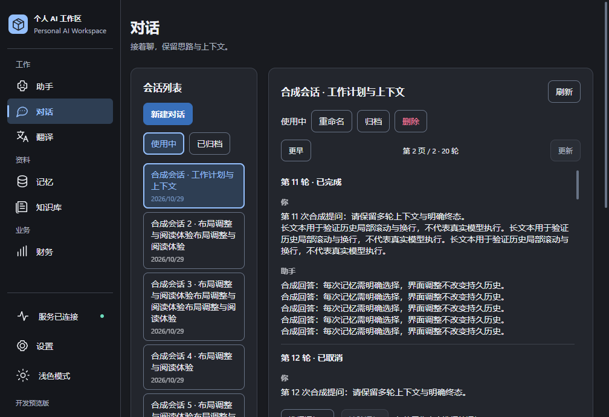
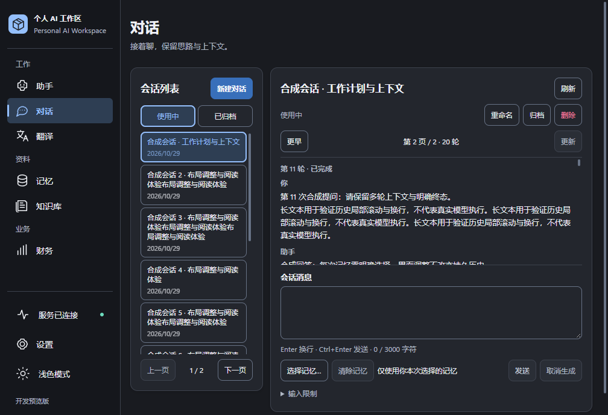
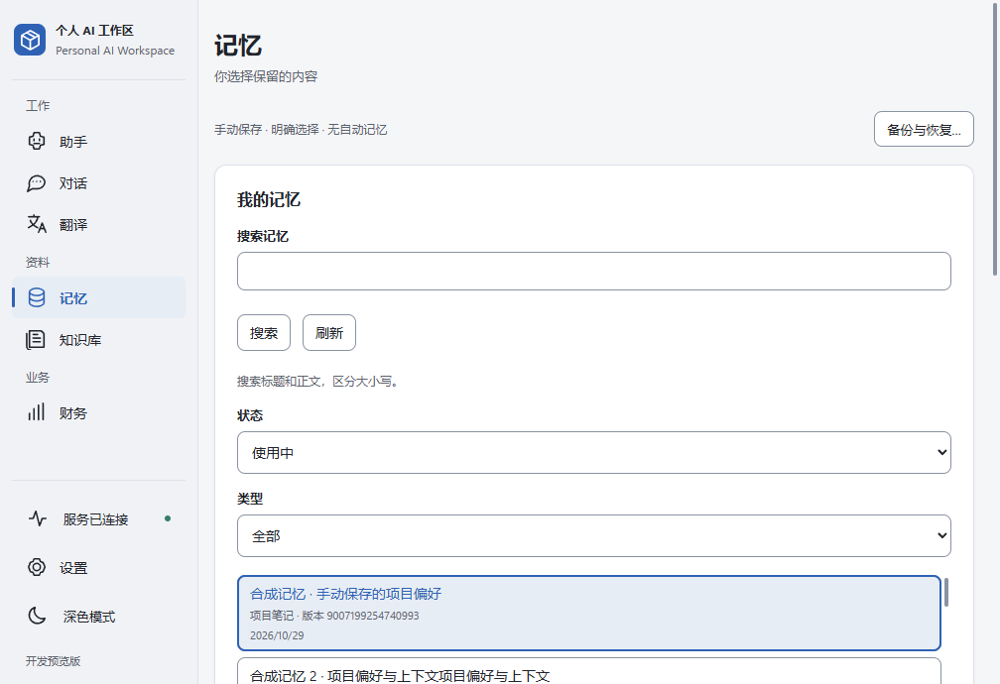
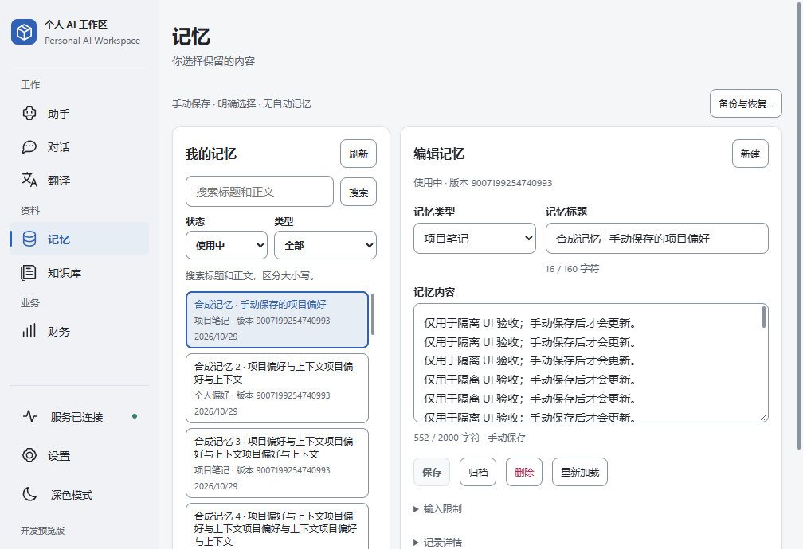
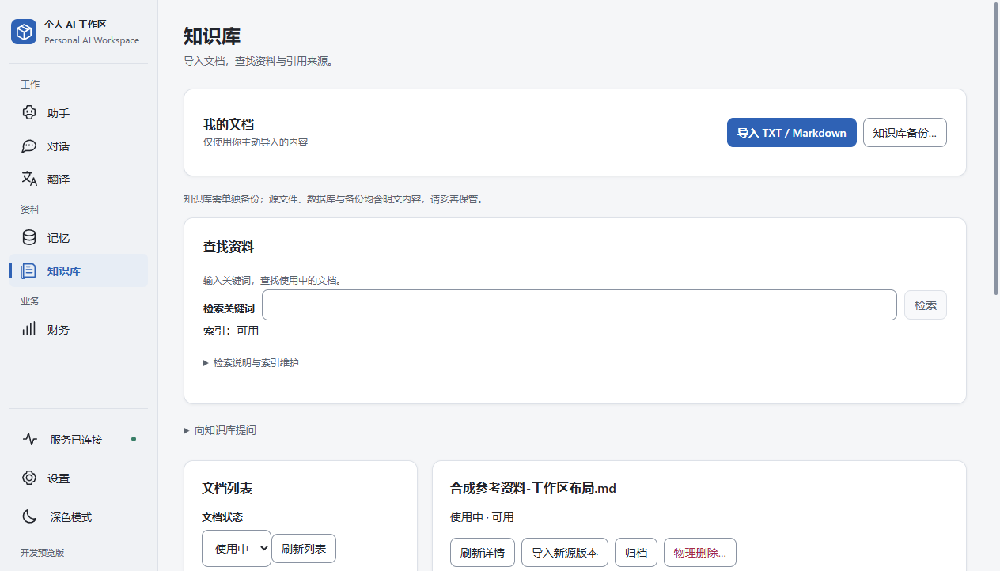
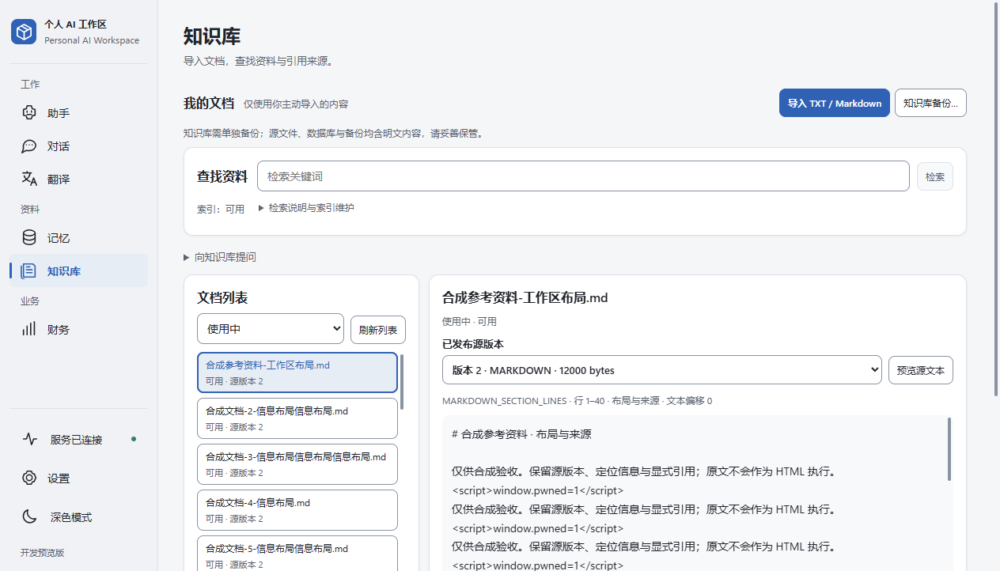
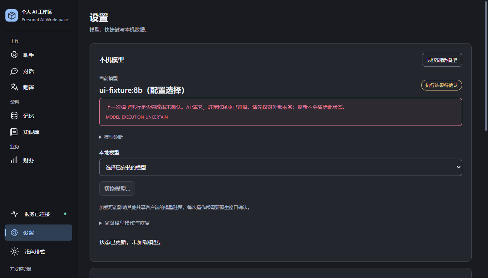
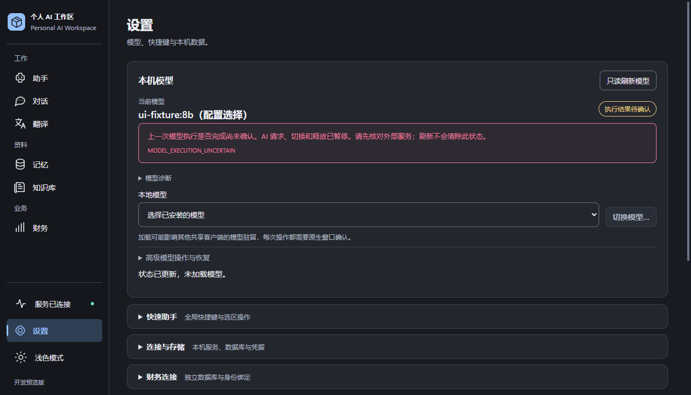

# UI/UX Layout Refinement P1

2026-10-29（Asia/Shanghai）。从 fetch 后的最新 `main @ 847f550e45fae9b0696bf3debbfd7529ad8d4d6b` 创建 `codex/ui-layout-refinement-p1`，沿用 B「聚焦型 Windows 工作区」。最终 Commit SHA 以分支 Git history 为准。

**Development-only / X1 Windows Acceptance PARTIAL / MODEL_EXECUTION_UNCERTAIN / Vision BLOCKED / 尚无已核验 CI PASS / 尚未 Production GO** 均保持。本轮不升级这些状态。

## 生产改动

| 文件（相对 `desktop/frontend/src`） | 调整 |
| --- | --- |
| `pages/ConversationsPage.tsx` | 列表标题与新建同排；输入区在历史下方集中呈现，显式记忆与发送并排；历史可用键盘聚焦、滚动。 |
| `pages/MemoryPage.tsx` | 搜索与按钮同排、刷新移至标题行、筛选并排；编辑类型与标题并排，保存操作提前到输入限制和元数据之前。 |
| `pages/KnowledgePage.tsx` | 导入与备份采用轻量工具栏，文档筛选收紧；版本选择与预览同排，阅读区优先于文档管理操作。 |
| `components/KnowledgeSearch.tsx` | 标题、关键词与检索同排，索引状态和维护说明收紧；保留可访问标签与说明，结果列表支持局部滚动和聚焦。 |
| `pages/SettingsPage.tsx` | 快捷键说明改为可展开设置组；模型选择和切换按钮同排。模型异常继续位于所有折叠组之外。 |
| `styles/workspace.css` | 四页局部密度、双栏比例、分页、阅读和紧凑设置行；Memory / Knowledge 在桌面窄窗保留双栏，800 CSS px 以下回到单栏。 |

Conversations 历史根据可用高度有界滚动，消息输入最小高度为 88px，保留原生纵向拖动与长文本滚动。列表、输入和阅读区域使用既有浅深主题、圆角、控件、焦点与原生细滚动条；未增加固定主滚动容器。Settings 普通分组、诊断和高级模型操作保持清晰层级，未折叠或淡化 uncertainty 警告。

仅重排 JSX、补充可访问属性与修改 CSS。没有改变请求、轮询、上下文、终态、显式记忆、revision、草稿离页确认、词法检索、可信引用、原生精确确认、身份绑定或安全操作逻辑。没有修改 Java Runtime、WPF / Bridge、数据库、schema、权限、凭据或真实用户数据。没有新增框架、依赖或长期测试。

## 真实 WPF / WebView2 前后截图

下列为真实 `MainWorkspaceWindow`、既有受信 WebView2 Host 和生产前端 assets 的原始 `CapturePreviewAsync` PNG；相同合成数据、窗口和主题，无裁剪、拼接或生成界面。复用 P0 所用的既有 Desktop / WebView2 程序集；相关原生生产源码自其历史基线至本轮没有 diff。本轮只编译独立截图驱动，没有重建生产 Desktop、Java 或分发包。

| 页面／窗口 DIP／主题 | 修改前 | 修改后 |
| --- | --- | --- |
| Conversations，1024×768，深色 |  |  |
| Memory，1024×768，浅色 |  |  |
| Knowledge，1280×800，浅色 |  |  |
| Settings，1280×800，深色 |  |  |

窗口 1280×800 DIP 对应实际 WebView 1264×722，1024×768 对应 1008×690；实测 DPI scale=1、WebView ZoomFactor=1。这是 WebView 渲染捕获，不是完整桌面截图，也不证明物理前台操作、真实推理或 Native Gate 通过。**没有将 CSS 页面缩放作为 Windows 系统 DPI 验收。**

同尺寸原始 DOM 起点测量，单位 CSS px，四舍五入：

| 内容 | 窗口 | 修改前 y | 修改后 y |
| --- | --- | ---: | ---: |
| 会话输入区 | 1280×800 | 761 | 508 |
| 会话输入区 | 1024×768 | 740 | 476 |
| Memory 正文 | 1280×800 | 500 | 381 |
| Memory 正文 | 1024×768 | 1277 | 381 |
| Knowledge 原文预览 | 1280×800 | 851 | 525 |
| Knowledge 原文预览 | 1024×768 | 1355 | 525 |
| 模型 uncertainty 警告 | 1280×800 | 254 | 225 |

这些数值仅代表此组合成内容。长历史、长记忆列表和完整文档仍需局部或页面滚动；不承诺任意内容都能同屏。

公开的八张 PNG 已逐张视觉审查，没有真实个人内容、凭据或用户路径；逐文件复制并核对 SHA-256 一致。完整四页、浅深主题、两种窗口尺寸的前后图，以及展开存储设置的补充图、几何数据、构建与驱动，保留在 ignored `.verification/ui-layout-p1-20261029/`。只提交审查后的图片，不上传整个证据目录。

## 本轮实际验证

- **类型与生产资产：** `npm --prefix desktop/frontend run check` 通过；使用既有 Vite 分别构建基线和修改后前端，输出隔离在本轮目录，保留生产 CSP 并生成既有 hash manifest，由真实 WebView2 Host 校验加载。既有大于 500kB 的 chunk 提示仍存在，未扩展为拆包工作。
- **现有聚焦测试：** 执行 `ConversationsPage.test.tsx`、`MemoryPage.test.tsx`、`KnowledgePage.test.tsx`、`SettingsPage.test.tsx`、`KnowledgeAnswer.test.tsx`，通过。最后调整 Knowledge 搜索标题行和 Settings 快捷键折叠组后，仅重跑受影响的 `KnowledgePage.test.tsx`、`SettingsPage.test.tsx`，通过。未修改测试源码或断言，也未重复执行其他已通过的测试。
- **真实原生渲染：** 四页两种窗口尺寸、浅深主题取得前后图；另取得展开连接与存储设置的前后图。窗口、实际视口、DPI 和 Zoom 一致，原始几何记录未见文档级横向溢出。逐张审查公开关键对比图，并检查另一个尺寸／主题的代表图与展开存储设置图。
- **一条合成浏览器综合流程：** 在实际 1280×800、1024×768 CSS 视口和浅深主题下核对四页主要内容可见、桌面双栏和无文档级横向溢出；补查 540px 单栏回退。验证历史、列表和原文局部滚轮、历史 PageDown、键盘焦点、长标题／长正文、根页面 PageDown 与 reduced-motion。
- **会话保护：** 显式记忆及精确 revision、模拟 composition 和 Ctrl+Enter、接受后清除草稿与选择、PENDING 取消后的持久终态、重命名、归档禁发与恢复、删除默认取消／Escape、stale 草稿保留与禁发、未知提交不自动重发，通过。
- **记忆与知识保护：** 编辑不自动保存；revision 冲突保留草稿并阻止保存；Reload 与离页取消／确认保留既有保护；显式保存精确推进 revision。关键词与问题只在提交后请求；检索高亮安全显示原文；版本切换清除旧预览；检索与引用打开精确源版本／偏移；物理删除 Escape 不提交；未知导入只读核对而不重发，通过。
- **设置保护：** uncertainty 完整可见，切换与释放禁用，无模型 mutation；快捷键可展开，存储检查先读取启动观察，再受控查询；数据库设置、Finance 身份绑定及三个备份入口仍走各自 typed native 方法。这里只验证合成入口分派，没有执行真实原生配置、绑定、恢复或其他 mutation。

综合流程最终无未捕获页面错误。临时脚本形成时修正了隐藏保留页导致的选择器歧义、标签精确匹配和原生滚动时序；均在本轮 harness 内解决，没有修改正确的生产业务、弱化断言或绕过门禁。覆盖点、主题和视口不是独立测试成功次数。类型、构建、真实原生渲染、合成交互与真实业务验收是不同证据。

未运行 Java、Desktop、Frontend 全套、完整 WorkspaceSanity、IME 矩阵、压力测试、真实模型／Provider／数据库测试或正式打包。没有连接真实 Runtime、Ollama 或财务服务，没有写入真实剪贴板、凭据或数据库。

## 保护与剩余人工验收

开始时对 40,996 个已有 ignored 文件记录路径、大小、mtime 和属性，交付前逐路径复核：没有改变或丢失。新增临时内容限定在本轮 ignored 目录；历史原始报告与证据保留。提交范围为六份生产文件、本报告、文档索引和八张原始 PNG。

仍需人工验收：真实 Windows 125%／150% 系统缩放、混合 DPI 跨屏、物理中文 IME、触控板与实际滚动手感、真实用户长数据流程。合成 Bridge 的模型名称、连接和终态不代表真实模型成功，也不关闭 X1 PARTIAL、MODEL_EXECUTION_UNCERTAIN、Vision BLOCKED、CI 或 Production GO 关卡。

仅交付独立开发分支 Commit / Push；main 不合并，不创建 Tag / Release，本轮结束后停止，不进入 P2。

返回 [文档索引](../README.md)。
