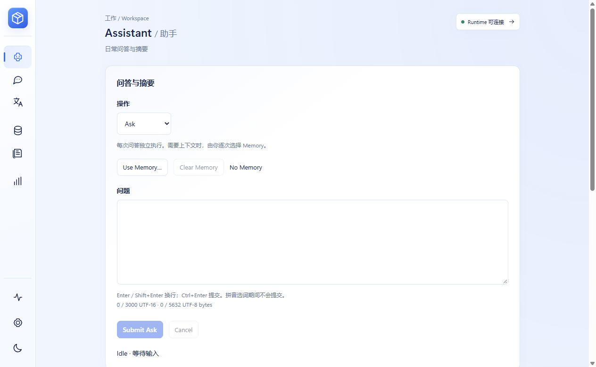
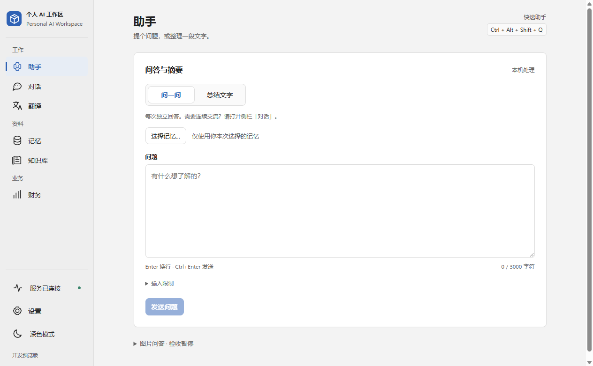
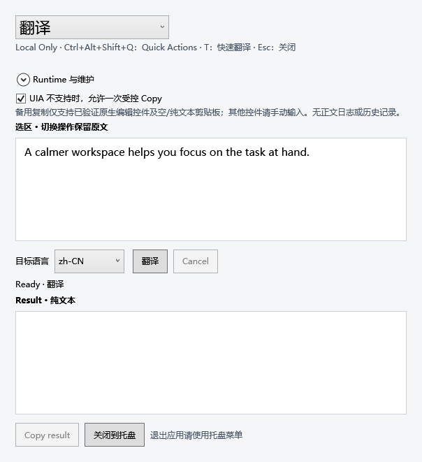
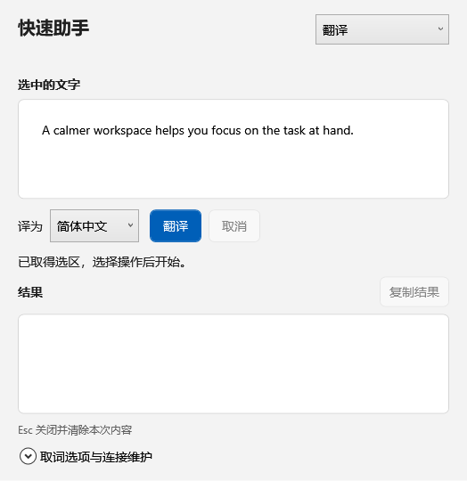
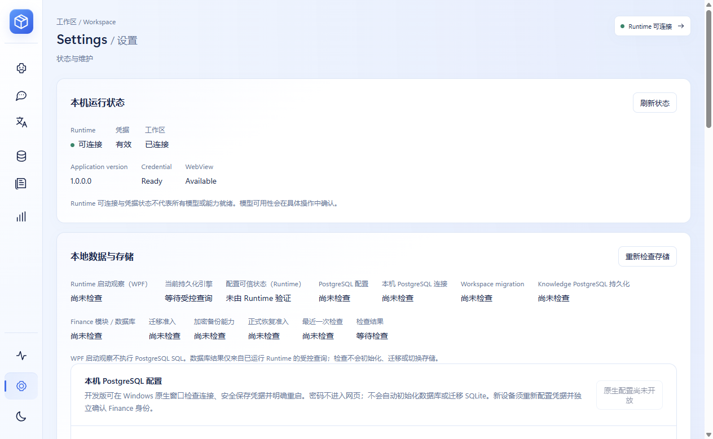
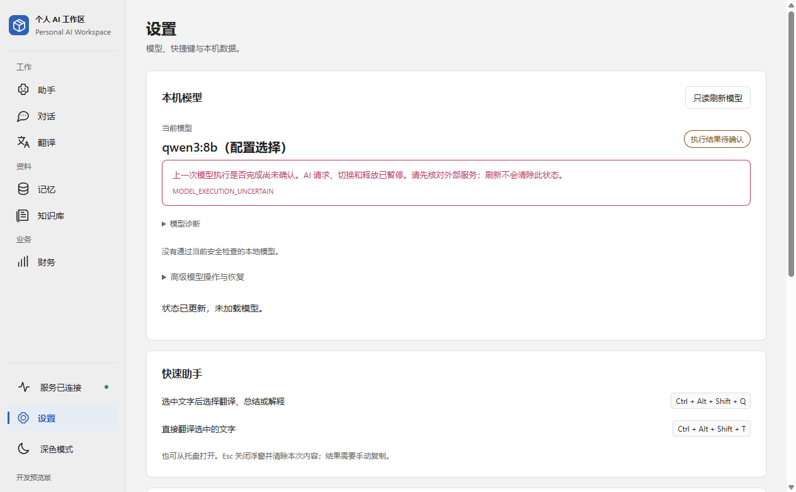
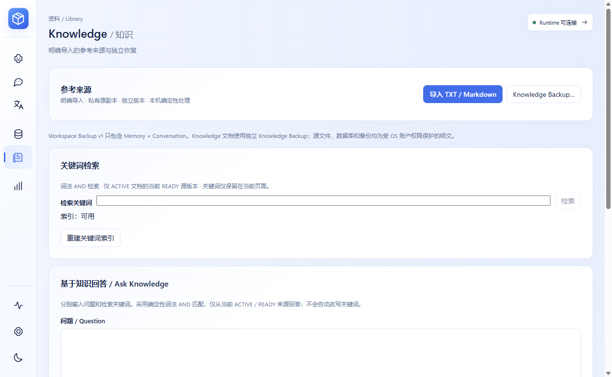
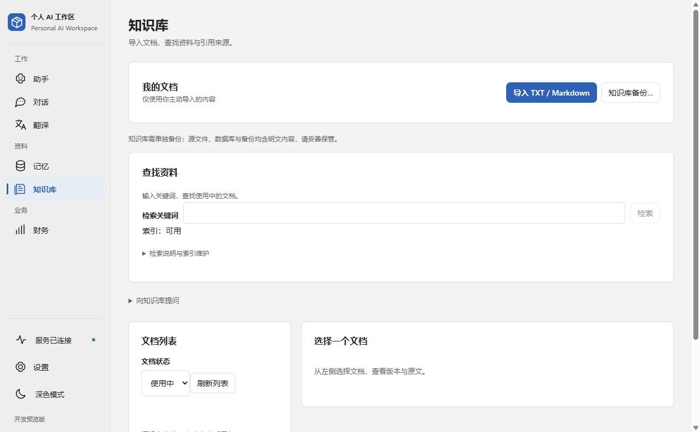

# Workspace 产品成熟度 / UI-UX 升级

2026-10-28（Asia/Shanghai）。基线为 `codex/x1-cross-app-assistant @ 8b00f743cc0479d2a4a7017c2c366cc8e120ecda`，入场工作树干净，fresh origin 与本地一致。独立分支 `codex/workspace-ui-maturity`。本轮限于 React/WebView2 与 WPF 界面，Development-only，没有 Production GO。

## 简短竞品对比

研究方式：核查 GitHub 仓库、许可证、最新 release 与推送时间；在浏览器中实际打开并查看官方发布的界面截图。没有安装或运行竞品，也没有执行其模型、翻译或系统操作。截图能证明布局，不能证明实际性能、中文翻译质量或错误恢复。本轮未使用 Firecrawl。

| 项目 | 实际查看的界面与取舍 | 许可证 / 维护快照 |
|---|---|---|
| [PowerToys](https://github.com/microsoft/PowerToys) | [Command Palette 界面](https://learn.microsoft.com/en-us/windows/images/command-palette/cmdpal-settings.png)：输入优先、当前项以细色条标记、底部集中键盘提示与设置。适合借鉴操作层级，不照搬通用命令平台。 | MIT；未归档；[v0.102.3001](https://github.com/microsoft/PowerToys/releases/tag/v0.102.3001)，2026-10-27；最近推送 10-28。 |
| [Flow Launcher](https://github.com/Flow-Launcher/Flow.Launcher) | [官方浮窗](https://www.flowlauncher.com/_astro/dark_screenshot.CcJ1EsJH_29bLM2.png)：左侧结果、右侧按需预览，名称与快捷键分开。借鉴轻量任务窗，不把完整工作区塞进浮窗。 | MIT；未归档；[v2.1.4](https://github.com/Flow-Launcher/Flow.Launcher/releases/tag/v2.1.4)，2026-09-20；最近推送 10-25。 |
| [Fluent Search](https://github.com/adirh3/Fluent-Search) | [官方浅色界面](https://media.fluentsearch.net/images/fast-search-light.webp)：中性色、轻边框、列表与动作预览分栏，主操作突出。截图为英文，未实测其中文体验。 | 仓库未声明开源许可证，主要提供发布与问题反馈；官网标注保留权利，不能当作可复用开源 UI 库。[稳定版 1.0.1.4](https://github.com/adirh3/Fluent-Search/releases/tag/1.0.1.4) 为 2025-05-24；仓库最近推送 2026-10-22，不等同于新版稳定发布。 |
| [Wox](https://github.com/Wox-launcher/Wox) | [官方首次使用界面](https://github.com/Wox-launcher/Wox/blob/master/screenshots/confetti.png)：展示一个搜索框和启动快捷键，提供明确开始入口。借鉴首次使用指引，不引入庆祝装饰和多插件复杂度。 | GPL-3.0；未归档；[v2.4.8](https://github.com/Wox-launcher/Wox/releases/tag/v2.4.8)，2026-10-25；最近推送 10-28。 |
| [Pot](https://github.com/pot-app/pot-desktop) | [官方中文浮窗](https://github.com/pot-app/pot-desktop/blob/master/asset/1.png)：原文、语言选择、分组结果，复制等操作紧邻内容。借鉴中文短标签与结果布局，不采用多 Provider 同屏堆叠。 | GPL-3.0；**已归档**；[3.0.7](https://github.com/pot-app/pot-desktop/releases/tag/3.0.7)，2025-05-10；最近推送 2026-07-04。[官网明确停止维护](https://pot-app.com/)。作为历史成熟交互参考。 |
| [Cherry Studio](https://github.com/CherryHQ/cherry-studio) | 官方[对话](https://github.com/CherryHQ/cherry-studio/blob/main/.github/images/readme/chat-light-en.webp)与[模型设置](https://github.com/CherryHQ/cherry-studio/blob/main/.github/images/readme/provider-light-en.webp)：导航、会话、内容分层，模型设置与日常对话分离。官方截图含 macOS 窗口装饰；只参考跨平台内容布局，不把它当成 Windows 原生截图。 | AGPL-3.0；未归档；[v2.1.8](https://github.com/CherryHQ/cherry-studio/releases/tag/v2.1.8)，2026-10-26；最近推送 10-28。 |
| [OpenTranslate（X1 已参考的项目）](https://github.com/stenastena/opentranslate) | 未找到发布的产品截图，因此仅作**源码审查补充**：[浮窗](https://github.com/stenastena/opentranslate/blob/main/src/renderer/popup/index.html)分为原文、翻译、回译；[设置](https://github.com/stenastena/opentranslate/blob/main/src/renderer/settings/index.html)将快捷键、语言、服务、外观与高级选项分组。它不是本轮实测竞品；不采用非官方翻译端点和自动回退。 | Apache-2.0；未归档；[v0.2.4](https://github.com/stenastena/opentranslate/releases/tag/v0.2.4)，2026-09-05；最近推送 10-25。与同名 `OpenTranslate/OpenTranslate` 翻译服务库不是同一项目。 |

以上六组官方界面图的本机浏览器查看记录为 `.verification/ui-maturity-research.json` / `ui-maturity-research-*.png`。OpenTranslate 的布局与错误隔离描述只来自源码/项目说明，未记作运行验证。竞品空状态、错误恢复及模型就绪语义没有经过本机故障注入；Workspace 的错误、取消、未确认执行和权限边界仍按自身合同保留。

**没有复制竞品源码、图标、字体或视觉资产，也没有新增依赖。** GPL / AGPL 及许可证未声明的项目仅用于交互观察；官方图仅保留在 ignored 验证目录，没有放入产品或提交为自有资产。

## X1 界面问题与改造

改造前来自已有 `artifacts/x1-development-20261028-final`；该包记录 `baseline=ad0913d / sourceDirty=true`，没有改写其历史构建身份。源码分支基线仍为上述 `8b00f74`。前后采用同一隔离 UI fixture、相同主窗口尺寸，无真实数据库或模型请求。

| 范围 | 实际看到的问题 | 本轮改变 |
|---|---|---|
| Main Workspace | 1280 外窗的实际内容宽度低于 1280，侧栏已只剩图标；双语标题、分组、状态与页脚反复出现。 | 常见桌面宽度保留中文导航；只在小窗口收为图标，进一步缩小时保留页面选择器；去掉双语重复与常驻宣传文案，统一中性色、字体与间距。 |
| Assistant | Ask / Submit Ask / No Memory、执行枚举、字符编码预算和整块本机状态抢占首屏。 | 问答/摘要直接切换；中文发送按钮、占位提示；预算详情可展开，超限仍明确提示且不截断；日常页面移除重复诊断。 |
| Conversations | 英文动作、ACTIVE、Turn / USER / ASSISTANT 混排，空列表缺少下一步。 | 中文动作、轮次和状态；列表显示日期；空状态引导新建；会话持久化、逐次记忆授权、取消与删除确认保持原合同。 |
| Memory | 英文类型、状态、按钮及长编码说明；记录 ID 常驻。 | 中文筛选与编辑；保留真实 enum 值；编码与记录详情展开查看；保存、归档、删除、草稿离开确认与 revision 语义保持。 |
| Knowledge | 文档列表被检索与完整问答表单推到下方；长篇工程说明；原生样式输入框不统一。 | 收起知识问答和索引维护，文档列表进入首屏；中文操作及可执行空状态；知识库独立备份和明文内容提示仍可见。 |
| Translate | 语言代码、Submit Translate、闲置 Cancel、重复 Runtime 状态。 | 自然语言名称、明确翻译按钮，保留多行/拼音输入保护与原语言 ID；取消仅在任务期间显示。 |
| Settings | 存储迁移与维护占据前部，模型管理埋在后面；Active、Configured、Installed、Loaded、Ready 等工程字段堆叠。 | 模型概览前置，配置选择与已验证模型不混淆；uncertainty 单独中文警告；诊断、连接/存储、财务连接与高级恢复分组。无候选时去掉无用的选择/切换控件。 |
| Quick Actions | 大型下拉框、快捷键说明、受控 Copy 说明和维护入口在输入前；复制与结果分离。 | 更窄、随内容调整高度的原生任务窗；操作选择与标题同一行，复制紧邻结果；取词与连接维护收起。原文切换保留、Esc/取消清除、Memory 授权与焦点/剪贴板边界不变。 |

主窗口工具栏的快速助手入口改为常驻，复用既有 native `LegacyAssistant` 操作，不增加 React Bridge 方法。此按钮的真实产品点击流程本轮仅源码审查和编译，未记作物理点击验收。

## 改造前后图

下图是本机 Windows 上真实 WPF / WebView2 的**渲染捕获**，不是设计稿。WebView 图由 `CoreWebView2.CapturePreviewAsync` 取得；快速助手由 WPF `RenderTargetBitmap` 捕获客户区。状态与空列表来自隔离模拟数据，**不是模型推理、实际库内容或 X1 验收 PASS**。整窗屏幕像素捕获因 `SetForegroundWindow` 后的前台归属检查未通过而跳过，没有强制抢焦点或向其他窗口注入输入。

| 界面 | 改造前 | 改造后 |
|---|---|---|
| 助手 / 主导航 |  |  |
| 快速助手 |  |  |
| 设置 |  |  |
| 知识库 |  |  |

其余对话、记忆、翻译、快速提问截图在 `.verification/ui-maturity-before/` 与 `ui-maturity-after/`。原生驱动只实例化真实窗口和 fake controller/native actions，没有启动 `AssistantApp`、Runtime、数据库、Ollama 或真实模型。临时驱动保存在 `.verification/ui-maturity-review/`，未加入产品或长期测试工程。

## 本轮实际验证

- React 聚焦：复用 OperationPage、SettingsPage、ConversationsPage、MemoryPage、KnowledgePage、KnowledgeAnswer 现有测试。首轮存在旧英文定位失败，同步中文定位后仅复验失败项；最终助手操作切换与模型卡调整后，复验对应两份测试通过。没有弱化原有权限、数据完整性、取消或结果断言。
- 长期测试仅扩展既有 Settings 综合测试：模拟 uncertainty 的告警位于折叠区之外，选中候选后切换与释放仍禁用，没有额外 mutation。其余测试变更为文案定位同步，没有新增测试文件。
- Desktop 聚焦：`SelectionAndLifecycleTests` 实际通过，覆盖既有受控 Copy / 取消 / 剪贴板恢复与 X1 选区切换、预算拒绝、Esc/关闭清理。这里的 Esc 是 routed event，不是物理键盘验收。
- 浏览器单条隔离流程通过：中文导航、操作切换保留输入、Memory 未保存草稿的取消/确认/焦点、连接入口展开、uncertainty 可见、浅/深色、1280/1024/780/540 宽度与 200% 缩放无页面横向溢出。forced-colors / reduced-motion 仅检查布局，无整套无障碍认证。
- 实际 Windows WPF/WebView2 成功加载 bundled assets，并逐页取得前后渲染图；快速助手翻译与提问布局可渲染。无真实推理。
- TypeScript、Vite 生产 assets、Desktop Debug Development 编译及资产完整性验证通过。Vite 仍有主 JS chunk 超过 500 kB 的提示，未借本轮扩大为代码拆包工程。
- 既有 Probe `--verify-package-sources` 实际返回 `DEVELOPMENT_PACKAGE_SOURCES_PASS`：只验证受信构建来源/文件持有，不创建 Profile、不启动 Runtime。

本机证据：`desktop/tests/PersonalAiWorkspace.Desktop.Tests/TestResults/ui-maturity-selection.trx`、`.verification/ui-maturity-final-focused.log`、`ui-maturity-model-test.log`、`ui-maturity-retest.log`、`ui-maturity-browser-result.json`、`ui-maturity-native-before.log`、`ui-maturity-native-after.log`、`ui-maturity-frontend-build.log`、`ui-maturity-desktop-build.log`。这些是 ignored 本机证据。没有重跑 Java / Desktop / Frontend 全量、完整 WorkspaceSanity、IME 矩阵、压力或正式发布矩阵；不把多个覆盖点或重复复验累计为测试数量。

## Development 构建与交付

独立目录：`artifacts/ui-maturity-development-20261028/PersonalAiWorkspace.Desktop.exe`。Framework-dependent Development-only 本机构建，依赖 .NET 10 Windows Desktop / Native helper runtime、WebView2 及现有受信 JDK/JAR；不是完整 portable bundle。入口、源码提交、payload hash 和前提记录在目录中的 `UI-build.json` / `README-UI.txt`。沿用已验证的受信 Runtime 来源，未重新打包 Java，未替换 X1 旧包。UI fixture 不进入该产品构建。

构建命令沿用现有 `Mmf3ProfileAcceptanceBuild=true / FrontendSkipBuild=true / TrustedDevelopmentManifest` 路径，前端先执行 `npm run build`。源码提交后使用已编译输出 `dotnet publish --no-build`，不因为文档变更重复运行测试或重编 Runtime。最终分支 HEAD 以 Git 与构建记录为准。

## 独立保留的 X1 验收问题

| 问题 | 本轮结论与后续边界 |
|---|---|
| `MODEL_EXECUTION_UNCERTAIN` | **仍未解决 / 未复验真实模型**。没有清除 guard、重置 Active、加载、释放、启动或切换真实模型；模拟状态只验证 UI 表达及按钮禁用。任何实际恢复须单独核对外部完成事实并走原生授权。 |
| 跨应用前台切换 / 物理输入阻塞 | **仍未解决**。本轮整窗截图也未取得前台证明；没有增加生产抢焦点 workaround，没有重跑真实 Q/T 选区推理链。 |
| Vision | **继续暂停**。未执行真实图片验证或推理。既有界面收进标明验收暂停的展开区；服务端权限和图片处理合同未改。 |

Finance、Memory、Knowledge、Browser 权限、服务端校验、持久格式、模型生命周期、原生安全确认和真实错误保持原有边界。多屏混合 DPI、物理 Quick Actions 端到端、真实模型输出与实际用户资料流程仍待单独验收。本轮产品成熟度交付不升级 X1 的 Windows **PARTIAL** 状态。
