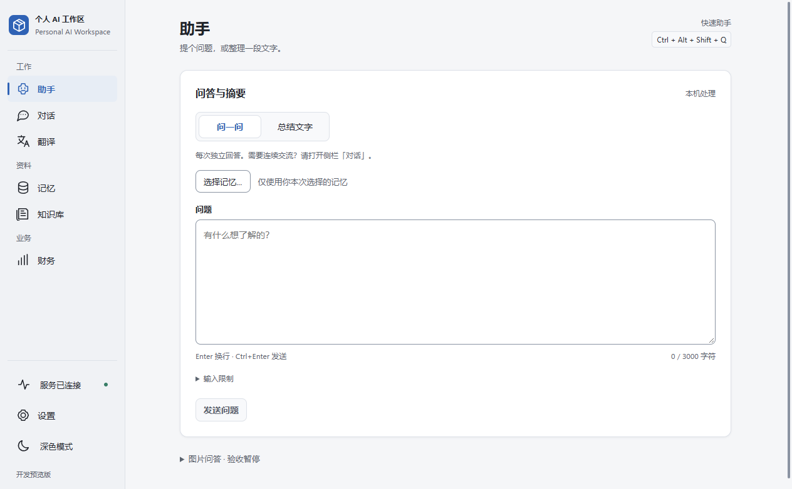
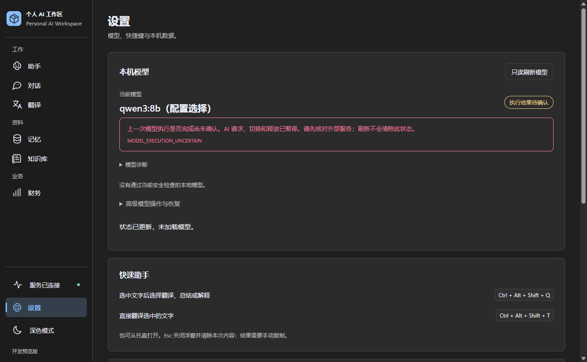
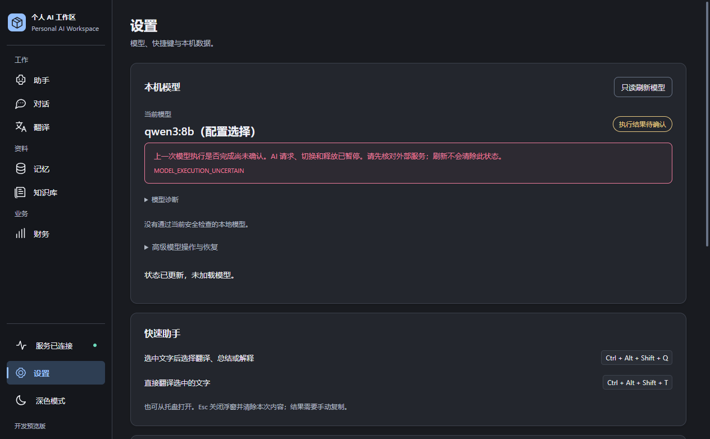
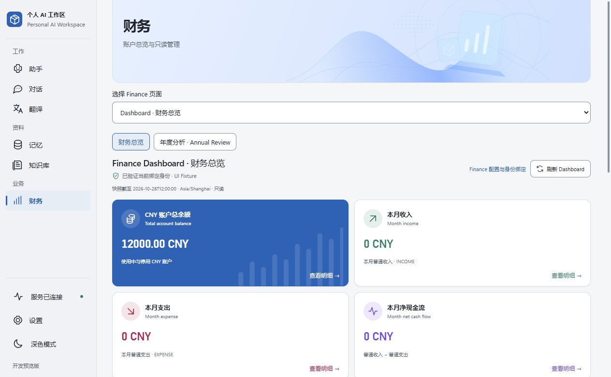
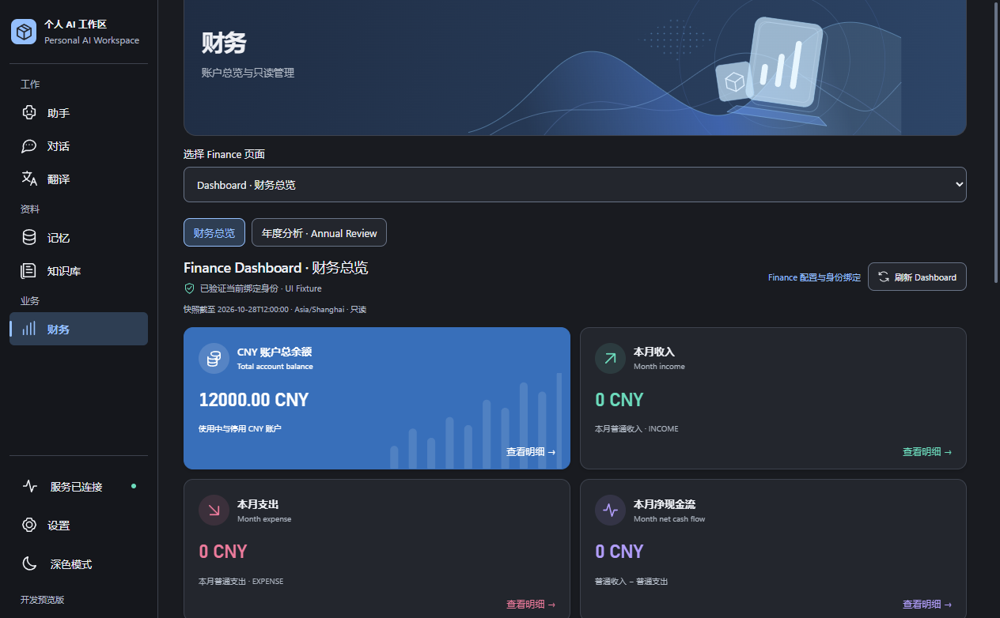

# UI Polish & Visual Consistency

2026-10-28（Asia/Shanghai）。基线 `main @ 5c81066ee4b0df00a962e5fff8a022a8ecbc913a`；开发分支 `codex/ui-polish-visual-consistency`。仅打磨现有 React / WebView2 共享样式，不重建 UI 或改变交互模型。最终交付 commit 由 Git history 标识，不自引用尚未生成的 SHA。

**Development-only / X1 Windows Acceptance PARTIAL / MODEL_EXECUTION_UNCERTAIN / Vision BLOCKED / 尚无已核验 CI PASS / 尚未 Production GO** 全部保持。

## 修改范围

生产变更仅在 `tokens.css`、`workspace.css`、`dashboard.css`：

- 沿用 Segoe UI / Microsoft YaHei 字体层级和 Windows 蓝色；统一浅／深主题的 canvas、surface、rail、中性色、边框、圆角与轻阴影。
- 卡片统一 12px 圆角，输入控件统一 8px；改善输入框边界与 Hover，保留 3px 键盘 Focus。Disabled 使用可读的中性色，不通过整块 opacity 降低所有内容的清晰度。
- Finance 导航复用主题选中态；指标卡弱化独立渐变／发光，保留所有指标、图表、数值口径、下钻和原业务说明。Finance 页面复用全局 gutter。
- 空状态沿用现有文案与语义，增加共享浅层背景；错误沿用现有错误内容和权限边界，仅调整主题底色。窄窗操作区可换行，文本控件限制在容器内。
- 根文档保持页面纵向滚动，不增加固定 main 滚动容器。历史、资料列表和宽表格等有意设置的局部滚动继续保留，不强行展平长数据。

没有修改 TS / TSX、Bridge、Runtime、Finance 业务／金额计算、数据库、模型准入、Native Gate、凭据、权限、导航或持久化格式。没有新依赖、新框架或新增长期测试。

## 滚动条合同

普通主题使用 10px 原生轨道，静止可见 thumb 约 4px，Hover 约 6px，并增强颜色；Active 沿用 accent。轨道／角落透明，不绘制额外箭头。`scrollbar-gutter: stable` 避免出现／消失时内容跳动。

WebView2 / Chromium 使用原生 scrollbar pseudo-elements；其他支持标准属性的环境使用 thin fallback。没有 JavaScript 滚动接管，也没有隐藏原生滚动或改变 wheel / drag / keyboard 的事件处理。forced-colors 下不应用定制滚动条，交回系统默认；reduced-motion 保持原有禁用过渡的规则。

## 真实 Windows 前后图

下列 PNG 是本机真实 WPF `MainWorkspaceWindow` / WebView2 的 `CapturePreviewAsync` 原始渲染捕获，未裁剪、合成或生成界面。前后使用相同窗口尺寸及合成数据。它们不是完整桌面物理截图，也不证明前台激活、真实模型推理或 Native Gate 验收。

| 页面 | 修改前 | 修改后 |
| --- | --- | --- |
| 助手，浅色 |  |  |
| 设置，深色 |  |  |

| Finance，浅色 | Finance，深色 |
| --- | --- |
|  |  |

截图中的 `UI Fixture`、金额、空列表、连接状态和模型配置名称均是隔离测试数据。设置中的模型名只用于模拟 uncertainty，不代表该模型通过准入或可实际执行。没有运行真实模型、数据库或行情 Provider。

六张公开 PNG 已逐张视觉审查，未见 Token、绝对用户路径、个人资料或真实财务信息；只从本轮隔离目录逐文件复制，字节哈希相同。原始截图、脚本、诊断与完整六页两主题渲染图保留在 ignored `.verification/ui-polish-20261028/`，没有批量上传整个证据目录。

## 本轮实际验证

**源码／构建：**

- `npm --prefix desktop/frontend run check`：TypeScript 检查通过。
- 直接使用现有 Vite CLI 对修改前／后源码做生产前端构建，输出隔离至本轮 `before/MainWorkspace` 和 `after/MainWorkspace`；保留原 CSP，按既有 formatVersion=1 / bridgeVersion=1 合同生成文件 hash manifest，并由真实 WebView2 Host 实际校验／加载。
- 既有大于 500 kB 的 JS chunk 提示仍保留，未扩大范围进行拆包。隔离 outDir 的“不自动清空”提示符合保留旧输出的意图。
- 没有重建 Java Runtime、生产 Desktop 或正式分发包。WPF / WebView2 程序集复用既有 `artifacts/ui-maturity-development-20261028`，其相关生产源码与本轮基线一致；本轮仅编译位于 ignored 目录的独立截图驱动。

**真实 WPF / WebView2：**

- 使用独立驱动实例化真实 MainWorkspaceWindow、既有受信 WebView2 Host 和合成 Bridge。Assistant、Conversations、Memory、Knowledge、Finance、Settings 均取得修改前／后浅／深色渲染图，已检查共享样式和布局。
- 没有启动 AssistantApp / DevelopmentRuntimeOwner / Java / Ollama，没有运行真实 Native mutation。此隔离 UI fixture 不绕过产品门禁来执行真实业务，也不能当成产品 Runtime 准入 PASS。
- 首次驱动运行因手工 Reference 的原生 DLL 搜索位置缺少 WebView2Loader 而失败，HRESULT `0x80131524`；参照旧驱动布局，仅在新驱动目录放置既有 x64 DLL 后重跑成功。没有修改产品加载器或降低权限。

**一个隔离浏览器综合流程：**

- 复用既有 Node Playwright、合成 fixture 与已构建生产 assets，验证完整导航、浅／深主题、根滚动条 wheel / 原生拖动 / PageDown、长 Memory 列表滚动、长输入和操作切换保留。
- 验证键盘 Focus、Disabled、Memory 草稿离开取消／确认、模拟加载与错误、uncertainty 可见，且未发起真实 mutation / inference；最终无未捕获页面错误。
- 检查 1920 / 1280 / 1024 / 540 CSS 像素窗口及 125% / 150% CSS 页面缩放下主要页面的文档横向溢出；未发现文档级横向溢出。局部宽表格仍允许有意的水平滚动。
- 检查 forced-colors 回到系统滚动条，以及 reduced-motion 的过渡为 0s。
- 从实际主题 token 计算文本对比度：浅色正文／次要文字／主按钮约 15.57 / 6.11 / 6.31，深色约 13.29 / 7.56 / 5.38；控件边界约 3.12 / 3.15。只覆盖这些共享色对，不宣称完成全部 WCAG 认证。
- 原黑盒 server helper 在 Windows 留下其 HTTP 子进程，后续已改为本轮脚本直接管理自己的 server 并清理；仅停止经命令行核对的任务自有进程。对比度脚本补齐压缩后的三位 hex 解析，合成长列表／loading 通过显式刷新同步，headless 验证移除默认 hide-scrollbars 参数；这些均是临时 harness 修正，没有修改正确的生产行为或弱化断言。

这是一条综合流程的覆盖说明，不把视口、主题和重复诊断计作独立测试成功次数。结果与原始请求方法记录见本轮 `browser-result.json`；失败截图和诊断仅属于 harness 形成过程，不冒充产品缺陷修复或验收 PASS。

**Git 与保护：** 检查实际 diff 和 whitespace；只提交三份 CSS、此报告、索引入口和六张审查过的 PNG。原 40,802 个 ignored 文件逐路径核对大小／mtime／属性未变；新增临时内容仅在本轮 ignored 目录。未读取私有凭据内容，未触碰真实数据库、旧开发包、历史验证目录或原始交付报告。

## 未执行与仍需人工检查

- 本轮未运行 Java / .NET / Frontend 全套、完整 WorkspaceSanity、IME／压力／GPU 矩阵、真实 Provider / 模型 / 数据库测试或正式打包。
- 125% / 150% 是 CSS 页面缩放，不是更改 Windows 显示 DPI；真实系统缩放、混合 DPI 跨屏、物理触控板、实际滚动条拖动手感和高对比度 Windows 主题仍需人工检查。
- 已有 X1 前台切换／物理输入、MODEL_EXECUTION_UNCERTAIN、Vision BLOCKED、完整真实用户数据流程与 Production GO 关卡未关闭。
- 开发分支正常 Commit / Push 后保留，main 不合并，不创建 Release 或 Tag，不自动进入后续功能阶段。

返回 [文档索引](../README.md) 与 [当前状态](../STATUS.md)。
